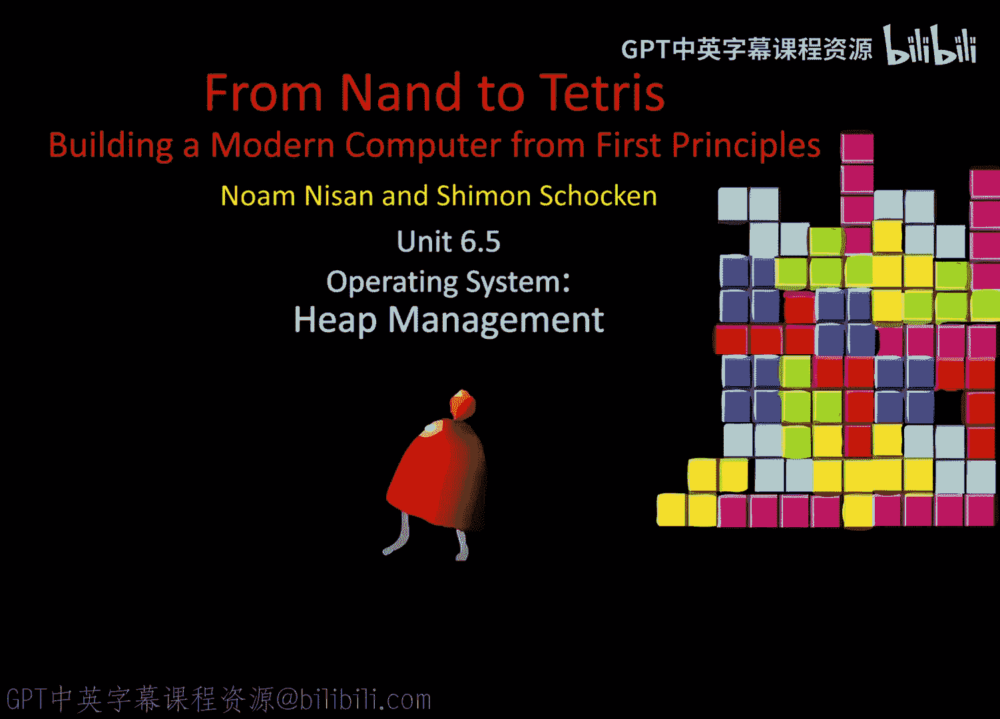

# 从零开始构建现代计算机2：单元6-5：堆管理 🧠



在本节课中，我们将要学习操作系统如何管理计算机的主内存资源，特别是“堆”这一部分。我们将探讨两个核心操作：`alloc`（分配内存）和`deAlloc`（回收内存），并了解如何通过一个称为“空闲链表”的数据结构来高效地管理堆内存。

---

## 堆管理的需求

上一节我们介绍了操作系统如何通过`peek`和`poke`操作来访问内存。本节中我们来看看操作系统如何管理程序动态请求的内存区域——堆。

在程序运行时，高级语言（如Jack）编写的程序会创建许多对象和数组。每个对象和数组在内存中都有一个对应的数据块，而指向这些数据块的指针通常存储在栈中。存放所有这些对象和数组数据的内存区域，在计算机科学中被称为**堆**。

挑战在于如何高效地管理堆内存资源。具体来说，我们需要知道：
1.  如何在被请求时分配内存。
2.  如何回收不再需要的对象和数组所占用的内存。

我们将通过操作系统的一个名为`Memory`的类来实现这些功能。它主要包含两个函数：
*   `alloc(size)`：接收需要分配的内存块大小作为参数，在RAM中找到一块合适大小的内存，并返回该内存块的起始地址给调用者。
*   `deAlloc(object)`：接收一个对象或数组的地址，回收该对象或数组在RAM中占用的空间。

---

## 高级程序员的视角

在深入操作系统实现之前，让我们先从一个高级程序员（如Jack程序员）的角度看看发生了什么。

当程序员声明一个对象变量（例如 `Point p`）时，系统会在栈上分配一个变量`p`并将其初始化为`null`（即0）。当程序员通过构造函数（例如 `let p = Point.new()`）实际创建对象时，会发生以下事情：

1.  构造函数内部会隐含地调用 `alloc(2)` 向操作系统请求分配2个字（word）的内存（假设`Point`对象有两个字段`x`和`y`）。
2.  操作系统找到一块可用的内存（例如地址8012），将其分配给这个新对象。
3.  构造函数将这块内存的基地址（8012）存入变量`p`中，从而建立链接。

当对象不再需要时，程序员应显式调用 `p.dispose()`。`dispose`方法内部会调用 `deAlloc(p)`，通知操作系统回收该对象占用的内存。

**注意**：像Java/C#这类语言拥有**垃圾回收器**，能自动跟踪对象引用并在引用数为零时自动回收内存。但Jack语言不包含此功能，因此需要程序员手动管理内存的回收。

---

## 堆管理的基本实现思路

现在，让我们向下迈进一步，探讨在操作系统层面如何实现堆管理。我们将介绍两种方法：一种简单但低效，另一种更复杂但高效。

### 简单方法：顺序分配

一个最简单的堆管理方法是维护一个指针（例如 `free`），它始终指向堆中下一块可用内存的起始地址。

*   **初始化**：`free = HeapBase`（堆的起始地址，在Hack计算机中是2048）。
*   **分配 (`alloc(size)`)**：
    1.  `block = free` （记录要返回的块地址）
    2.  `free = free + size` （将空闲指针向后移动`size`个字）
    3.  `return block` （返回分配的内存块地址）
*   **回收 (`deAlloc(block)`)**：什么都不做。

**代码描述**:
```java
// 伪代码示意
function alloc(size) {
    block = free;
    free = free + size;
    return block;
}
function deAlloc(block) {
    // 什么也不做
}
```

这种方法的问题显而易见：它只分配，不回收，最终会导致内存耗尽。它只适用于程序运行时间很短或创建对象极少的情况。

### 高效方法：使用空闲链表

一个更现实的解决方案是使用一个**空闲链表**来跟踪所有当前可用的内存段。

链表中的每个“段”具有以下结构：
*   **两个开销字（Overhead Words）**：
    1.  `size`：本段中**数据区**的大小（以字为单位）。
    2.  `next`：指向链表中下一个空闲段的指针。
*   **数据区**：紧随其后的、实际可用来存储对象或数组数据的连续内存空间。

**公式描述一个内存段**：
`[段地址] -> [size | next | data...]`

初始时，整个堆是一个大的空闲段，链表只有一个节点。

以下是核心操作流程：

#### 内存分配 (`alloc(size)`)

当请求分配大小为 `size` 的内存时，操作系统需要搜索空闲链表，找到一个足够大的段。

**寻找策略**：
*   **首次适应**：从链表头开始，找到第一个大小 >= `size + 2` 的段（`+2`是用于存放`size`和`next`的开销）。这是一种贪心算法，速度较快。
*   **最佳适应**：搜索整个链表，找到大小 >= `size + 2` 且最小的段。这有助于减少内存碎片。

找到合适段后，从中“切出”一块大小为 `size + 2` 的内存（包含开销）。剩余部分（如果有）形成一个新的、更小的空闲段，需要更新链表。最后，返回被切出块的**数据区起始地址**（即块地址 + 2）给调用者。

#### 内存回收 (`deAlloc(block)`)

当回收一个对象时，我们获得的是其数据区的起始地址。我们需要将其对应的整个内存块（包括开销）重新链接到空闲链表中。一个简单的实现是将其**追加到链表的末尾**。

#### 内存碎片整理

随着频繁的分配和回收，空闲链表会变得“碎片化”，即包含许多小的、不连续的空闲段。这可能导致无法分配较大的对象，即使总空闲空间足够。

**碎片整理**算法会周期性地遍历空闲链表，将**物理地址相邻**的空闲段合并成更大的段。这是一个高级功能，在本课程的操作系统实现中是可选的扩展项目。

---

## 实现技巧与内存布局

在Hack操作系统的`Memory`类中实现上述想法，需要一些具体的技巧。

我们可以在`Memory`类中声明一个静态数组`heap`，但它**并不是通过`Array.new`创建的真正数组**。我们只是借用“数组”这个概念，将其起始地址设置为堆的基地址（2048），然后将其当作一块大的、可自由读写的内存区域来管理我们的空闲链表。

**初始化 (`init`)**：
1.  设置 `heap` 的基地址为 `2048`。
2.  初始化空闲链表：让链表头指向 `2048`。
3.  在第一个“段”（地址2048）处，设置 `size = 16384 - 2048`（整个堆的大小），`next = 0`（链表结束标志）。

**访问段信息**：
*   对于一个位于地址 `addr` 的段：
    *   其 `size` 存储在 `heap[addr]`。
    *   其 `next` 指针存储在 `heap[addr+1]`。
    *   其数据区从 `heap[addr+2]` 开始。

通过操作这个“伪数组”`heap`，我们可以实现`alloc`、`deAlloc`以及可选的`defrag`函数。

---

## 总结

本节课中我们一起学习了操作系统堆管理的核心概念。我们了解到：
1.  **堆**是用于动态分配对象和数组内存的区域。
2.  堆管理通过`Memory`类的`alloc`和`deAlloc`函数实现。
3.  一种高效的实现方式是使用**空闲链表**来跟踪可用内存段。
4.  **分配**时可采用“首次适应”或“最佳适应”策略在链表中寻找合适内存块。
5.  **回收**时将内存块简单地链接回空闲链表。
6.  **内存碎片**是长期运行程序的挑战，可以通过**碎片整理**算法来缓解。


现在，你已经理解了现代操作系统中内存管理的基础原理。在接下来的单元中，我们将探索另一个核心主题：图形系统。