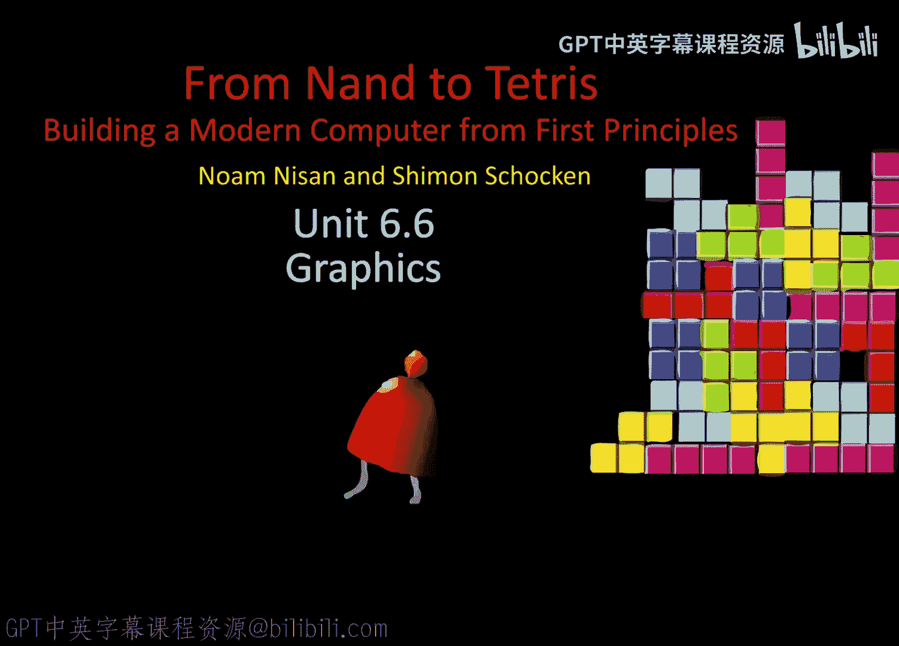

# 耶路撒冷希伯来大学《从零开始构建现代计算机2｜Build a Modern Computer from First Principles》中英字幕 p72 72_08_07_单元6-6_图形处理.zh_en -BV1DA4m1w7FU_p72-

So welcome to unit 6。6 in which we are going to talk about graphics and in particular we are implementing the jack operating system and the class that is relevant to this module is the screen class which we are going to use to handle all the graphical operations of our programs and in particular we'll talk about this library that features several。

Basic operations for drawing figures and pixels on the screen。

And what we'll do in this unit and in the next one is we'll explore some of the more interesting functions in this library。

Now， before we do this， I would like to say some you know。

 general words of introduction about the notion of graphics。

 and let us begin with this with these two figures here that the look identical。

 right what we have here is Donald Duck。Trying to understand how computers work。

In a more direct way than what we do in this course。

 so the first thing that we'll do is we'll remove the computers so they don't get harmed。And then。

 let us begin to。Zoom in on Donald Duck。And you will notice that as I zoom in more and more。

 a glaring difference between these two images reveals itself。

And the difference is that the image on the right does not scale nicely。

 whereas the image on the left scales up perfectly。

And the reason for these differences in these graphical effects is due to the fact that the two images are stored using two different techniques。

The image on the left is。Managed using what is known as vector graphics and the unit。

 the image on the right is an example of BiMap。And what I'd like to do in the next few minutes is discuss the virtues of every one of these techniques。

 and in particular I want to focus on vector graphics。

So here's an example of some portion of the screen。

And let's say that I want to draw this cup on the screen。 Well。

 I will draw it somewhere doesn't matter exactly where。

 and I draw it by simply turning on and off pixels， which is what we can do in Jack， right in Jack。

 I'm sorry on the he computer。 we don't have colors。 we have only black and white。

 although we can easily add colors， but perhaps not in this course。And so。

This is the way the cup is going to be drawn on the screen。And here is the bitmap file。

 which is going to store this image。So what I do here is something which is very straightforward for every pixel which is white。

 I store zero， for every pixel which is black， I store one。

 and I get you know a bunch of numbers that taken together。

 give me a one to one correspondence between the figure and the binary digits。So， that's bitmap。

If I have an image that consists of a million bits， I'm going to have。

Several hundreds of thousands of such tus in this file。Now。

 here is the very same image stored in vector graphics。 Now， as you see。

Instead of actually recording the information in this figure。

 what I record is a set of instructions that specify how to draw the figure。

So the first instruction is draw a line from 30 to 110。And this will give me the top row of the cup。

Then I take advantage of the fact that I have a large rectangle， so I draw a rectangle from 31 to 95。

 and so in one shot I described how to draw I think 35 pixels and then I keep on drawing a few more lines in order to complete the specification of this cup。

So what are the advantages of vector graphics？Well。

 if you try to scale up these two cups like we did before。

 you will notice that the bitmap doesn't scale up properly。

All we have is these bits information and therefore we can try to use all sorts of opportunistic algorithms that compute you know pixel averages and so on but the result will not be satisfying at all to the human eye。

 whereas in vector graphics we get perfect scaling。

 why because we have a set of instructions and if we want to draw the cup on a different resolution or on a different screen size all we have to do is manipulate these numbers using some you know simple proportional constants and and boom I'm going to get the perfect figure drawn in any resolution that the T desire。

So in a nutshell， the vector graphics technique has several。Very important advantages。 First of all。

 it contains relatively little information because I don't have to record the pixels。

 I have to record instructions on how to create， you know， huge expenses of pixels。

And so it doesn't take a lot of space on the disk and for the same reason。

 I can easily transmit vector graphics images over the internet because the files are relatively small。

And when I get to render this figure on some screen， I can easily scale it up or down。

And this is extremely important in a world that is characterized by， you know。

 many different screen sizes。 I mean， think about cell phones， think about cameras。

 think about laptops， tablets。 It doesn't matter， you know what the target screen is。

 I can always scale it up efficiently and effectively。And finally， if you like Bimap。

 well I can always turn it into Bimap。😊，So altogether， vector graphics is a very important invention。

 and that's what we are going to use in our operating system as well。😊，And in particular。

 the three primitive operations that we are going to explore is how to draw a single pixel。

 how to draw a line， and how to draw a circle。And we'll begin with drawing a pixel。 Now。

 I must say that there's something which is slightly inaccurate here。

 Drrop pixel is something which is which is needed both in vector graphics and in bitmap right in bitmap。

 you also have to draw pixels。 So this is perhaps the most fundamental and primitive operation。

 And I should have put it in a class of itself。 because。

 you know droprop pixel is absolutely primitive and basic and on top of it。

 we can create either bitmap or vector graphics figures。😊，Alright。

 so let's begin with drawing pixels。 How do we do it？

So I wish to remind you that when we built the he computer。

We decided to allocate a certain segment of memory for representing the screen。And basically。

 we took a chunk of 8k registers。And we call them the screen memory map。

 And the contract is such that if we want to draw some pixels on the screen。

We turn on and off various carefully selected bits in the memory map and then you know the image will be drawn automatically quote unquote on the screen Now how does this work Well。

 it works because there is you know a contractor yet another contractor which is realized by the hardware。

Which is called refresh or screen refresh and the contract is such that several times each second there is an automatic and routine refresh in which the computer is going to take all the bits that it finds in the memory map and commit them to pixels。

 which it is going to draw on and off on the physical screen。So that， you know。

 if you want to draw this figure here， once again we actually draw it in memory and then everything else is taken care of automatically by the refresh routine。

So， for example， suppose I want to draw this particular pixel， the pixel。

 which is characterized by 450 and 200。 How do I draw it？ Well， if I write in Jack。

 I will probably use something like this command here。 Dr pixel。4450 by 200。And of course。

 someone has to take care of this operation。And this someone is the operating system。

So the operating system and in particular， the OS Sc class。

Is going to have an implementation of the draw pixel routine。

And when Dr Pixel will be asked to draw this particular pixel， here is what it will do。

It will figure out somehow that the word that we have to manipulate is word number 22，812。

And it will also figure out that within this word， we have to turn on the third pixel or the third bit from the right。

Now， how will it make these calculations？ Well， if you will stop the tape and think about it on your own for 5。

10 minutes。You will be able to easily come up with a mapping。

 because you see in the right hand side on on the screen。

 we have a representation which is 512 pixels wide and。😊，256 pixels deep。 And on the left。

 we have a Ram， which is so many words long of 16 bit words。

 So the mapping between the two dimensional space that we have here and the one dimensional space that we have there is quite straightforward。

And if you work out the math， you will discover that here is what you have to do。

The address in the realm of the word that we have to manipulate can be found using this。

Mulipplication and addition。And then what we do is we go to the RE and we retrieve the value which is currently located in this address plus the base address of the memory map。

So now we have this value in our hand right the next thing that we do is we set x mod 16 bit of this value to the current color。

 which is you know either one or0 or whatever it is that we wanted to draw。

And after we make this manipulation， we take this value and we store it back where it belongs in the Ram。

Now， you may ask yourself， why did I bother to first read？And then write。

 why didn't they just go in and manipulate this bit directly？Well there are two reasons why I did it。

 first of all， you simply cannot manipulate bits directly， you must operate in chunks of 16 bits。

 or if the computer is 64 bits wide， you have to operate in chunks of 64 bits and that's how computers work。

So you have to。You know manipulateip a whole byte or a whole word in order to end up manipulating a single bit。

And the reason we had to read it first is also。Due to the fact that we may have some other things drawn already in the vicinity of this bit and look at the picture here we have this little man standing there and if we just go on and manipulate a bit using the 16 bit operation。

 we might mess up images which are in the vicinity of this bit， so by reading this bit。

 I'm sorry by reading these 16 bit first。And then manipulating only the bit that we have to focus on without touching the rest of the bits。

 we are writing this bit safely。And so you， we retrieve these 16 bits and then we'll probably use some 16 bit or operation。

To add up， you know。What we have here with a single bit that we want to manipulate。

 and then we write it back to the Ram and the result will be turning on this specific pixel on the screen。

So that's how the magic of pixel drawing works， probably slightly more complicated than you thought。

Now notice that the drop pixelix subroutin， which belongs to the screen class。

 makes use of the peak and poke subroutines which belong to the memory class。And the memory class。

 of course， is something that we've already implemented in previous units。

And this is quite routine in operating system modules。

 this interdependency of one module using another， and that's an example of this interdependency。

So we talked about draw pixel and in the next unit will teach you how to draw a line。

