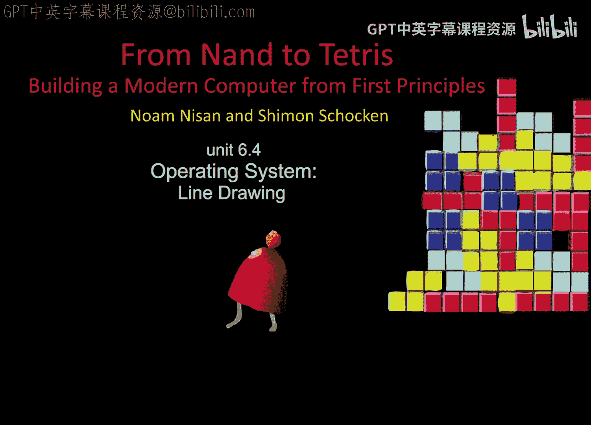

# 耶路撒冷希伯来大学《从零开始构建现代计算机2｜Build a Modern Computer from First Principles》中英字幕 p73 73_08_08_单元6-7_线段绘制.zh_en -BV1DA4m1w7FU_p73-

Welcome to this unit in which we're going to talk about line drawing。Now， in the previous unit。

 we talked about vector graphics and bitmaps graphics in general。

 and we discussed the virtues of vector graphics。And among other things。

 we decided that we are going to implement three graphics primitives， which are drawing a pixel。

 you know， a single individual pixel on the screen in a certain。

Location drawing a line from you know two points on the screen and drawing a circle given given a center and a radius so in this unit we will start with a draw pixel as a point of departure because we've already discussed it in the previous unit and we will learn how to draw lines using a draw pixel。

And how to draw circles using a draw line。And so let us begin with draw line and in order to motivate line drawing。

We go back to this figure that we saw in the previous unit。

 and one nice thing about vector graphics is that because everything is governed by simple algebraic statements。

I can， for example， ungroup this bunch of polygons into， you know。

 some of some subsets or sub imagess。All of which are drawn using vector graphics。

 and I will choose arbitrarily the beak to focus on。

And I'd like to show you how we can draw this beak。 So basically， we can draw it as follows。

 I draw this line and that line。And I keep on drawing lines， which。

Eventually is going to are going to constitute the polygon， which。Implements or。Reizes this a beak。

And I intentionally draw it slowly。Because， you know， I want you to feel the frustration。

I wanted to say， you know， when are we going to finally get this big drone on the screen， Well。

 here it is。 we got it。What I wanted to illustratestate to you are two things。First of all。

 that image drawing is done as a succession of line drawing operations。And second of all。

 you better do it fast， because if line drawing is going to be slow。

Then everything is going to be sluggish。 The user is going to be extremely frustrated。

 will have no animation， no video， no YouTube， and the world will be much ableleaker。

 So everything depends on the pace in which we can draw these lines。

 and we want to draw them as quickly as possible。So let's delve into the details of line drawing using this sample grid here。

And let me begin with a simplifying assumption。 I want to focus only on lines that go northeast。

So heres one typical such line， I want to draw the line that goes from x1 y1 to x to y2。

And I want you to notice that。It's really impossible to draw such a line。Why。

 because the only thing we can do is turn pixels on and off。So in this particular example， you know。

 I have to turn on this pixel。And this one and this one and that one。And notice that I can only。

Approximate the line， right， and。In each iteration， I either go right or up。 Why。

 Because we going northeast。 So these are my only two possibilities。

Now look at this pixel right here。It looks like maybe I should turn on。This pixel， right。

 the one which is diagonly on the top right of it。 but I don't want to do it because if。

 if you do that， you're going to create something that will eventually look like a hole。

In the middle of the line。 So I always go either right or up。 And in this particular case。

 I can make an arbitrary choice。 So I decide to go up， then I go right， right， right。 Once again。

 I can go either right or up。 I go up and right。So what I got is a pixelite approximation of the desired line。

 and if the resolution of the screen is sufficiently large and if these pixels are sufficiently small。

 I'm going to draw something which is going to fool the human brain to think that what we have here is a smooth line okay that's the trick。

😊，That we do in vector graphics。All right， so once again。

 drawline is implemented through a sequence of drop pixel operations。And in each stage。

 we have to make a very simple decision。 Do we want to go right or up。 That's all。

And we better make this decision fast because it turns out that this decision or the time that it takes to compute it holds the key to the speed of this entire algorithm。

So let's look at the details。 Here is the line that I want to draw。

And I begin by introducing some convenient notation。Instead of using absolute coordinates。

 I use deltas， you know I begin with x and y， but I want to go all the way to x plus dx Y plus dy。

 which is more convenient。And I'm going to use the following algorithm。

Which takes a minute or two to get used to。I will use two variables A and B。To。

Account for how many pixels I went to the right so far。This would be A。

And how many pixels I went up so far， and this would be B。And at the beginning， Nb equals 0。

And I'm going to draw in each iteration of the algorithm， I'm going to draw x plus A and y plus B。

So at the beginning， I'm going to draw the X， Y pixel because A and B are 0。

And then the next thing that I'm going to do is I'm going to decide if I want to go right or up。 Now。

 in this example here， I have to go to the right。So to go to the right， I increment a。

And I don't touch B。So when I go back to the while， I'm going to draw the pixel x plus one。Y plus 0。

And it's this pixel， right here。And now I see that I have to go up。

 So I'm going to leave a intact and B will become one。And therefore， going back to the Y loop。

 I'm going to draw this pixel now。So you see that in each iteration I either increment A or B。

 I never increment both because you know we decided to avoid going diagonally。

 so either a goes up by1 or B goes up by1 and so irrespective of how I'm going to snake around this line at the end A is going to make a distance of dx and B is going to make a distance of B Y。

And this gives you a clue on how we can implement the while condition。 Well basically。

 as long as a is less than D X and y and B is less than D Y， I still have work to do。

 I haven't reached my target yet。All right， the next thing I want to delve into is this condition going right。

 How do I know if I want to go right or up。Well， here is what we propose to do。

Take a look at this line here。And compare these two angles。D Y over D X is the desired angle。 That's。

 that's the holy grarail。 That's where you want to go。And B over a is what you ended up doing so far。

Okay。So if B over a is greater than dy over dx， you want to make a correction to the right。

 Otherwise， you want to make a correction。Going up。 So in this particular case， you know。

 that's the condition that we get。 And now we are going to go right。

And we're going to draw this line again。 Once again， B over a is greater than dy over Dx。

 So once again， we want to manipulate a。And we're going to make a instead of three， A will become 4。

 So we get this pixel。We draw this line。Now， B over a is less than dy over D x。

 So we're going to manipulate。B， and we're going to go along the Y axis。 So we'll have this pixel。

 Once again， we compare the two angles。 We go to the right。We compare the two angles。

 we go to the top， and you got the picture。And so。As you or if you end up overshooting。

 you make a correction to the right。 if you end up underhooting， you make a correction up。

That's the basic algorithm。So， it looks like。Weidan。And yet I told you。

 and I warned you that line drawing must be as fast as we can。And if you inspect this algorithm。

 and in particular， if you look at this condition here。

Then the only two words that come to my mind are Ove。

Because we see that in every iteration of this algorithm。

 for every humble pixel that you want to draw， you have to make two divisions。

Which are expensive operations。And maybe if we use some ingenious tricks。

 we can somehow get rid of these two division operations。 or maybe one of them。 let's。

 let's see what we can do。So let's begin by looking at this condition and we realize using elementary school algebra that B over a greater than d over Dx is the same。

 it has the same truth value as ADY less than BDX。With that in mind。

 let us look at this expression here， AY minus BDX let's call it diF。Now。

 obviously this diff is going to change in every iteration because in every iteration we change either A or B。

Now at the beginning， this is going to be 0 because n and b are 0。

And the condition that you have here， this messy condition can be effectively replaced by the question。

 is it true that di is less than  zero， so already we have a nice simplification of the algorithm。

And yet， we have to maintain di， right， When A or B change， we have to change diff as well。

 So what is the impact of incrementing A and B on di， Well。

 it turns out that it has a beautiful impact because。When a goes up， look at the definition of D。

 when a goes up by1， diff goes up by D Y。And when B goes up by  one， diff goes down by Dx。 You know。

 this comes out of the definition of di。With that in mind。

 this entire algorithm can be reduced to what we see here。So that in every iteration。

 we either increment A or B， and we update this accordingly。

And the beauty of this algorithm is that it involves only addition and subtraction operations。

And because it involves only additional subtraction， versions of this algorithm can be implemented。

Highly efficiently on either software or hardware。And the algorithm is as good as it gets。

 You cannot improve it， okay。And the runtime of this algorithm now depends only on the number of pixels that you have to draw。

 and you have to draw these pixels anyway， right， I mean。

 you have to draw these pixels and therefore we get a beautiful algorithm， which once again。

 is as good as we as good as we can hope for。All right， so we know how to draw lines。

And now that we know how to draw lines using draw pixel， I want to illustrate。

How are we going to draw circles using lines？So here's my circle。If I asked to draw a circle。

 I should get at least three inputs which are the center of the circle， X， Y and the radius。And。

How can I draw it。Well呃。Once again， let us remember， you know。

 this is not the perfect pure world of geometry。This is the pixelite words world of computer screens。

So we cannot draw circles。 We can only approximate the circles using。Pixel drawing or line drawing。

So in particular， you know this circle here， if we are content of drawing a filled circle rather than the outline。

 then we can draw this line and then this line and that line and you know so on and so forth。

 we can draw all these lines。And this will create the illusion of a filled circle。

 If the resolution of the screen is sufficiently small。

 our brain will think that what it sees is a smooth circle。How do we do it， How。

 How do we draw these。These rows of pixels。Well， here's the algorithm。Here's the signature。 you know。

 we want to draw a circle that started the origin X， Y and has a radius of R。And to get started， I。

 I want to draw the entire diameter of the circle。 and I want to。Characterize each one of these rows。

 You know， I'm going to to draw two R。2 R rows， right， I mean。

 we have R pixels going this way and then another R pixel。

 So altogether we're going to draw two R rows。And I can characterize each one of these rows by the distance of this row from the origin。

And so。In the middle of the circle， I mean， the longest row is characterized by dy equals 0 because the distance from y is 0。

 And then as I go up。The distance goes down because remember the00 origin is at the top left of the screen。

 that's the convention in computer graphics， so as you go up the distance goes down until it reaches all the way to minus r。

And as I go down， the distance from the origin goes up until I end up with dy equals R。

And with that in mind， let's take a look at this typical pixel here。

And let's try to figure out what is the coordinate of this pixel， Because if we figure out。

What is the coordinate of this pixel we have done？Because the other coordinator of the pixel on the other side is going to be symmetrically equivalent。

And then we can draw a line between these two pixels， and we can do the same thing in every。

Line along the contour of this circle。 So once again。

The coordinates of this pixel hold the key for the entire algorithm。So what are the coordinates？Well。

 I don't know what the x coordinate is， I call it x1。

But the y coordinate must be the origin Y plus dy， right。

 And the same is going to happen in the symmetric pixel on the other side of the。Of the circle。

So we know what is y and we still don't know what is x。

 but we already begin to see the logic of the algorithm and the logic is such that for every Dy。

 going from minus s to R， we want to draw a line that goes from x1， y plus dy to x2， y plus dy。

That's the logic of the algorithm。And the only thing that remains to be done is to figure out what x1 and x2 are。

 if for no x y and x2， we can finish the specification of this algorithm。Now。

To compute these two coordinates。😮，What I think every one of you would do after a few seconds of reflection is you will draw。

 you know， these lines here and you will look at these two。呃。

Triangles and you can use the porian theorem to compute the base of each one of these triangles。

And now that we have the base， we are home free。 Now the base is as you see。

 is defined in terms of the inputs only R and dY is also a function of y。

So here is the coordinate of this pixel。Here is the coordinate of that pixel。

 which is symmetrically equivalent。 and all I have to do is plug these two numbers into my algorithm and I'm done。

 you know， this is the algorithm for drawing circles。Using line drawing。

It may not be what you have expected， but it delivers the goods。It will draw a fill circle。

And what about drawing just the outline of the circle， which may be required？😮，Well。

Why don't you think about it yourself and give yourself one or two minutes to think about this question。

 And when， when you have the answer or not。Continue the tape。 So stop the tape now， think about it。

 You know， how can we modify this algorithm to draw the outline of the circle。

And then run the tape again， and we'll talk about the answer。All right。The question was。

 given that we know how to draw a field circle。How do we draw just the contour of the circle or the outline Well the answer is instead of doing a draw line you do two draw pixel operations right。

 you draw the left pixel and the right pixel， the left pixel and the right pixel left， right。

 left right， left right left right left right， and you've drawn the entire circle。All right。

 so this is circle drawing and we know how to draw pixels， lines and circles。

And it's time for our implementation notes。So up until now， everything was very elegant and nice。

 And from now on， we have to deal with the nitty gritty details of actual implementation。

So here is our drop pixel algorithm， we saw it in the previous unit。

And notice that it has to use a pe and poke， so pe and poke are readily available in the memory class that we implemented in one of the previous units。

And notice also， if you look at the third line from the bottom。We have to set。

The X modulu 16th bit of value to the current color。

So how can you access an individual bit within a 16 bit value？Well。

 this can be done using some logical 16 bit operations。 So think about it。

 This is something for you to ponder about。 and you will figure out how to set individual bits in this value。

 which is you know one requirement along the way of。Writing a jack implementation of a draw pixel。

What about draw line？Well， we have to do several modifications， first of all。

This algorithm that I showed you， because I showed you this graphical metaphor of going upright and so on。

 I decided to base this metaphor on a0， zero origin， which is at the bottom left of the screen。

Which is the intuitive mathematical way to think about it。 But in reality， in computer graphics。

 the 0，0 is up here。 It's in the top left corner of the screen。

 So you have to modify this algorithm to account to a top left origin So that's one modification。

And the other modification is that recall that we made a simplifying assumption we decided to draw only lines that go northeast in reality we have at least four different situations。

 you know we go either northeast or southeast or northwest or southwest。And so you have to modify。

 have， you have to somehow you have to somehow handle every one of these four possibilities。

And what about lines that go you know along the cross。

 you know that go either vertically or exactly horizontally， Well。

 these lines I think should be handled as special cases because you know。

 maybe if you think about it a little bit， maybe we can handle them more efficiently。Then， you know。

Just using the same algorithm for these lines。 also， think about it。So that's。

 that's another tweak that we can do in order to optimize a line drawing。 By the way。

 it's an important tweak， because many line drawing operations are either horizontal or vertical。

 For example， you know， whenever you want to draw a rectangle， a square and so on。 so。

We want everything to go to， to be fast。 but in particular， we want popular operations to be fast。

 So it's。It's worth our while trying to optimize。Drawing of horizontal vertical lines。All right。

 what about draw circle Well it turns out that this algorithm can overflow。

And yet if you set R to a number which is no greater than 181。

 then you won to run into overflow problems and you know here we draw circles and this is this makes your graphics package hardware dependent。

 you know it depends on the size of the he screen but so be it。

 you know every once in a while you have to make some concessions in life。And so。This is it。

 you know that's as much as I wanted to say about the screen class and we talked about draw pixel。

 draw a line， draw a circle， the remaining functions are simple to implement so I trust that you will do it using your own judgment and that's it and in the next unit we're going to talk about textual outputs。

