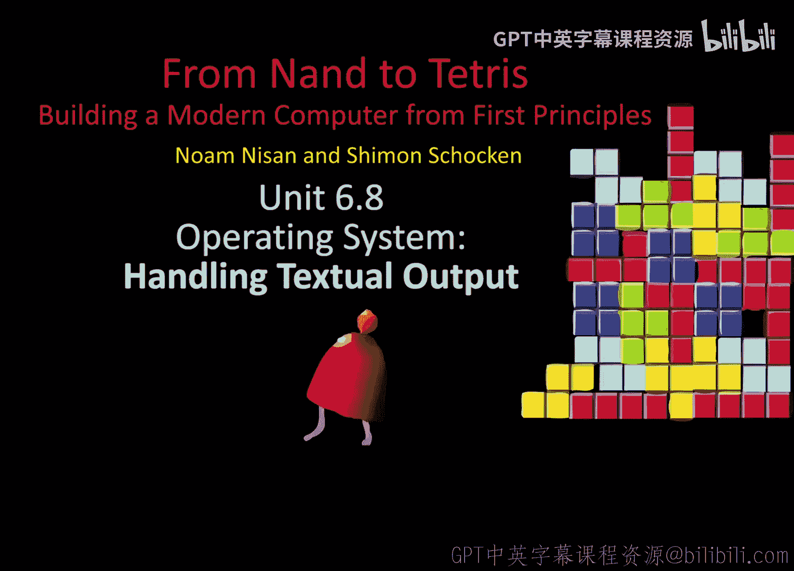

# 耶路撒冷希伯来大学《从零开始构建现代计算机2｜Build a Modern Computer from First Principles》中英字幕 p74 74_08_09_单元6-8_处理文本输出.zh_en -BV1DA4m1w7FU_p74-

Welcome to this unit in which we'll discuss how to handle textual output。Now。

 computers have at least two modes of handling the screen。First of all。

 your program can think about the screen in graphics mode and what I mean by this is that the program thinks that the screen consists of a grid of 256 rows by 512 pixels each black and white on the Hank platform。

And using the various obstructions， which are supplied by the screen class。

 we can draw all sorts of of nice pictures and do some some nice outputs， graphics oriented outputs。

However， in many situations， we also have to develop textual applications。

And these applications have to draw， you know， letters and numbers and and so on。In order to do this。

 we provide another mode of operation， which we call textual。And when we work in this mode。

 we can think about the class， I'm sorry， you can think about the screen as a grid of 23 rows by 64 characters each black and white once again。

 and in order to use the screen in this fashion we don't use the screen class we use a completely different class called output。

 so these two classes， the screen and the output classes provide two different ways to think about and operate the screen。

Now， notice that， you know just like the screen class implements such obstructions as circle and rectangle drawing。

 Well in a very similar fashion， the output class implements such obstructions as drawing the letters K Q1。

7 and so on。 I mean， the letter K or the image K is just an obstruction and someone has to work hard in order to actually draw this image on the screen。

And that's what this unit is all about。Alright， so we are dealing with the operating system and we are focusing on the output class。

And the first thing that we have to determine is what kind of characters are we expected to draw？

Well， our heck Jack platform。Is you know， characters by many different specifications。

 And one of them is this character set。So the computer supports and recognizes all these characters。

Some of which are printable and others are nonprintable。

 So all the printable characters must have some bitmap image that displays them on the screen。

And the nonprintable characters convey some very important information。

 but they don't have visual side effects。 Well， except for new line and backspace that do have visual side effects。

 but they don't display any particular character on the screen。

And what we see here in these tables are the ASCI code or the Unicode。

 it's the same thing and this subset of the character and on the left hand side we see the name of the character or the way we will see this character on the screen。

All right， so with that， here is a typical textual output。

 we see that the screen is characterized by a grid that runs from 0 to 63 on the X axis and 0 to 22 on the Y axis。

And yet， we have to remember that the actual physical screen is still 256 by 512 pixels。

Which is represented in our computer memory using a block of 8k16 bit words。

And so we are facing the low level challenge of using a 256 by 512 pixels grid to realize a 23 by 64 characters grid designed for textual applications。

Because at the end， you have to understand we are going to draw pictures you know。

 the letters A and N， which together constitute the name N。 Well。

 these are three different bitmet figures that we have to draw using pixels。How should we do it？Well。

 let's take a closer look at this part of the output。And let's take even a closer look。

 And now let's get real close。And we see that what we have here is。What is called a font。

And the heck fund。By a design， occupies a fixed。Area of 11 pixels high and 8 pixels wide to represent every character in the character set。

 We call this area frame。And if you look at these frames， you will see。

That the frame includes two empty columns on the right for character spacing。

And one row at the bottom for row spacing。Now it may look to you that we have two empty rows at the bottom。

 but in fact， remember that we have letters like G and capital Q that have some tails going down so we have to use one more row to handle these characters and you know these four characters don't happen to have any of these tails so you don't see it here but we'll see this later so this is the heck font and we worked quite hard to design it because we had to draw these bit mapps to decide you know which images to use for each character in our bitmap the font is not incredibly beautiful but it is definitely serviceable and you know we could work harder and create some nicer fonts and in fact you you the more you definedfin fonts the closer you get to something like a fancy word processor。

So each font is， in fact， a whole set of images that。Determins how to。

Draw every character set on the computer's screen。All right， now。How should we implement this font。

Well， the bad news once again is that it's a lot of work and the good news is that we did it for you and we don't expect you to do it yourself because it's rot work and we don't want you to do rot work。

So we implement this font using the output class。That we are going to explore next。

So here is this output class。And as you see， we begin by defining a static array called character maps。

 this array will hold all the bit maps of every one of our every member in our character set altogether。

 127 characters。And notice that it must be static， it must be static because we want every method in this class to use this font for various purposes。

 so we put it you know up at the class level and this way everyone can use it。All right。

 now we wrote a private method， a private function and by the way， when I say private function。

 we don't have the designation of private and public in Jack so for me a private function is a function that I don't tell the world about okay so the world doesn't even know that this function exists and yet I need it and I need it in order to create this these bit mapps once and for all。

 so I begin by defining the array character maps。And then I use a method。

 yet another private function called create。That actually determines you know the numbers that I have to write in every one of for every one of these characters。

 so take a look at a you know a is the first row in this first statement in this last chunk of code and you will notice that the creator function has first parameter 97 which happens to be the SD code of lowercase a and then we have 11 numbers and these numbers determine you know which numbers we have to draw in every row of the bitnap So if you look at the a image you will see that the first the top three rows are empty and indeed it begins with three zeros。

And the next row， the the roof of the a letter。It looks like。0，1，1。

1 and then come you know a few more these zeros。 Now we have to invert it。

 So actually what we have here is 1，1，1，0 and 1，1，1。

0 I think is 14 and indeed we have 14 as the next parameter and so on and so forths。

So that's how we define the bitmap of A， then we define the bitmap of B， C。

 you know all the other letters in the alphabet， then we do the digits。

 then we do all the special characters。And that's it。 You know， we have， if you look at the code。

 which is available to you if you downloaded the Nte software suite。

 you will see that we actually worked hard to create this font。

And what remains to be described is this create function that we use here， and。Here it is。

 This is the create function。 It it takes 12 parameters。

 The first parameter is the index of the array， and then come。And the index of the array， by the way。

 also happens to be the ASI code。And then come the 11 numbers。And so this function here。

Defins yet another array called map， you know this is the array of the actual letter。

 The previous array was the array that holds all the bit mapps。

 This is one specific bitmap so we define an array called map and created with 11 entries one for every number in the character frame and then we set car maps index to map so essentially we are implementing a two dimensional array。

 Now car mapps is the static array that holds all the bit mapps。

And then we populate our little net array with the actual numbers， A，B，C，D， and so on and so forth。

 and return。And we do this 127 times for every characters character in the character set。

 And the good news is that we do it only once。 You know。

 we don't do it every time we have to draw a character。 But when we turn on the computer。

 when we reset。😊，We are going to also reset the operating system and when the operating system will be reset。

 it will also reset this output class and the output class will run an init method that will create this font and once this font is created。

We can start using it using a few more methods that I haven't shown you。

 which are very well documented in your course materials。All right。

 now one more thing that we have to worry about when we deal with the text is。

What is known as the cursor？So if you look at this example here。

 the cursor is where this red rectangle shows。 I mean， we don't actually see a red rectangle when。

 when you see this output on the screen， I just use it in in the slide here。

To show you what I'm talking about。 So the cursor is this frame， you know，11。

11 pixels deep and 8 pixels wide that shows where the next character will be written。 if。

 if and when， I'm sorry， if and when willll be asked to write an next character。

And this notion of a cursor has both logical and physical manifestations， if you will。 First of all。

 the logical notion is such that I really have to know， where is the cursor。

I as the person who develops the output class here because you know if I will be asked to write a character。

 I have to know where to put it on the screen， so I have to do some internal accounting to just remember where the cursor is and obviously the location of the cursor will be affected each time I draw a new character。

But also， I may want to be nice and show the user where the cursor is on the screen so that she or he will know you know what happens when she touches the keyboard。

 when she touches the keyboard， she wants to know where on the screen she is going to see the next letter or key that or she is touching。

So， you know， I may want to create some blinking effect or I may just want to put an underline or a little arrow。

 it's it's a design decision and which is completely independent of the notion of the logical state of of the cursor and I think that in our Jack hackck platform we decided not to show a cursor at all。

 So the user is expected to figure out himself or herself where the cursor is and。But I may be wrong。

 I don't remember the exact details here。 It's not terribly important。 All right。

 so how should we manage the cursor。Well， if we are， and I'm talking now about the logical cursor。

If you are asked to display new line， well in that case。

 we have to move the cursor to the next line on the output。If we ask to display backspace。

 we have to move the cursor  one column to the left。

And if we are asked to display any other character。

 then we have to display the character and move the cursor one column to the right。

 So these are the rules of the game。So with all that in mind。

 we are now in a position to take a close look at the output class。

And will do it only at the API level。So， first of all。

 we have the init method and the init method is the method or the function that is going to call。

The functions that I saw earlier that create the font。And this will be done， you know， only once。

And then we have several functions which will serve us， you know。

 every time we want to to use a text， not every time， but in some textual situations。

 So we have a move cursor。Fun that can put the cursor anywhere on the screen。

 And when I say I J here。啊。I mean， the location where the cursor is going to end up with。

Then we have a print car。Method that knows how to display a single character and move the cursor accordingly。

 we have a print string that can string， you know print a string of any reasonable length we have a print in。

 which is very similar to print string， but it knows how to print numbers， integer numbers。legegibly。

And we also have a print line that basically you know moves the cursor to the next line and we have a backspace that I described before。

 so these are the functions of the output class and implementing them is not terribly complicated given all the information that I gave you and given that we have already implemented the font the he font for you so you don't have to mess up with that and therefore the implementation is certainly something that you can figure out on your own。

So to recap， we are working on the operating system， we described the math， memory。

 screen and output classes， and the next class that we are going to explore called keyboard is going to describe how we manage inputs。

