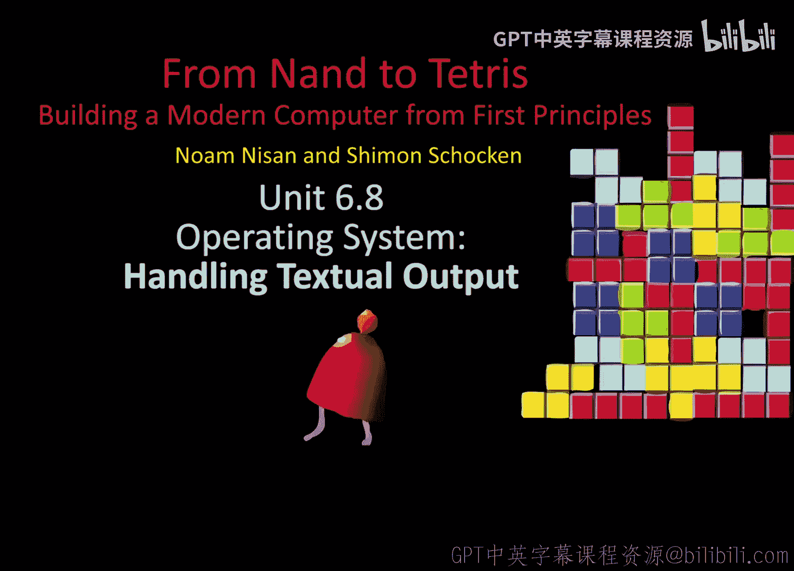

# 从零开始构建现代计算机2：单元6-8：处理文本输出 📝

在本单元中，我们将学习计算机如何处理文本输出。计算机屏幕通常有两种工作模式：图形模式和文本模式。我们将重点介绍文本模式，以及如何通过操作系统中的 `Output` 类在屏幕上绘制字符。

## 屏幕的两种模式

上一节我们介绍了计算机屏幕的基本概念。本节中我们来看看它的两种工作模式。

计算机屏幕至少有两种处理模式。首先，程序可以以图形模式看待屏幕。在这种模式下，程序将屏幕视为一个由 256 行、每行 512 个像素组成的黑白网格。通过 `Screen` 类提供的各种抽象，我们可以绘制各种图形，实现面向图形的输出。

然而，在许多情况下，我们也需要开发文本应用程序。这些应用程序需要绘制字母、数字等。为此，我们提供了另一种操作模式，称为文本模式。在这种模式下，我们可以将屏幕视为一个由 23 行、每行 64 个字符组成的黑白网格。为了以这种方式使用屏幕，我们不使用 `Screen` 类，而是使用一个完全不同的类，称为 `Output`。因此，`Screen` 和 `Output` 这两个类提供了两种不同的方式来思考和操作屏幕。

请注意，就像 `Screen` 类实现了绘制圆形和矩形等抽象一样，`Output` 类也以非常类似的方式实现了绘制字母 K、Q、1、7 等抽象。字母 K 的图像本身就是一个抽象，需要有人努力才能在屏幕上实际绘制出这个图像。这正是本单元要讨论的内容。

## 字符集与字体

既然我们要处理文本输出，首先需要确定要绘制哪些字符。

我们的 Hack Jack 平台支持并识别许多不同规格的字符，其中之一就是这个字符集。计算机支持并识别所有这些字符，其中一些是可打印的，另一些是不可打印的。所有可打印字符都必须有相应的位图图像来在屏幕上显示它们。不可打印字符传达一些非常重要的信息，但它们没有视觉效果。当然，换行符和退格符除外，它们有视觉效果，但不会在屏幕上显示任何特定字符。

在这些表格中我们看到的是 ASCII 码或 Unicode（两者是相同的），以及这个字符的子集。在左侧，我们看到字符的名称或我们将在屏幕上看到该字符的方式。

以下是一个典型的文本输出示例。我们看到屏幕由一个网格来表征，X 轴从 0 到 63，Y 轴从 0 到 22。然而，我们必须记住，实际的物理屏幕仍然是 256 x 512 像素，这在我们的计算机内存中使用一个 8K 16 位字的块来表示。

因此，我们面临着一个底层挑战：如何使用一个 256 x 512 像素的网格来实现一个为文本应用程序设计的 23 x 64 字符网格。因为最终我们必须理解，我们将要绘制图片，例如构成单词 “AN” 的字母 A 和 N。这些是三个不同的位图图形，我们必须使用像素来绘制。我们应该怎么做呢？

让我们仔细看看这部分输出。让我们再靠近一点看。现在让我们真正靠近。我们看到这里的东西被称为字体。

Hack 字体在设计上，使用一个固定的 11 像素高、8 像素宽的区域来表示字符集中的每个字符。我们称这个区域为“帧”。如果你看这些帧，你会发现帧的右侧包含两个空列用于字符间距，底部包含一行用于行间距。现在你可能看起来底部有两行空行，但实际上，请记住我们有像 G 和大写 Q 这样有向下延伸部分的字母，所以我们必须多使用一行来处理这些字符。这里显示的四个字符恰好没有这些延伸部分，所以你在这里看不到，但我们稍后会看到。

这就是 Hack 字体。我们花了相当多的精力来设计它，因为我们必须绘制这些位图，为每个字符决定使用哪个图像。这个字体不是非常漂亮，但绝对可用。事实上，你定义的字体越多，你就越接近像花哨的文字处理器那样的东西。

所以，每种字体实际上是一整套图像，决定了如何在计算机屏幕上绘制每个字符。

## 字体的实现

现在，我们应该如何实现这个字体呢？坏消息是，这需要大量工作。好消息是，我们已经为你完成了，我们不期望你自己去做，因为这是重复性工作，我们不希望你做重复性工作。

我们使用接下来要探讨的 `Output` 类来实现这个字体。

以下是这个 `Output` 类。如你所见，我们首先定义一个名为 `characterMaps` 的静态数组。这个数组将保存我们字符集中每个成员的所有位图，总共 127 个字符。请注意，它必须是静态的，因为我们希望这个类中的每个方法都能出于各种目的使用这个字体。所以我们把它放在类级别，这样每个人都可以使用它。

我们编写了一个私有方法（私有函数）。在 Jack 语言中，我们没有私有和公有的指定，所以对我来说，私有函数是我不向外界公开的函数。外界甚至不知道这个函数存在，但我需要它，并且我需要它来一次性创建这些位图。

我首先定义数组 `characterMaps`。然后我使用一个方法，另一个名为 `create` 的私有函数，它实际上决定了为这些字符中的每一个需要写入的数字。

看一下代码块中的第一条语句，字母 ‘a’。你会注意到 `create` 函数的第一个参数是 97，这恰好是小写字母 ‘a’ 的 ASCII 码。然后我们有 11 个数字，这些数字决定了在位图的每一行需要绘制哪些数字。如果你看字母 ‘a’ 的图像，你会看到顶部三行是空的，确实它以三个零开始。下一行，字母 ‘a’ 的顶部，看起来像 0,1,1,1，然后是一些零。我们必须将其反转。所以实际上我们这里有的是 1,1,1,0，而 1,1,1,0 我认为是 14，确实我们下一个参数就是 14，依此类推。

这就是我们定义 ‘A’ 位图的方式，然后我们定义 ‘B’、‘C’ 的位图，以及字母表中的所有其他字母，然后我们处理数字，然后处理所有特殊字符。就是这样。如果你下载了 Nand2Tetris 软件套件并查看代码，你会看到我们实际上努力创建了这个字体。

剩下需要描述的是我们在这里使用的 `create` 函数。这就是 `create` 函数。它接受 12 个参数。第一个参数是数组的索引，顺便说一下，这个索引也恰好是 ASCII 码。然后是 11 个数字。

这个函数定义了另一个名为 `map` 的数组，这是实际字母的数组。之前的数组是保存所有位图的数组。这是一个特定的位图，所以我们定义一个名为 `map` 的数组，创建时有 11 个条目，对应字符帧中的每个数字。然后我们设置 `charMaps[index]` 为 `map`。本质上，我们正在实现一个二维数组。`charMaps` 是保存所有位图的静态数组。然后我们用实际的数字 A、B、C、D 等填充我们的小 `map` 数组，然后返回。

我们对字符集中的每个字符执行此操作 127 次。好消息是，我们只做一次。我们不必每次绘制字符时都这样做。当我们打开计算机，当我们重置时，我们也将重置操作系统，当操作系统重置时，它也会重置这个 `Output` 类，而 `Output` 类将运行一个 `init` 方法来创建这个字体。一旦这个字体被创建，我们就可以开始使用它，通过一些我还没有向你展示的方法，这些方法在你的课程材料中有详细记录。

## 光标管理

在处理文本时，我们必须担心的另一件事是所谓的“光标”。如果你看这里的例子，光标就是这个红色矩形显示的地方。我的意思是，当你在屏幕上看到这个输出时，实际上看不到红色矩形，我只是在幻灯片中使用它来向你展示我在说什么。所以光标是这个帧，11 像素深，8 像素宽，显示下一个字符将被写入的位置，如果以及当被要求写入下一个字符时。

光标这个概念既有逻辑上的表现，也有物理上的表现。首先，逻辑概念是我真的必须知道光标在哪里。我作为开发 `Output` 类的人，因为如果要求我写入一个字符，我必须知道把它放在屏幕上的什么位置，所以我必须做一些内部记录来记住光标的位置。显然，每次我绘制一个新字符时，光标的位置都会受到影响。

此外，我可能想友好地向用户显示光标在屏幕上的位置，以便她或他知道当她触摸键盘时会发生什么。当她触摸键盘时，她想知道在屏幕上的哪个位置会看到她将要触摸的下一个字母或按键。

所以，我可能想创建一些闪烁效果，或者可能只想放一个下划线或一个小箭头，这是一个设计决策，完全独立于光标逻辑状态的概念。我认为在我们的 Hack Jack 平台中，我们决定根本不显示光标。所以用户需要自己弄清楚光标在哪里。但我可能记错了，我不记得确切的细节了。这并不太重要。

那么，我们应该如何管理光标呢？我现在谈论的是逻辑光标。如果要求显示换行符，那么我们必须将光标移动到输出的下一行。如果要求显示退格符，我们必须将光标向左移动一列。如果要求显示任何其他字符，那么我们必须显示该字符并将光标向右移动一列。这些就是游戏规则。

## Output 类 API

考虑到所有这些，我们现在可以仔细看看 `Output` 类。我们只会在 API 层面进行。

首先，我们有 `init` 方法。`init` 方法是将会调用我之前看到的创建字体的函数的方法。这只会做一次。

然后我们有几个函数，在我们想要使用文本的某些情况下（虽然不是每次）会为我们服务。我们有一个 `moveCursor` 函数，可以将光标放在屏幕上的任何位置。当我说 I J 时，我指的是光标将要到达的位置。

然后我们有一个 `printChar` 方法，它知道如何显示单个字符并相应地移动光标。我们有一个 `printString`，可以打印任何合理长度的字符串。我们有一个 `printInt`，它与 `printString` 非常相似，但它知道如何清晰地打印整数数字。

我们还有一个 `printLine`，基本上将光标移动到下一行。我们有一个我之前描述过的 `backSpace`。这些就是 `Output` 类的函数。鉴于我给你的所有信息，并且鉴于我们已经为你实现了 Hack 字体，所以你不必为此烦恼，因此实现这些函数肯定是你自己可以搞定的。

## 总结

本节课中我们一起学习了计算机如何处理文本输出。我们介绍了屏幕的图形和文本两种模式，重点探讨了在文本模式下，如何使用 `Output` 类在屏幕上绘制字符。我们了解了字符集、Hack 字体的结构及其实现方式，包括如何通过位图定义每个字符。我们还讨论了光标在逻辑和物理上的概念及其管理规则。最后，我们预览了 `Output` 类的主要 API 方法，为接下来的键盘输入处理学习做好了准备。