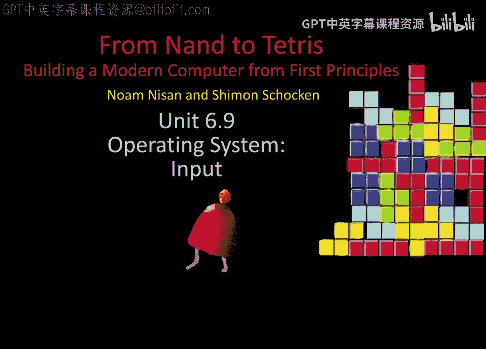
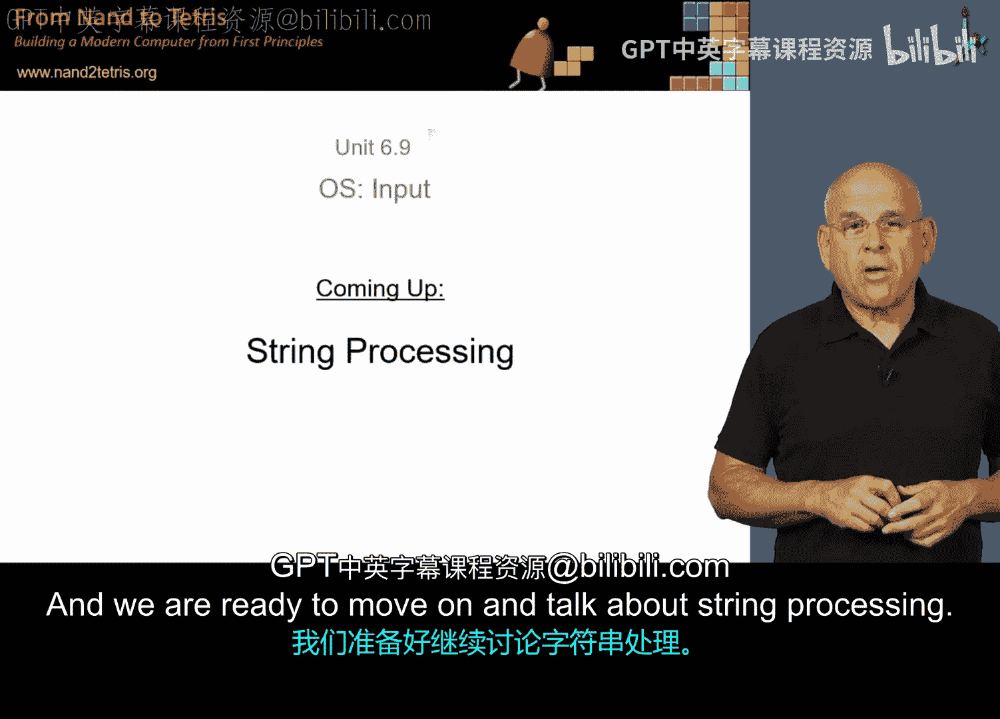

# 耶路撒冷希伯来大学《从零开始构建现代计算机2｜Build a Modern Computer from First Principles》中英字幕 p75 75_08_10_单元6-9_输入处理.zh_en -BV1DA4m1w7FU_p75-

Welcome to this unit in which we' are going to talk about the input capabilities of our operating system and in particular we're going to talk about a class called keyboard that manages all the dialogue。

 if you will， between our computer and the physical keyboard。😊。

And if you recall this is how we handle input output devices on the hec platform。

 This was covered in nanoote spot1 and mentioned only also in a module0 of this course。

 So by convention we allocate certain space in the Ram to represent or stand for the screen and likewise we allocate a single 16 B register in the Ram to represent the keyboard。

 Now this 16 B representation is all that is needed in order to represent any possible character in the Unicode character set So this is sufficient for handling the keyboard and this is called the keyboard memory map which once again is a single RamM register。

That's how it looks like using this graphical metaphor。

 so on the right hand side we see a keyboard which is identical。

 you know more or less to the keyboard that you are currently using on your computer and on the left we see this single RAM register that we discussed before。

 which we also call keyboard by convention。So here's the contract when you press a certain key on the keyboard。

 the keyboard register works in such a way that it immediately and instantaneously displays the binary value of the scan code or the Unicode or the ASCI code that you have pressed。

All these codes are the same within the subset of characters that are recognizable by the heECer computer。

And so that's what happens when you press the keyboard once you release your finger and no key is pressed。

The keyboard register is set to zero， so normally the keyboard register is0 because most of the time no one touches the keyboard and in the few instances in which we touch the keyboard。

 we get some non-zero value reflected in this register。

This contract is delivered by the hardware and therefore we don't have to worry about it。And yet。

 everything that we will do in the keyboard class of the operating system is going to be built on this very humble foundation。

So let me illustrate to you how this thing works。 Suppose I take my finger and press K。Now。

 as long as my finger is down on the K key。I'm going to see in the keyboard register。

The value of the scan code that represents K， which happens to be 75 in ASI。 So once again。

 as long as the finger is down， I'm going to be to see 75。

 Once I lift my finger off and nothing touches the keyboard。I'm going to see the default value。

 which is0。In the key register。Now I take my finger again and touch four。

 you know the key that represents the four digit。Now the ASI code of 4 happens to be 52。

 and that's what I'm going to see in the keyboard register。 Once I lift my finger。

 I'm going to see nothing or0。Put my finger again down this time on space。

 as long as the finger is down on space， I'm going to see 32。

 which happens to be the SI value representing space。Lift my finger。 I see 0。

 I put my finger down again this time on the up arrow key。

It so happens that the ASI code of up arrow is 131。

 So I'm going to see this number in the keyboard register。 Once again， I lift it up。

 I see0 and so on and so forth。 You got the idea。Now with that in mind here is the complete character set that the he computer recognizes what you see here is a table which I split into several columns to make it easier to follow on the left column。

 you see the name of the character， it's an agreed upon name and on the right hand side you see yet another agreed upon code that represents this character using some integer value。

Taken together， all these characters are the heck Jack character set。

So now that we understand the notion of characters， let's move on and talk about the keyboard class。

We have chosen to base this class on four subroutines and here they are。

 there's no need to read the documentation because we are going to delve and into every one of these subroutines and implement it carefully。

 but basically Keyre is designed to capture。You know。

 one the event of pressing a key on the keyboard Read Car is designed to capture the event of reading a character from the keyboard。

 and then we have read line， which reads a string。Up to an enter or carriage return character。

 and finally read in does the same， but interprets what it read as an integer。

And taken together this is the API of our keyboard adapter or our keyboard class。

 and so let's go on and begin to implement this class starting with Key press Keypress is quite trivial。

 if a keyboard key is pressed。We return the scan code of that key， else we return0。

You may be guessing how to implement it and if not we'll discuss it later when we talk about our implementation notes。

 so this is the most primitive function or input function in the operating system。

And notice that this is kind of it's a real time listener。Kind of a function。 In other words。

 when you invoke it， what you get is what is currently being pressed on the keyboard in this very instant of time in which you invoke this method。

And so it operates on a sort of a blink of a second。 You know， you call this method。

 it returns a value， and that's it。 So it's the most real time function that you can that you can think of。

Now， Recar。Is is quite different。 Okay， The read car function has you know， persistence。 it returns。

The key that was last pressed by the user and notice that this is very different from Keyre and I'll try to explain why once again。

 Key press is a real time operation。And yet， you know。

 suppose I write a program that puts a string on the screen saying something like press a key。

 I tell the user to press a key。So now I have to wait and see what the user will do。

 See that's what Ricar does。 Now first of all， the user you know， may not be willing to cooperate。

 Maybe he saw this prompt press the key and he decided to go and get himself a cup of coffee。

So by the time he returns or she returns 10 minutes of passed and they haven't yet pressed the key。

 and then all of a sudden they press the key。Now I'm exaggerating， but even in real key presses。

 you one key press， it might take a few milliseconds here and a few milliseconds there。

 different users react， have different response times。So at some point。

 the user is going to press the key。And then we also have no idea how long the user will be willing to leave his or her finger on the keyboard。

 you know， maybe they enjoy putting their fingers for a few seconds， maybe they lift the keyboard。

 their fingers immediately， so once again we don't know。😊。

So we see the readcar has to overcome or handle two sources of uncertainty。

 how long it takes before the user obliges and presses the key and how long it takes before the user is willing to remove his or her finger。

 So how do we handle it， we have to neutralize these uncertainties。 So first of all。

 we display the cursor。 if you want to be nice， we want to show the user where actually on the screen they will see the feedback of what what they pressed。

 and then we have to wait until a key is pressed。 Now the most natural way to do it is to use this strange looking Y loop and basically we say that as long as key press is0。

 we do nothing。So if you think about it。😊，All the action of this loop is actually in the condition。

 The condition here is very active because the condition calls key the key press function for its effect and it does it in this loop。

 which may well be infinite if the user is not going to press anything。😊。

And so this loop essentially amounts to sampling the keyboard。

 We sample the keyboard until something happens。 Now， when something happens。

 key press will not be0 any longer。 So we're going to be to be ejected outside this Y loop。

And then we can finally capture the key that the user has pressed。

 We put it in some variable that I called C。And now remember， the finger is down。

 so the finger is down。And we don't know for how long。

 So we are going to wait until the key is released and we'll do it using a very similar loop so that as long as the finger is down。

 we do nothing。 Okay， And once the finger grows up， keep press will become again 0。

 and then we can finally give the user some feedback on what he or she pressed and return C to the collar。

So once again， I hope that you appreciate the difference between Readcar and Keyre and understand that we need Readcar to overcome。

These uncertainties that we cannot control。Well， actually， we do control them quite nicely。

 but within the program level。And then the next method or function I'd like to discuss is reading a string。

And recall that you know， typically when we ask the user to enter something like enter your name or enter your age。

 we expect the user to enter several keys， not one。

 several keys like know the name Peter or 53 or whatever。And normally。

 we expect the user to signify that the input has been completed by entering enter or sometimes call it return。

So we have to write some logic to handle this kind of user behavior。

 and that's what Readline is doing in the OS keyboard API。So we begin， we're going to build a string。

 right， That's the string that the user is entering and we'll start with null。

And then we're going to enter some repeat loop in which we are going to grow the string。

 according to the keystrokes that the user is submitting。 So first of all。

 you know we read the character and notice the beauty of this obstruction， you know。

 we say read Car but we know that we've completely handled all the drama of putting the finger down。

 putting the finger up。 All this is encapsulated by Read Car。 we took care of it。

 So we read the character。And then we want to look at this character and check what it is。

 So if the character is new line。Wwhich is the ASCI code of the enter key or whatever is the key on your keyboard。

 then we want to display new line and return the string。Now display new line。

 you know is not our business， this is something which is done by the output class。

 so we have to call the output method that displays a new line。

 you can check the output API how to do it and this will cause the cursor you know to go to the next line and by then we know that the SDR。

 the string has been entered so we simply return it。So that's the end of the process。

Now another possibility is backspace。 If the user has entered backspace。

 then we know that the character that was last entered should be erased。

 so we remove the last character of STR。And then we also want to acknowledge the fact that the user has pressed backspace and we do it by calling the output backspace function。

In this function， which we discussed in the previous unit knows how to move the cursor one position backward。

 But you know， that's not our business output is going to do it for us。

So these are the two kind of extreme possibilities of entering characters and so if it's not enter and it's not backspace。

 then presumably we have a Bona Fida character， we have a real character to work with。

 so we take this character and we append it to SDR。And that's the end of the logic here。

 we keep on doing this and notice that the only way to get out of this loop is to encounter a new line which is exactly what we wanted and when this happens we return STR。

So that's the function for reading lines from the keyboard。

So having described the logic of these functions， I'd like to give you some hints on how to implement them on the heCC platform。

So beginning with a keyre well keyres can be very easily implemented using memory peak if you recall we have a function called peak that allows you to get into any register in the Ram and return its value well one of these registers happen to keep the current contents of the keyboard so you know take it from here and and I'm sure that you know how to you will know how to implement it。

what about Readcar where Readcar simply implement thesda code that I showed you in the previous slide and likewise readline you can implement the same well thesda code of Readline and finally we have readDt and readDt is a function which is quite similar to Readline except that we expect the user to enter digits only。

 and as we read these digits we build an integer from them and once again this is logic that you should be able to write on your own using the guidelines that we gave you before。

So these are all the necessary implementation notes for writing the keyboard class and with that we have completed all these classes in the operating system and we are ready to move on and talk about string processing。

