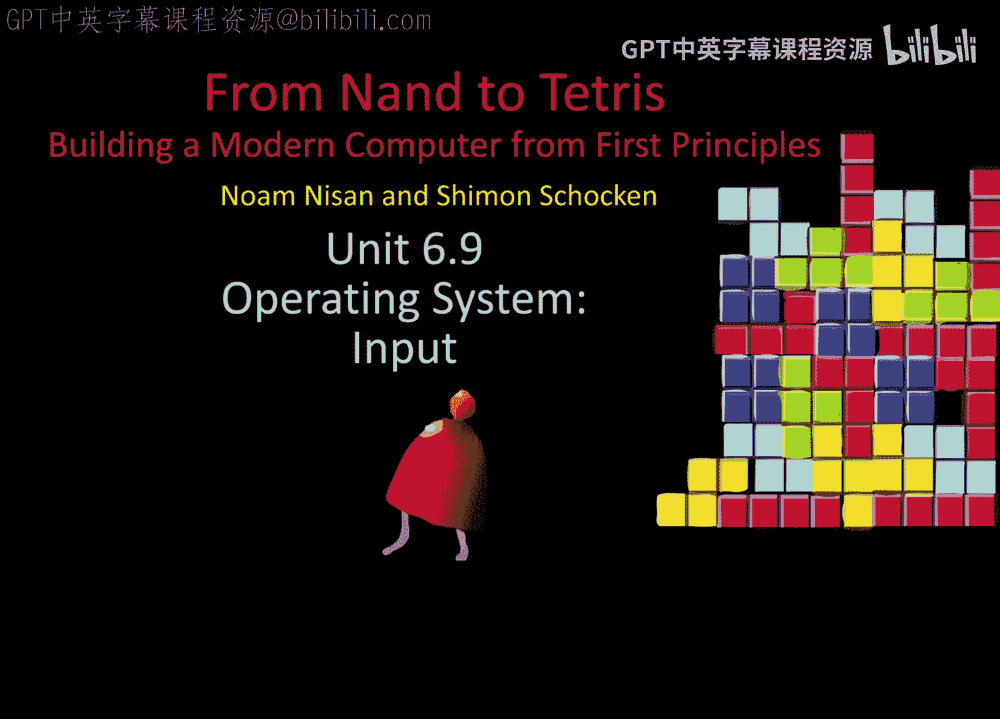
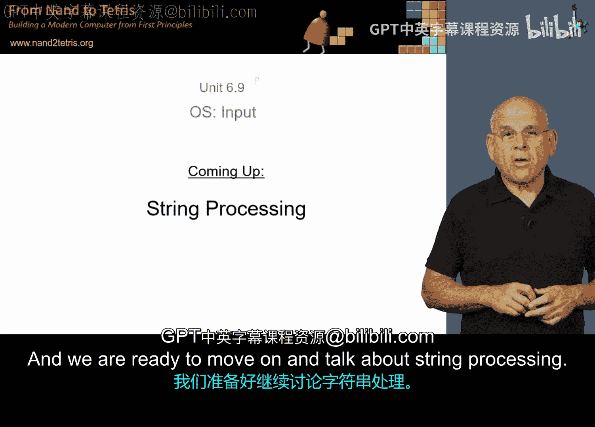

# 从零开始构建现代计算机2：单元6-9：输入处理 🖥️⌨️



在本单元中，我们将探讨操作系统的输入能力，特别是介绍一个名为 `Keyboard` 的类，它负责管理计算机与物理键盘之间的所有交互。

## 键盘内存映射

上一节我们介绍了操作系统的基本架构，本节中我们来看看输入设备是如何在HEC平台上处理的。这曾在Nand2Tetris项目的第一部分以及本课程的模块0中提及。

按照惯例，我们在RAM中分配特定区域来代表屏幕。同样，我们在RAM中分配一个16位的寄存器来代表键盘。这个16位的表示足以代表Unicode字符集中的任何可能字符，因此足以处理键盘输入。这被称为键盘内存映射，它本质上是一个单独的RAM寄存器。

下图展示了这个概念：


右侧是一个键盘，与你当前使用的键盘大致相同。左侧是我们之前讨论的那个单独的RAM寄存器，按照惯例我们也称之为“键盘”。

以下是硬件实现的约定：当你在物理键盘上按下某个键时，键盘寄存器会立即、瞬时地显示该按键的扫描码（或Unicode/ASCII码）的二进制值。在HEC计算机可识别的字符子集内，这些编码是相同的。当你松开手指，没有按键被按下时，键盘寄存器被重置为0。因此，键盘寄存器通常为0，因为大多数时间无人触碰键盘。在我们触碰键盘的少数情况下，该寄存器会反映出一个非零值。

这个约定由硬件实现，我们无需担心。然而，我们将在操作系统的 `Keyboard` 类中构建的所有功能，都将建立在这个简单的基础之上。

## 工作原理示例

让我举例说明其工作原理。假设我按下 `K` 键。只要我的手指按住 `K` 键，我将在键盘寄存器中看到代表 `K` 的扫描码值，在ASCII中恰好是 `75`。一旦我抬起手指，键盘未被触碰，我将看到默认值 `0`。

再次按下代表数字 `4` 的键。数字 `4` 的ASCII码是 `52`，这将是键盘寄存器中的值。抬起手指，看到 `0`。按下空格键，只要按住，看到 `32`（代表空格的ASCII值）。抬起手指，看到 `0`。按下上箭头键，其ASCII码是 `131`，将在键盘寄存器中看到这个数字。抬起后，再次看到 `0`。你应该明白了。

## HEC字符集

了解了字符的概念后，我们继续讨论 `Keyboard` 类。以下是HEC计算机识别的完整字符集。这个表格被分成几列以便阅读。左列是字符的约定名称，右列是代表该字符的整数值代码。所有这些字符共同构成了HEC Jack字符集。

## Keyboard类API

我们选择基于四个子程序来构建这个类。以下是它们的简要介绍，我们随后将深入探讨并仔细实现每一个。

*   `keyPressed`: 设计用于捕获键盘按键按下的事件。
*   `readChar`: 设计用于从键盘读取一个字符的事件。
*   `readLine`: 读取一个字符串，直到遇到回车符。
*   `readInt`: 功能类似，但将读取的内容解释为整数。

这些共同构成了我们键盘适配器或 `Keyboard` 类的应用程序接口（API）。现在，让我们开始实现这个类。

### 实现 `keyPressed`

`keyPressed` 的实现相当简单。如果键盘有键被按下，则返回该键的扫描码，否则返回 `0`。你或许能猜到如何实现它，我们稍后在讨论实现说明时会详细说明。这是操作系统中最基本的输入函数。

请注意，这是一种实时监听函数。换句话说，当你调用它时，你得到的是调用该方法那一瞬间键盘上当前被按下的键。因此，它操作在“一瞬间”。你调用这个方法，它返回一个值，仅此而已。这是你能想到的最实时的函数。

### 实现 `readChar`

`readChar` 则完全不同。`readChar` 函数具有持久性；它返回用户最后按下的键。这与 `keyPressed` 有很大区别，我来解释原因。

`keyPressed` 是实时操作。然而，假设我写了一个程序，在屏幕上显示“请按任意键”的字符串，我告诉用户按一个键。现在，我必须等待并查看用户会做什么。这就是 `readChar` 的功能。

首先，用户可能不会立即配合。他们看到提示后可能决定去喝杯咖啡。十分钟后他们回来，还没有按键，然后突然按下一个键。我有些夸张，但即使是真实的按键，一次按键也可能需要几毫秒，不同用户的反应时间不同。所以，在某个时刻，用户会按下键。其次，我们也不知道用户愿意将手指放在键盘上多久，可能几秒钟，也可能立即抬起。

因此，我们看到 `readChar` 必须克服或处理两种不确定性：用户响应并按下键需要多长时间，以及用户愿意抬起手指需要多长时间。我们如何应对？我们必须消除这些不确定性。

首先，我们显示光标（如果希望用户体验良好），向用户展示他们按键的反馈将出现在屏幕的哪个位置。然后，我们必须等待直到有键被按下。最自然的方法是使用这个看起来有些奇怪的 `while` 循环：

```pseudocode
while (keyPressed() == 0) {
    // 什么也不做
}
```

这个循环的所有动作实际上都在条件判断中。这里的条件非常活跃，因为它为了其效果而调用了 `keyPressed` 函数，并且在一个可能是无限的循环中调用（如果用户不按任何键）。因此，这个循环本质上相当于对键盘进行采样。我们持续采样键盘，直到有事情发生。当有事情发生时，`keyPressed` 将不再为 `0`，于是我们跳出这个 `while` 循环。

然后，我们终于可以捕获用户按下的键，将其存入一个变量（我称之为 `c`）。现在记住，手指是按下的，我们不知道会按多久。因此，我们将等待直到键被释放，使用一个非常相似的循环：

```pseudocode
while (keyPressed() != 0) {
    // 什么也不做
}
```

只要手指按下，我们就什么也不做。一旦手指抬起，`keyPressed` 将再次变为 `0`。然后，我们最终可以给用户一些关于他/她按了什么的反馈，并将 `c` 返回给调用者。

我希望你能够理解 `readChar` 和 `keyPressed` 之间的区别，并明白我们需要 `readChar` 来克服这些我们无法控制的（程序层面的）不确定性。

### 实现 `readLine`

接下来要讨论的方法是读取字符串。回想一下，通常当我们要求用户输入某些内容，如“请输入您的姓名”或“请输入您的年龄”时，我们期望用户输入多个键，而不是一个，比如名字“Peter”或数字“53”等。通常，我们期望用户通过按回车键（有时称为返回键）来表示输入完成。

我们必须编写一些逻辑来处理这种用户行为，这就是操作系统键盘API中 `readLine` 的功能。

我们开始构建一个字符串（即用户正在输入的字符串），初始化为空。然后，我们将进入一个循环，根据用户提交的击键来增长这个字符串。

首先，我们读取一个字符。注意这个抽象的巧妙之处：我们说 `readChar`，但我们知道我们已经完全处理了手指按下和抬起的所有过程，这一切都被 `readChar` 封装了，我们已经处理好了。

然后，我们查看这个字符并检查它是什么。如果字符是换行符（即回车键的ASCII码），那么我们想要显示换行并返回字符串。显示换行不是我们的事，这是由输出类完成的，因此我们必须调用显示换行符的输出方法（你可以查看输出API了解如何操作），这将使光标移动到下一行。到那时，我们知道字符串 `str` 已经输入完毕，因此我们直接返回它。这就是过程的结束。

另一种可能是退格键。如果用户输入了退格键，那么我们知道最后输入的字符应该被擦除，因此我们从 `str` 中移除最后一个字符。然后，我们也想确认用户按了退格键，通过调用 `output.backSpace()` 函数来实现。这个函数（我们在上一单元讨论过）知道如何将光标向后移动一个位置，但这不是我们的事，输出类会为我们处理。

这些是输入字符的两种极端可能性。因此，如果既不是回车也不是退格，那么大概我们有一个真正的字符需要处理，我们取这个字符并将其附加到 `str` 的末尾。

这就是这里的逻辑。我们持续这样做，注意跳出这个循环的唯一方式是遇到换行符，这正是我们想要的。当这种情况发生时，我们返回 `str`。这就是从键盘读取行的函数。

## 实现说明

描述了这些函数的逻辑后，我想给你一些关于如何在HEC平台上实现它们的提示。

从 `keyPressed` 开始，它可以很容易地使用 `Memory.peek` 函数实现。如果你记得，我们有一个名为 `peek` 的函数，允许你获取RAM中任何寄存器的值并返回它。这些寄存器中恰好有一个保存着键盘的当前内容，你可以从这里入手，我相信你知道（或将会知道）如何实现它。

`readChar` 呢？`readChar` 只需实现我在上一张幻灯片中展示的伪代码。同样，`readLine` 你也可以实现其伪代码。

最后是 `readInt`。`readInt` 是一个与 `readLine` 非常相似的函数，只是我们期望用户只输入数字。当我们读取这些数字时，我们从中构建一个整数。同样，这是你应该能够根据我们之前给出的指导方针自己编写的逻辑。

这些是编写 `Keyboard` 类所需的所有必要实现说明。

## 总结

在本节课中，我们一起学习了操作系统的输入处理机制。我们首先了解了键盘在内存中的映射原理，即通过一个特定的RAM寄存器来实时反映按键状态。接着，我们探讨了 `Keyboard` 类的四个核心API函数：用于瞬时检测按键的 `keyPressed`，用于等待并读取单个字符的 `readChar`，用于读取整行字符串的 `readLine`，以及用于读取整数的 `readInt`。我们详细分析了 `readChar` 和 `readLine` 的实现逻辑，它们通过循环等待和状态判断来克服用户输入时间的不确定性。最后，我们给出了在HEC平台上实现这些函数的关键提示。至此，我们已经完成了操作系统中所有核心类的介绍，为后续的字符串处理等主题做好了准备。



