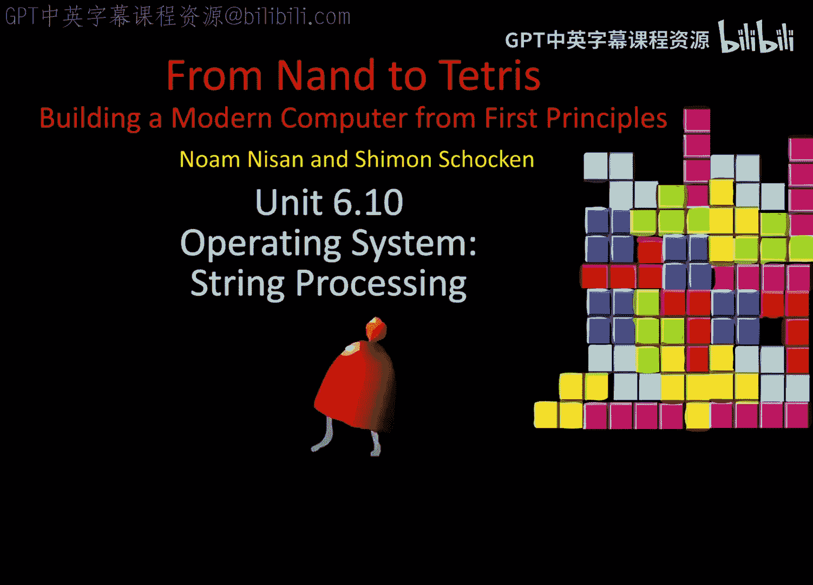
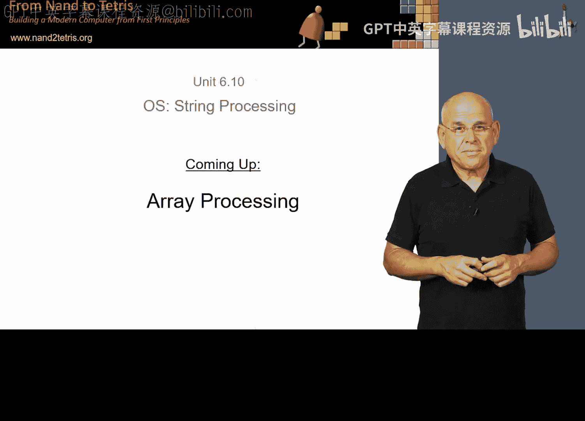

# 耶路撒冷希伯来大学《从零开始构建现代计算机2｜Build a Modern Computer from First Principles》中英字幕 p76 76_08_11_单元6-10_字符串处理.zh_en -BV1DA4m1w7FU_p76-

Welcome to this unit in which we are going to talk about string processing。

And in the jack operating system， strings are handled using a class called a string。So as you see。

 we are inching away through the operating system， one class at a time。

And you have to admit that this module has a lot of class。

So let's start with this string class and take a look at its API。

And we'll see that we have a constructor designed to create a new strings of a given length。

 something which is supplied by the client program that uses this service and wants to create and manipulate strings。

Then we have a disposal。Quite naturally， as we should have in every class that creates objects。

 we should have one that knows how to destroys them and recycle their memory resources。

 which happens all the time with strength。Then we have an accessor that returns the length of the current string。

And we have a method called CAt， which returns the character in the given index in the current string。

 set CAt， which sets this character to some desired integer。 I'm sorry to some desired character。

And we have an append car which takes the character and appends it to the end of the current string。

And then we have a set of additional methods like erase the last character。

Provide the integer value of the current string， assuming that the characters in the current string are digits。

And we have a set in， which takes a particular number。Integer value and turns it into a string。

 So a value like 123 becomes the three characters that represent the digits 1，2， and 3。

And then we have three more methods that return the character。

 the I'm sorry the ASI values of new line backspace and double quote。

 which is convenient to have because well first of all。

 programmers routinely forget what these values are and there's no reason in the world to remember them and second of all。

 if you use these method calls instead of actual constants， your code will be far more readable。

So these are the methods or the API of the string class and。You may ask yourself， were these。

No method names and structures and signatures came from。 well， when we designed the operating system。

 we decided to use this particular API based on our experience and taste and whatnot。And in fact。

 this API is quite similar to the API of the string class in in other object based languages。

 although there's some syntactical differences， of course。 but in essence。

 it's it's pretty much the same thing。 Now， before we open up the string class for implementation discussions。

 I'd like to。Iustrate how strings are actually being used。 So let's take the perspective of a client。

 And here's some client code that creates。Or actually declares a string called S and an integer variable called X。

 and then the client goes on to construct a string which has the maximum length of 6 and the actual length of 0 because it contains no characters yet。

And now the client appends the character 97 to S 97 happens to be the askI code of a。

 and so now the string contains the code the stringer A。If we now append 98， the string becomes AB。

ABC， ABC D， you know I just follow what the client code says if I now ask what is the length of this string。

 I get the number four which is the actual length， once again。

 not the maximum length but the actual length which changes all the time when you do string manipulations。

And here's an example of starting with an integer value， 314， you know。

 some 16 bit value and turning it into the three characters，3，1， and 4。

Which internally are stored as three Sque values。 So what you will actually see inside the string now is。

The S code of 3。Which， I think is。Let's see。 the askI code of 1 is 49。 So it's 49，50。 It's 51。

 So we see the the number 51， which is the askI code of 3。And then the number 50， which is。

 I'm sorry。 then then the number 49， which is the ASI code of one。And then 54，53， I think。

 which is the Ski called of4。 The details are not important， right。

 but you have to understand the difference between a binary value that represents an integer value and three characters that represent the string equivalents of this particular example。

Intvalue does exactly the reverse。 Intvalue takes looks at the string and says even though this string consists of three characters or you know as many characters as they are。

 I'm going to treat them as an integer。 so we have to take these three ASI values and convert them into an integer。

 once you do it you can multiply it by two as I did here。

 just in order to dramatize the difference between a character or a string value and an integer value of a bunch of digits that happen to be characters that happen to be digits。

😊，So if you're not sure what I'm talking about， stop the tape and think about it for a few minutes using the API that I showed you before and everything will become clear。

Alright， so that's the client view。 And in particular， the two most interesting。

M methods here are the set int method which turns integers into strings and the in value method which turns strings into into ints and what I'd like to do next is discuss these two methods because they are in fact the only challenging things that we have to do when we set out to implement this class al right。

 so we're going to present you know two general purpose algorithms for converting integers to strings and strings to integers beginning with int to string。

So let's see。 we have a particular value， which is an integer。

And we want to convert it into a string。So let's take some values as In example。

 Let's say that the value is 1，2，3， which， you know， the number 100。123， that's the value。

 We want to convert it to a string。What can we do？Well。

 we can look at this number and decide that we start with the rightmost digit。

Which happens to be three。Right。Now， how do we extract this digit from a 16 B value。Well。

 we can apply some modular 10 operation on this value。

 and modular 10 always gives you the last digit of any given number。

 right if you take some decimal number， if you divide it by 10 and take the remainder。

 you will get the right most digit。 So using modular 10。

 we are going to extract the right most digit。And。If the number is just one digit。

 you know if it's less than 10， we are done， we take this number。

 we convert it to ASI and we return it。's that's all we have to do。 So let's see。

 is this what the algorithm says， Yeah， last digit is value module 10 and then I take the character that represents the last digit and if the value is less than 10 I'm done。

 I return this digit as a string or as a character and I'm home free。

But what happens if it's not less than 10， Well， if it's not less than 10， I have more work to do。

 right？In this example， I started with a value 123。 So I extracted 3。And1 23 is greater than 10。

 So have more work to do。So now I would like to chop off the rightmost digits。

And focus on what remains， right what remains are the digits  one and2。

How can I chop off the rightmost digit， I can take 123 and divide it by 10。 this is integer division。

 so 123 divided by 10 is 12。So that's great because I got rid of the rightmost digit F 12。

And now I can apply exactly the same algorithm on this 12， right。

 And I hope that if I apply it recursively， then it will focus on the rightmost digits， which is2。

And then I will focus on the 10 and so on and so forth。

 I think you got the picture and here is how I do it。I。Shorten the input by divided by 10。

And then I apply the same algorithm to it， and I append the C that I computed in the current method invocation to whatever this algorithm is going to return。

So this is a classical recursive operation。As we drill down the recursion。

 I'm making this thing shorter and shorter。 You know， the input becomes shorter and shorter。

 and in each drill down， I compute the C of the current recursive recursion level。

 and because recursion you know， grows the stack as we learned in previous units。

 all these Cs remain in various levels of the recursion。

 And as I unwind from the recursion as I return from these recursive cause。

 I'm going to do append app pen app pen append append app pen and I'm going to end up with a string。

That holds the character equivalentence or the EI codes of all the digits that made up 123。

So that's how I convert integers to strings。What about the reverse。But the reverse is I think。

 somewhat easier。 We have to convert a string to integers。 So what will be the string。

 Let's say that the string is。Double quote 1，2，3。 Okay， so 1，2，3 within double quotes。 So internally。

 you know， we are not going to have 1，2，3。 It's it's a string， right。

 So we are going to have the S codes of one followed by the S code of 2， followed by the S code of 3。

The ASI code of1 is I think， as I said before 49， then I' going to have 50 and 51， 49， 50， 51。

 this is going to be the value of STR。How do I turn it into an integer？

Well it's not terribly difficult， I can start going from left to right from the you know。

 most significant character， so to speak to the least significant character。

And if I have 123 or the characters of  one，2 3， I can take the left one。Which is 50， the F code 50。

And I can convert it into an endt。 That's the very easy conversion。 I will get the number one。Then I。

 I remember this one， and I look at the next character。 You know。

 the next character is going to be 50，50 stands for2。So what I can do now is take what I had before。

 which is one multiplied by 10。And add to it， the integer value of the S coded 50。

 So I'm going to get 10 plus 2， which is 12。Great， okay， because remember， the input was 1，2，3。

And now I shift my attention to the next character， which is the ASI code of 3， which is 51。

And I take the int value of 51， which is3。And then I take what I had before， which is 12。

 multiply times 10。I to83。 so I get 123。And then I'm out of characters， so I'm done。

So this logic by and large is shown here on the screen。If my explanation was confusing。

 I recommend that you stop the tape and play with some other example。

 convince yourself that you understand what's going on。

But I wish to remind you that I allow myself to be somewhat remiss about all these algorithmic discussions because this is not a course about algorithms。

 It's a course about building computers and we are now building an operating system。

 So I don't want to you know belaor too much of these algorithms because that's not the point。

 The point is to build an operating system。But once again。

 we have a fantastic opportunity to show some beautiful algorithms， so that's what we are doing here。

 but it's up to you to decide how deep you want to delve to dive into these examples。😊。

So here are some implementation notes and advice on how to。Implement this string obstruction。Well嗯。

We have to create objects that represent strings。And if you think about it。

 you will realize that the most sensible way to do it is to represent any given strength as an array。

That contains character values。You know， integers that stand for EC codes。

And so this this will be one field， one field of the array， I'm sorry。

 one field of the string object， one characteristic or property of the string object is going to be the array that contains all the data of this string。

And the other field which makes sense to implement is the length， the maximum length of this。Of this。

 I'm sorry。The actual length of this string， which varies。

From one point to another throughout the strings life cycle。

All right so here's how we construct this string， we have a constructor called new as usual。

 the user says you know build me a string which is at most 100 so we create an array which is 100 entries long。

 we set the length to0 because presently this string contains nothing and we return the base address of this string to the collar。

And that's the new。 So that's， that's the constructor。So with that in mind。

I think that everything else should be self explanatory。 You know。

 all these methods that you see here， length of current， set correct and so on。

Can be easily implemented using manipulations of the SDR array。And int value and set in。

Are jack implementations of the two algorithms that I saw that we saw previously in this unit。

 and finally new line backspace and double quote these trivial functions simply returned。

The ASI values is 128， 2934， which happened to be the ASI values of these three characters。

And that's it。 So we are done with a string class， and we'll happily move to the next unit in which we are going to talk about。

😊，Implementing array processing。

