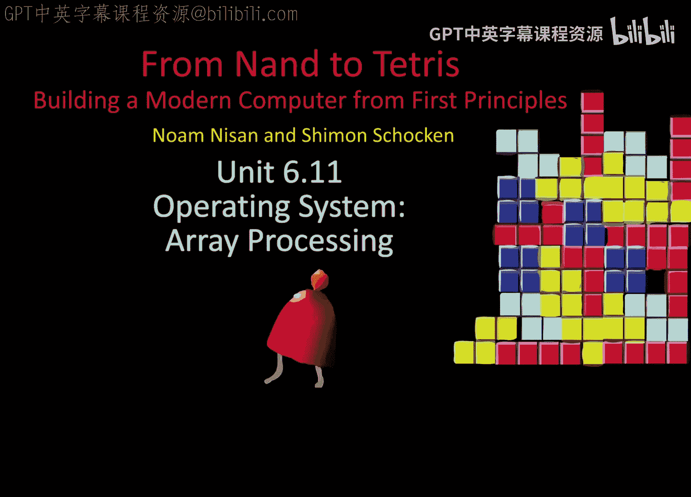
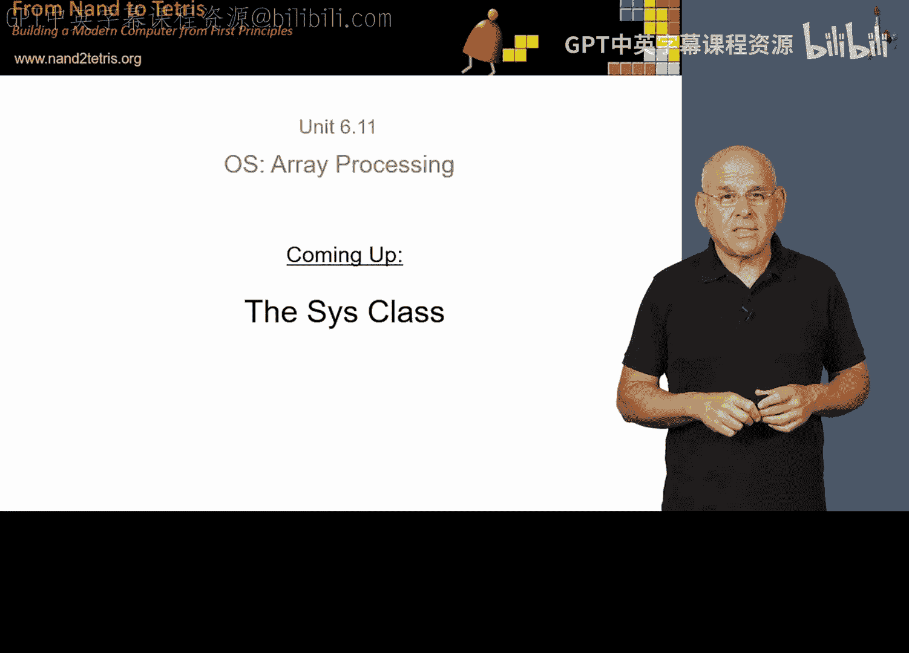

# 耶路撒冷希伯来大学《从零开始构建现代计算机2｜Build a Modern Computer from First Principles》中英字幕 p77 77_08_12_单元6-11_数组处理.zh_en -BV1DA4m1w7FU_p77-

So welcome to array Pro by the J operatinging System。In fact， when I think about it。

 array processing is not a great title for this unit。

 it should have been called arrayray representation。For reasons that I think will become clear。

As we discuss what lies ahead so we are building the operating system and we are focusing on the array class and the API of the array class is trivial。

 We have only two subroutines， the first subroutine is designed to create a new array of a given size and the second subroutine is designed to dispose。

The array on which it was called to， to operate。So before we get started with the implementation。

 let's take a client's perspective and here is a piece of code that creates to array A and B。

And then the client says construct a。Construct an array of size 3 and let a point to it。

And then we set a2 to some arbitrary number， and we constructed another array and we set B to point at it and then we set B1 to be a2 minus 100 and so and so forth and then at some point we say a dot dispose。

 So what you see here are typical array creation and manipulation commands。And already now。

 you see that the term array processing is not。Ideal for this unit。Because。

Aray processing proper is not handled by the operating system。 It is handled by the compiler。

And we spent a whole unit talking about co generation for operations like B1 equals a2 minus-100。

 So this is。Aray processing is mostly the jurisdiction of the compiler， not the operating system。

 whereas the operating system， at least in Jack has to worry about two things only。

Creating an array and getting rid of it， which are mostly representation， kind of。Of operations。

All right， so how do we do it？Well， notice that。Curiously enough。

 the new subroutine is not a constructor， but rather a function。And。Why is this？

A function and not a constructor。Well， let's think about it。If it were a constructor。

Then when the compiler would compile this。This class。

 and I wish to remind you that the operating system has to be compiled like any other program out there。

Windows has to be compiled， Uni has to be compiled。

 they are all programs that at some point have to be compiled。So if this were a constructor。

 then the code that the compiler would generate for this constructor。

Would be programmed by design to go to the symbol table of this class。

And count how many fields are being。Use to represent objects of type array。And you know， in Jack。

 everything is 16 bits。 So it's easy， but in other languages。

 it will also look at the the length of each of these fields。 And then based on all this information。

It will call aoc to create space in the Ram for the newly constructed array object。And yet。E raises。

Have no feels。Right。So if this were a constructor， the constructor would go to look for all this information in the symbol table and there will be no symbol table。

 So quite frankly， I don't know exactly what will transpire。

 but I'm sure that something good will not come out of it。

So in order to avoid all this sort of unnecessary。Symbol table， access and processing。

 we simply use a function。When the compiler compiles the function， it doesn't go to the symbol table。

 it doesnt does do anything special。All we sorry， All we have to remember， however。

Is that no one is going to call a look for us。Because this is not the constructor。

 So we have to call aoc explicitly。So， when you write this function。

I must admit it's such a trivial function。 It's embarrassing to talk about it so much。

 You have to call memory aoc and then return the address of the newly constructed。

Or Ram area to the collar。And then the caller can start populating the array with the values and so on。

 and then it will be the business of a compiler to figure out。What the client wants to do。

What about disposing an array Well， once again you have to write this function。

 once again it's a trivial function， all you have to do is call the alloc and memory the alloc will do its magic to recycle the Ram area which was held by this array。

So that's it， that's what I had to say about the array class and we almost done。

 you know we have one more class to go and we'll complete the design of the J operating system。

 so I will see you in the next unit where we're going to talk about the cis class。

