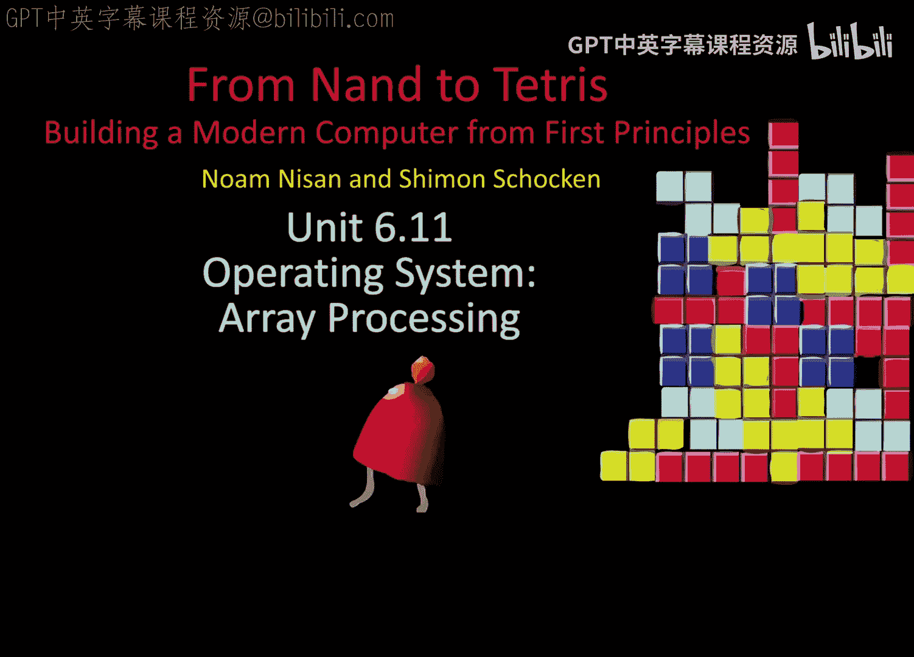
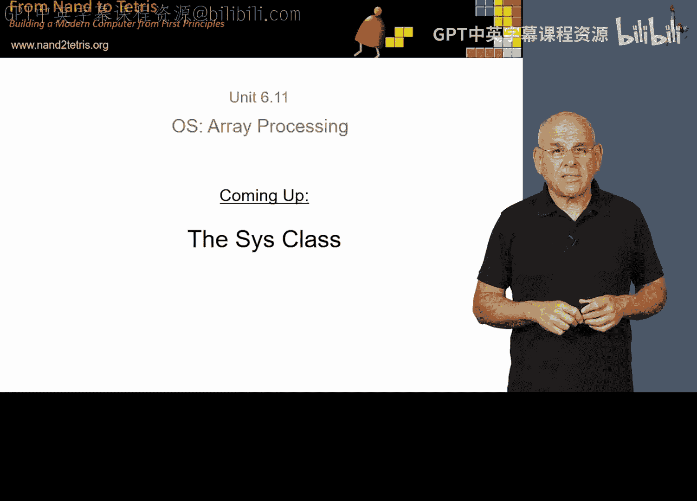

# 从零开始构建现代计算机2：单元6-11：数组处理 🧮



在本节课中，我们将学习操作系统中的数组处理。更准确地说，我们将探讨数组在内存中的表示方式，以及操作系统如何创建和销毁数组。我们将重点关注数组类的实现，其API非常简单，仅包含两个子程序。

## 数组类概述

上一节我们介绍了操作系统的基本结构，本节中我们来看看数组类。数组类的API设计得非常简洁，它只包含两个核心子程序。

以下是数组类的两个主要功能：
*   `new`：创建一个指定大小的新数组。
*   `dispose`：销毁调用该方法的数组。

## 从客户端视角看数组操作

为了更好地理解这些功能，我们先从一个客户端的角度来观察。客户端代码会创建数组并进行操作。

以下是一个典型的客户端代码示例：
```java
// 创建两个数组引用
Array a, b;

// 构造一个大小为3的数组，并让a指向它
let a = Array.new(3);
let a[2] = 77;

// 构造另一个数组，并让b指向它
let b = Array.new(1);
let b[1] = a[2] - 100;

// 在某个时刻，销毁数组a
a.dispose();
```
这段代码展示了数组的创建、赋值和销毁过程。值得注意的是，像 `b[1] = a[2] - 100` 这样的数组元素操作，其处理权在于编译器，而非操作系统。我们之前已经用整个单元讨论了编译器如何生成此类操作的代码。

因此，操作系统（至少在Jack语言中）只需要关心两件事：**创建数组**和**销毁数组**。这主要涉及数组在内存中的表示。

## 实现细节：为何使用函数而非构造器

现在，让我们深入探讨如何实现这些功能。首先，请注意 `new` 子程序被设计为一个函数，而不是一个构造器。这是有原因的。

如果 `new` 是一个构造器，那么编译器在编译这个类时，会去查询该类的符号表，以确定需要为 `Array` 类型的对象分配多少内存空间（即计算其字段的总大小）。然而，数组对象本身并没有字段。因此，使用构造器会导致不必要的符号表访问和处理，甚至可能引发问题。

为了避免这种情况，我们选择使用一个普通的函数。当编译器编译一个函数时，它不会去查询符号表或做任何特殊处理。但我们必须记住，由于这不是构造器，系统不会自动为我们调用内存分配器。因此，我们需要在函数中显式地调用 `Memory.alloc`。

`new` 函数的实现非常简单，甚至有些微不足道。它的核心就是调用 `Memory.alloc` 来申请一块指定大小的连续内存空间，然后将这块新内存区域的首地址返回给调用者。之后，调用者（通常是编译器生成的代码）就可以开始向这个数组中填充值了。

## 实现细节：销毁数组

至于销毁数组的 `dispose` 函数，其实现同样直接。它也是一个非常简单的函数，主要任务就是调用内存管理模块中的 `Memory.deAlloc` 方法。`Memory.deAlloc` 会施展它的“魔法”，回收被该数组占用的内存区域，以便后续重新利用。

## 总结与过渡

本节课中，我们一起学习了操作系统中的数组处理。我们了解到，数组类的核心功能是管理数组在内存中的生命周期——通过 `new` 函数创建内存空间，并通过 `dispose` 函数回收内存空间。具体的数组元素访问和运算则由编译器负责。

至此，关于数组类的讨论就结束了。我们的操作系统构建之旅也接近尾声，只剩下最后一个类需要完成。



在下一单元，我们将讨论 **Sys类**，完成整个J操作系统的设计。