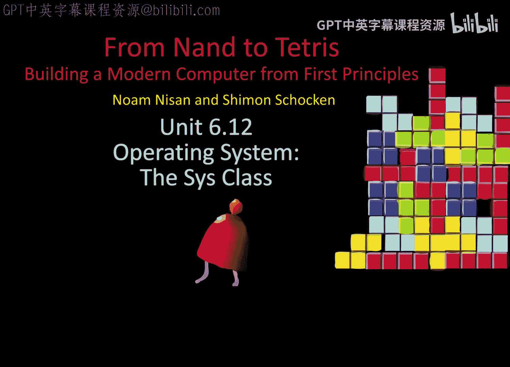
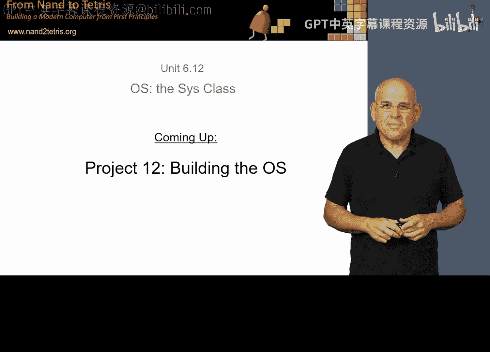

# 耶路撒冷希伯来大学《从零开始构建现代计算机2｜Build a Modern Computer from First Principles》中英字幕 p78 78_08_13_单元6-12_Sys类.zh_en -BV1DA4m1w7FU_p78-

So welcome to Unit 12。In our operating system module in which we are going to develop the cis class。

 the last class in our operating system， yeah。So let's see what it takes to implement the Cs class。

Well。The cis class consists of， I think， four methods。

Of which the most interesting one is a private method that users don't get to see。

And this is our in it function。Now， I wish to remind you in Jack。

 we don't have public and private modifiers。For class members。

But we can write functions and simply not tell the world about them and in it is one of these functions which is absolutely necessary for the operating system。

 but this function is used strictly for OS services。

 as I will just set out to describe before I do so。

 I want to take a diversion and say a few words about bootstrapping。Sometimes called booting。Well。

 I wasn't sure exactly what how to define bootstrapping。

 so I went to Wikipedia and Wikipedia said that bootstrapping is the process of loading the basic software into the memory of a computer after power on or general reset。

 especially the operating system。Which will then take care of loading other software as needed。

 So that's what。Wikippedia says so it must be true。And in fact， it is true because， you know。

 think about it when you turn on your laptop， what happens？Well。

 there is some software which is burn into your computer。And this little software goes to the disk。

 loads the operating system kernelnel， then the most important part of the OS。

 the OS starts running and sets itself to do all sorts of things。

And then it loads another program that， you know， shows the windows on the screen。

 and then you can select some word processor。You know， writerite something or email or whatnot。 So。

 you know， this description here is actually quite apt。Now。

 what do we have to do in order to make this magic happen， And indeed， it is a magic。 You know。

 you take a piece of electronics。😊，And push a button and then boom， you know。

 it starts to play a tet with you or sound music or watch a movie or whatnot。 it。

 It is absolutely magical。 How do you make this magic happen。😊，Well in the jackHck platform。

 we do it using four different contracts that all of them have to be fulfilled at various levels of the computer。

So first of all， the hardware contract is that when the computer is reset。

 execution always starts with the instruction， which happens to be located in Ro 0 this is equivalent to this software which is burn into the realm of your computer。

All right。 now the VM contract is such that。The VM translator。

 when it translates the program that you want to run。Always puts at the top of the rom at Rom 0。

 it puts the following two instructions， set the stack pointer to 256。

 which is a heer VM convention and call Ss in it。 These commands must be written in machine language。

 of course， not not in the VM language。 So this is just cellel code。All right。

 the next contract is coming from Jack and if you recall when you write a program like Te or whatever or an accounting software or whatnot。

There must be one class called main and within this class there must be one method called the main。

 and this is the entry point to your application。And you find such conventions in every programming language and and Jack is no exception。

 So this is something that the Jack programmer is responsible for providing。

If you take all these things that is written here into account。

 you will see that in order to complete the bootstrapping picture。

 what remains to be done is to cause cyst in it。Well， first of all。

 you have to have a ci in it because。The room is going to call this method。

 so Cs in it should be a function which is available in the operating system somewhere， well。

 most naturally in the cis class。This in its function should do two things。 first of all。

 it should initialize the operating system so that the OS would be ready to perform all its super important operations when when the application programs will start using its services。

And then ci in it calls main dot main。And by doing so， Sis init achieves two objectives。

 first of all， it sets up the OS and second of all。

 it fires up the application that the user wanted to run。So。

You knowIf you take all these contracts together， you get how we implement the bootstrapping logic on our computer and it's kind of intriguing that these contracts have to be fulfilled by very different agents。

 if you will， the builder of the hardware has to do something。

 the person who or the team that implements the VM translator must obey this contract。

 the jack programmer must obey the contract， the team that builds the operating system。

 but if each one of these teams that may well have never met each other。

 plays according to the rules of the game， then everything will work smoothly like a great symphonic orchestra。

All right， so let us open up the Ss class and the first thing that I want to discuss is indeed this in it。

Function。And as we just discussed， the image function should， first of all， go through all。

The O S classes that have an in it function and call them one by one。So， this would cause。

Every one of these classes to get initialized， so math is going to create whatever it needs in order to do mathematical computations。

 memory will create the arrays that it needs in order to access the RA。And so on and so forth。

 So for every class that has an init function， we have to call it some。

 some some voice classes don't have an init function。 So we don't have to call them like array。

 I think， doesn't have one。So after we call all the in functions of the OS classes that have init functions。

 then we simply call main dot main and that's it and then from this point on。

Everything that happens is at the mercy of the programmer that developed the high level application。

So that's the init function， which is by far the most interesting function in this cis class。

Then we have a few more utilities。Which are necessary but not terribly exciting。

We have a halt utility。That is designed to stop the computer in whatever it is it's currently doing。

And I shouldn't say stop， but it's designed to create the illusion that the computer has stopped because。

You know， one way to implement this whole thing is simply to put the computer into an infinite loop。

 So that's what you can do if you want to。 It's not probably the most elegant way to do it， but。

It works。Then we have a weight function。Which is necessary when we implement all sorts of interactive programs and we want to control the length of various operations and so on。

 we deal with user interaction。So the weight function， according to its API。

 receives a certain parameter， which is the duration in milliseconds。And it waits for that duration。

So if you provided the number three， it will wait for3 milliseconds。Now。How should you implement it。

 Well， once again， I recommend that you use the loop。

And the loop should have some delay factor in it， some constant。

That playing with this constant will cause you， will help you。Make sure that。

The runtime of this loop will be such that it conforms to the required duration。

So if your computer is very fast， then the delay factor will have to be large because you want to slow it down。

If your computer is slow， you will want a small delay factor to make this loop operator fast enough。

 so you have to get yourself you know a watch or you can use your cell phone for this and write this loop and then time it。

 you know play with different values of this delay factor until your loop conforms to what you want to do。

So， you know， it's very difficult to time 1 millisecond because it's a thousands of of a second。

 So you can time how long this loopper runs， let's say， for。For 5000 milliseconds。

 which is five seconds。And then， you know， if， if， if the loop ended in three seconds。

 then you have to do something to a delay factor or to。To play with it。

 So you'll get a weight implementation， which is platform dependent。 You know， it depends on your。

On the strength of your， of the processor of your own computer。 And that's， that's okay。 You know。

 operating systems have some platform specific parameters。 And this is one of them。Finally。

 we have a housekeeping utility called error， which simply you know receives some number of an error code and prints it nicely on the screen and this is a。

So trivial that I don't want to discuss it。And that's basically our cis class， which is also。

The last class in our operating system。And I think that it it has some。

Poetic beauty in it that this class， which is last。In our OS。

 in terms of you know and the order of development is also the class。

That implements the beginning of everything。 you know， because that's what in it。Is designed to do。

And。So this reminds me of a quote by I think T S。 Elliot。

 who said that we will not ceaseize from explorations。And when we come back。

We will know the place for the first time。And I think that this quote is very relevant to this course because。

Because you guys were willing to go through all these explorations and go deep and wide inside the computer in general and the OSA in particular。

When you come back from these explorations， you all of a sudden understand this thing。

 all of a sudden， you know things like allocating space in memory， drawing circles。

 converting strings to numbers and vice versa。 all of the sudden。

 these things are no longer a mystery。And they are no longer a mystery because you guys had the character。

To sit through all these lectures。And， you know， and， and not。Lose your consciousness in the middle。

 I hope， and you also have the character to build this thing。Which is what we'll do。In the next unit。

