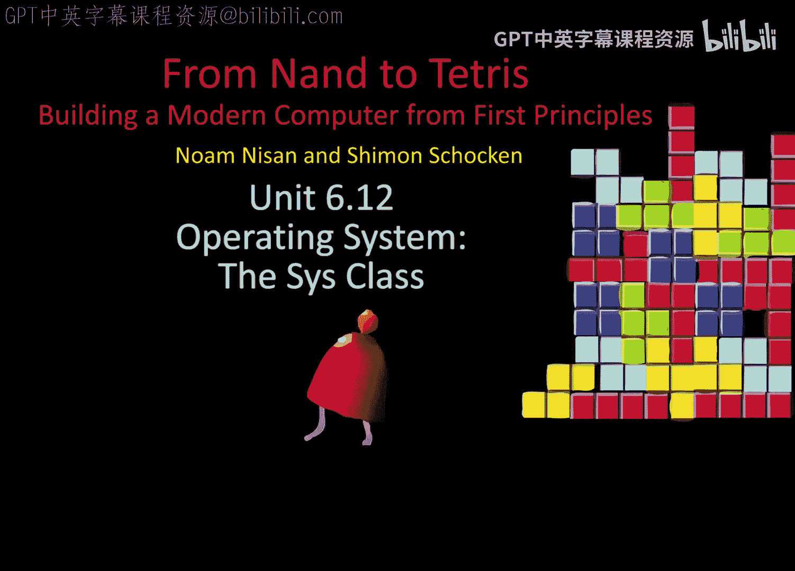
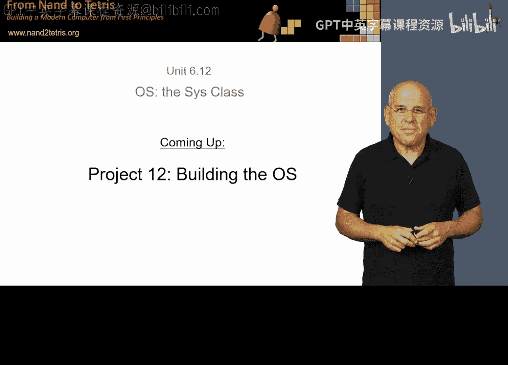

# 从零开始构建现代计算机2：单元12：Sys类 🖥️



在本节课中，我们将学习如何实现操作系统的最后一个类——Sys类。Sys类包含几个关键方法，它们负责系统的初始化、控制以及错误处理，是连接硬件、虚拟机、操作系统和用户应用程序的桥梁。

## 系统初始化与引导程序 🔄

上一节我们介绍了操作系统模块的整体结构，本节中我们来看看Sys类的核心功能。首先，我们需要理解“引导程序”的概念。引导程序是指在计算机通电或重置后，将基本软件（尤其是操作系统）加载到内存中的过程。随后，操作系统负责按需加载其他软件。

在Jack平台上，实现引导需要满足四个不同层面的约定：

1.  **硬件约定**：计算机重置时，执行总是从ROM地址0处的指令开始。
2.  **虚拟机约定**：VM翻译器在翻译程序时，必须在ROM顶部（地址0）放置两条机器语言指令：`SP=256` 和 `call Sys.init`。
3.  **Jack语言约定**：每个Jack应用程序必须包含一个名为`Main`的类，且该类中必须有一个名为`main`的方法，这是应用程序的入口点。
4.  **操作系统约定**：操作系统必须提供一个`Sys.init`函数。

当所有这些约定都被满足时，引导过程得以完成：硬件从ROM 0启动，执行VM设置指令并调用`Sys.init`。`Sys.init`函数随后初始化操作系统，并调用`Main.main`来启动用户应用程序。

## Sys.init 函数详解 ⚙️

`Sys.init`是Sys类中最关键的函数，尽管它对用户是隐藏的。它的主要职责是初始化操作系统，然后启动用户程序。

以下是`Sys.init`函数需要完成的两个主要步骤：

1.  **初始化操作系统组件**：遍历所有包含`init`函数的OS类（例如`Math`、`Memory`），并逐一调用它们的`init`方法。这确保了操作系统各服务在应用程序使用前已准备就绪。
2.  **启动用户程序**：调用`Main.main()`方法。从此，控制权便交给了用户编写的高级应用程序。

## 其他实用方法 🛠️

除了`init`，Sys类还提供了一些必要的实用方法。

### halt 方法

`halt`方法用于停止计算机的当前运行。一种简单的实现方式是让程序进入一个无限循环，从而制造出计算机已停止的假象。

**代码示例**：
```jack
function void halt() {
    while (true) { }
}
```

### wait 方法

`wait`方法用于实现延时，这在开发交互式程序时非常有用。它接收一个以毫秒为单位的时长参数，并让程序等待相应的时间。

实现`wait`的关键是使用一个循环，并通过调整循环内的“延迟因子”来控制总耗时。这个因子是平台相关的：在较快的计算机上需要更大的值来减慢循环，在较慢的计算机上则需要较小的值。

**实现思路**：
1.  使用一个循环。
2.  在循环体内进行空操作或简单计算以消耗时间。
3.  通过实验（例如用秒表或手机计时）校准循环次数，使其符合指定的毫秒数要求。

### error 方法

`error`方法是一个简单的内务处理工具，它接收一个错误代码，并将其清晰地打印到屏幕上。其实现非常直接，此处不再赘述。

## 总结 📝

本节课中我们一起学习了操作系统的最后一个类——Sys类。我们深入探讨了系统引导的完整链条，它需要硬件、虚拟机、编程语言和操作系统共同遵守约定才能实现。我们详细分析了`Sys.init`函数如何初始化OS并启动用户程序。此外，我们还了解了`halt`、`wait`和`error`这些实用方法的作用与实现思路。



正如T.S. Eliot的诗句所言：“我们不应停止探索，而所有探索的终点，都将回到起点，并第一次真正认识此地。” 通过这门课程，你们深入探索了计算机与操作系统的内部奥秘。当完成这些探索后，你们将对内存分配、图形绘制、数据转换等概念有全新的、透彻的理解，因为它们不再是神秘的黑箱，而是你们亲手构建过的系统的一部分。在接下来的单元中，我们将亲手实现这一切。