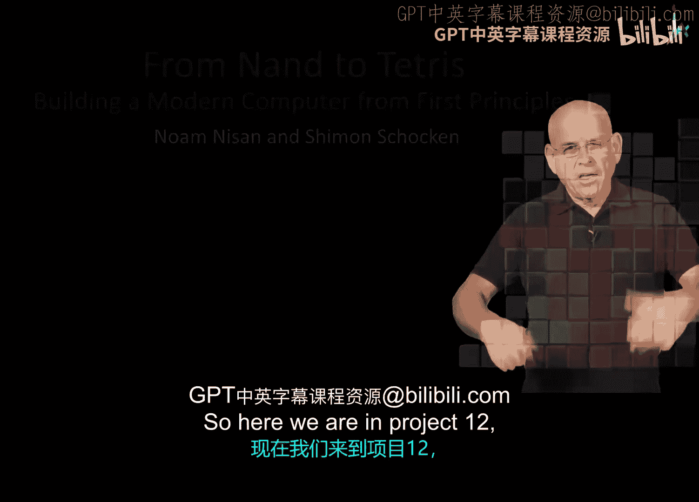

# 耶路撒冷希伯来大学《从零开始构建现代计算机2｜Build a Modern Computer from First Principles》中英字幕 p79 79_08_14_单元6-13_项目12：构建操作系统.zh_en -BV1DA4m1w7FU_p79-

So here we are in Project 12， the last and final project in Anthetriris in which we are going to build our operating system from the ground up。

Here is the operating system in all its glory， consisting of eight different classes。

 each designed to service you know some other functionality like memory management。

 screen management， keyboard management， and so on。😊。

And I wish to remind you that at least in this form of description。

 the operating system is nothing more than an obstruction。

It is basically a set of APIs that describe what the operating system can do for you or for other application programmers。

For example， let us sample one class from this set of eight classes。

 screen and take a look at this class description。Basically。

 what we'll see is a set of subroutine signatures each describing how to use it for its effect。

And this documentation is aimed at application developers。

So an application developer can write some code in any class that Hiosshi desires。

 and this code can use the services of the screen OS class。

 it can draw lines and rectangles and circles and whatnot。Now。

 if this were an introduction to computer science course or you know many other courses in computer science。

 then we would have been content with this level of description。

 the API of the operating system because we view the OS from a user's perspective。

But in none to Tetriris， we don't take anything for granted。

 and so we are going to actually build and realize this operating system from scratch。

And in particular， in Ntetriris， we are going to find three different implementations of the same OA obstruction。

First of all， the supplied VM emulator， which is a fancy Java program that we wrote several years ago。

 well this VM emulator also has a built in Java based implementation of the J operating system。

So when you execute a program in the VM emulator， if you find a call to let's say， memoryory。aloc。

 the VM emulator knows how to service it using Java。

Also we provide a completely different implementation of the JOS in this folder here。

 which is now on your computer because it's part of the Nanttetriris soft suite that you have downloaded at the beginning of the course。

 basically it's a set of eight VM files which are the compiled version of the operating system that we wrote also using the J language。

And in Project 12， you're going to do exactly the same thing。

 you're going to write these eight OS classes inject yourself， and after you compile them。

 you will get your own set of eight VM files which presumably will deliver the same functionality as our VM OS classes。

They will not necessarily be the same code， but hopefully they will have the same behavior because they implement the same or they seek to implement the same API。

Now， before we go on， I'd like to say a few words about reverse engineering。

 which is an important technique in the software developers toolbox。

So let's assume that we want to implement some existing operating system。

And let us assume further that the operating system naturally consists of several executable modules。

These modules are standone classes， for example， in some language like Java or C++。

They are executable， so they don't have the source code。

 and they also interact with each other intensively。

 as you know often happens in a complex program like an operating system。

How would you go about writing this software from scratch， after all， you don't have the source code。

 You have only the executables for each module in the O S， you can focus on this module only。

Develop the source code of this module separately。And use the remaining n minus1 executable modules to support it。

So if your module will call a method in some other executable module for its effect， you know。

 the executable module will be there to service the call。

So that's a very nice and elegant development strategy and if you just follow it step by step。

 then after end stages you will end up developing the whole operating system yourself。😊，By the way。

 this is exactly how systems like Gu UniX and Linuxux were developed。

The developers of these systems started from an existing executable well known operating system。

 Unix， and they went on to develop their own versions using reverse engineering。

 using precisely the same technique that we are using here。So going back to N to Tetriris。

 let us assume that we want to develop the screen class。

 which is one of the eight OS classes and test it using some supply the test code。

 which we call main dot check How should we go about doing it Well the development strategy is going to be surprisingly simple。

What we suggest that you do is that you take the Sc jack file that you want to develop and the supply the main dot jack and put them in some directory on your PC。

Then you can go on and compile the directory using the jack compiler Now what you'll get is a set of VM classes or two VM classes。

 screen do Vm and main do Vm that you can now go on to execute how will you execute it Well you will simply execute the directory in the VM emulator。

Now， think about it。 The VN emulator has built in implementation of the operating system。

But if it finds a user implementation of any VM function， including let's say。

 a draw rectangle or draw line， you know functions that you have written in J and compiled and transformed into VM functions。

 then the VM emulator is going to use your implementation instead of the built in implementation。

 So what you get is exactly the ideal setting for reverse engineering。

Now the VM emulator will first of all， execute your code。

 including your own implementations of the OS subrouts and all the other OS subrouts。

 which may be called in process will be serviced using the built in OS version。

So that's how we're going to do it for every class in the OS。

So let's go on and continue with this example of the screen class because it will serve as an example of how to do all the other classes in the operating system。

Well this file is going to be supplied to you by us。 it is part of the Notetriris software package。

 it's part of Project 12 and I call this file stub file and I use this term and you know it's not a term I invented。

 it's a wellknown term in software engineering basically it's a skeleton of a class that contains the signatures of all the subroutines of interest in this class and notice that these subroutines include also the non-public subroutines that application programmers don't get to see In other words。

 you know this file was delivered to you by the system architect who said you know now go on and implement every every subroutine that you see here。

 including for example in it you know which is a subroutine that application programmers don't get to see。

Now how should you go about implementing this class Well we discussed it in several units in this module so you just go back。

 you reread if necessary the relevant modules in the relevant units in module 6 if you want you can consult chapter 12 in the book and then you just go on and implement every one of these methods using the jack language。

 so that's how you will develop the screen class what about testing it。Well。

 we are going to supply a test file and the name of this test file is going to be main DoJ and as you see。

 the test file calls all sorts of methods in the screen class。

And if you will run this directory on the VM emulator， then here is what you get to see。

 some simple picture which is designed to demonstrate that your screen class is well behaving。

So we are going to provide the Stub file and the test file and it's your job to implement the Stub file and bring it to a level that it can service the test file to your and our satisfaction。

Now， that's what you have to do with every one of the eight classes in the operating system。

So five of these classes are going to be designed in exactly the same technique using a supplied the Stub file and supply the main DoJ and the remaining three classes will be tested slightly differently using both JTSD and Compare files and all the details are in the project page in the Ntootetis website so I don't want to belabor on it because you can just go on and read it yourself。

Now， any one of these classes can be developed in any order that you fancy because you can always use the remaining seven classes to support it by default if you use our VM emulator。

And once you're done with these eight classes。We requested you do a final test and the final test will be to test the operating system that you developed in the context of a Pg application。

 And if you read the steps here， they will tell you exactly how to do it。

 So this will be the final test and once it passes this test。

 we can say that your operating system is well， it's not fully tested， obviously。

 but it's sufficiently tested to to ascer that you have completed Project 12 to our satisfaction。

So that's it。 and in the next unit， we'll go on to talk about some perspective on operating systems。

