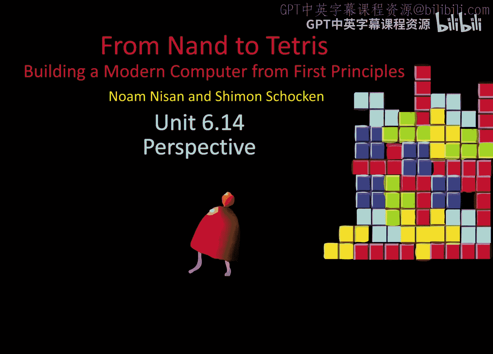

# 耶路撒冷希伯来大学《从零开始构建现代计算机2｜Build a Modern Computer from First Principles》中英字幕 p80 80_08_15_单元6-14_视角.zh_en -BV1DA4m1w7FU_p80-

So we are done building our operating system and we are at the very last unit of the very last module of NanttetriPA2。

 our perspective unit on operating systems so let's see what is our first question what are the major differences between the J operating system and regular operating systems。

Well， obviously， the J operating system provides very limited functionality compared to industrial strength systems。

For example， our OS supports neither multi threadreading nor multi processingces。

 and at the same time， the very kernel of typical operating systems is designed to do exactly that。

Also， we somehow managed to get away without building a file system。

Thanks to the very simple fact that the hec platform has no disks。Obviously。

 if you have to manage mass storage， a file system is an absolutely necessary obstruction and typically the operating system supports this obstruction。

What else， let's see？Most users expect to interact with computers via either command line shells and interfaces or some windowing system。

 and yet none of these goodies is featured by our operating system。

There are numerous other services that we don't support， like obviously security and communications。

Having said all this。I think that our OS still closes some significant gaps between the underlying hardware and application programs。

 and in doing so it hides numerous gory details， technical details and low level details from the application programmer。

And overall， it does this humble job in a rather elegant and clean way。And in that respect。

 I think that our OS provides a very good point of departure or starting point for anyone who wants to get a feeling of what it takes to design and implement a simple operating system。

Let's see what is the next question？How come the J O S is so wide open。

Programmers can do whatever they want。Well， first of all。

 this is very much in the spirit of Nanttotetriris in which everything is wide open and users are expected to treat both the hardware and the software systems as open laboratories。

And yet in reality， in most computers， the OS code indeed is considered privileged and accessing OS services and OS functions requires a permission mechanism that is more elaborate than just issuing a simple function call as we do in our system。

Also in most systems， the OS functions execute in a special protected mode that also allocates for them some additional hardware resources like clock cycles。

 for example。And yet， in our platform。The user level and the user level code and the OS code run in exactly the same execution level。

 And this， I guess， is quite unheard of compared to real computer systems。 But once again。

 it encourages a sense of experimentation and engagement。😊，All right。

 let's move on to the next question。How does the JOSOS rate in terms of efficiency？

That's a very important question。And I think that the two areas that are most relevant to this question are mathematical operations and graphics。

 I also think that in both of these areas， we did a reasonably decent job。Efficiency wise。

First of all， the algorithms that we presented for multiplication and division were efficient。

The big difference between the way we did it and the way other computers do it is that in other computers。

These algorithms are typically implemented in hardware。Rather than in software。

Yet both implementation approaches are based on exactly the same algorithmic ideas and insights。

In particular， the running time of the multiplication and division algorithms that we presented is O of n proportional to n。

 where n is the number of bits that we have to process or to say more precisely。

 the running time is O of n addition operations。And since adding up2 n bit binary numbers also requires O of n bit operations。

 it turns out that the total running time of any one of these algorithms ends up being n square or O of n square bit operations and as it turns out。

 o of n square is not bad at all。Now， there exist multiplication and division algorithms whose running time is asytotically faster than o of n square。

 but these algorithms begin to carry their weight only when you have to multiply and divide very large numbers of bits。

Which， in our case， is not really a problem。And what about graphics？Well。

 the line drawing algorithms that we presented are quite efficient。And yet， in most systems。

 these graphics primitives are typically implemented by a combination of software and special graphics acceleration hardware。

😊，These are so called GPUs。Serve to offload the central processing unit from carrying out complex high performance graphics like drawing 3D images and rendering smooth surfaces。

 something that requires a lot of computation power。

In the heckjack platform there is no such separation of responsibilities between the CPU and other dedicated processes。

 everything is being done by the poor CPU。So to make a long story short。

Operating systems is a huge area of research and practice。

 especially in a world in which computation is increasingly becoming more distributed， open。

 portable， and at the same time exposed to many different hazards。And therefore。

 we should expect to see dramatic improvements in the state of the art of operating systems。

 and I do hope that some of you guys will play a major role in these developments。

