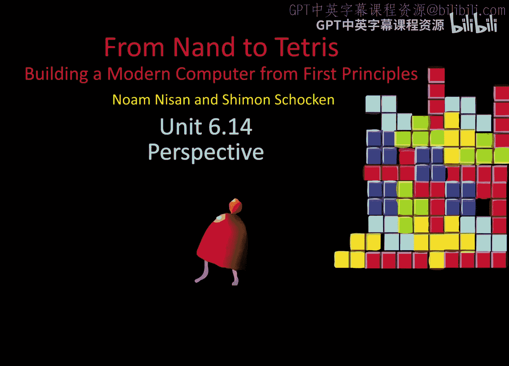

# 从零开始构建现代计算机2：单元6-14：视角 🧭

在本节课中，我们将回顾并总结我们构建的J操作系统，并将其与真实的工业级操作系统进行比较，探讨其设计理念、功能、效率以及未来展望。

---

## 概述

我们已经完成了操作系统的构建，这是Nand2Tetris项目最后一个模块的最后一个单元。本节将从宏观视角审视我们的J操作系统，分析它与常规操作系统的核心差异，并评估其设计效率与意义。

---

## J操作系统与常规操作系统的差异

上一节我们完成了操作系统的构建，本节中我们来看看J操作系统与真实世界中的操作系统有何主要区别。

J操作系统提供的功能与工业级系统相比非常有限。例如，我们的操作系统既不支持多线程，也不支持多进程处理。而典型操作系统的核心正是为了处理这些任务而设计的。

同时，我们巧妙地避免了构建文件系统。这得益于Hack平台没有磁盘这一简单事实。显然，如果需要管理海量存储，文件系统是一个绝对必要的抽象层，而操作系统通常支持这种抽象。

以下是其他一些我们未支持的功能：
*   用户通常期望通过命令行界面或窗口系统与计算机交互，而我们的操作系统不包含这些功能。
*   我们还不支持许多其他服务，例如安全性和通信功能。

尽管如此，我们的操作系统仍然弥合了底层硬件与应用程序之间的重要鸿沟。它向应用程序员隐藏了大量复杂、技术性和底层的细节。总体而言，它以相当优雅和清晰的方式完成了这项基础工作。从这个角度看，我们的操作系统为任何想了解设计和实现一个简单操作系统所需知识的人，提供了一个非常好的起点。

---

## 开放性与权限机制

了解了功能差异后，我们来看看J操作系统为何如此开放，允许程序员进行任何操作。

首先，这完全符合Nand2Tetris的精神，即一切开放，用户应将硬件和软件系统视为开放的实验室。

然而在现实中，大多数计算机的操作系统代码被视为特权代码。访问操作系统服务和功能需要一个比我们系统中简单的函数调用更复杂的权限机制。此外，在大多数系统中，操作系统函数在一种特殊的保护模式下执行，这种模式还为它们分配了额外的硬件资源，例如时钟周期。

但在我们的Hack平台上，用户级代码和操作系统代码在完全相同的执行级别上运行。与真实的计算机系统相比，这几乎是闻所未闻的。但这再次鼓励了实验和参与的精神。

---

## 效率评估

接下来，我们来探讨一个非常重要的问题：J操作系统在效率方面表现如何？

我认为与此问题最相关的两个领域是数学运算和图形处理。在这两个领域，我们都做了相当不错的工作。

首先，我们为乘法和除法提供的算法是高效的。我们的实现方式与其他计算机的主要区别在于，在其他计算机中，这些算法通常在硬件中实现，而不是在软件中。然而，两种实现方法都基于完全相同的算法思想和见解。

具体来说，我们介绍的乘法和除法算法的运行时间是 **O(n)**，与 **n** 成正比，其中 **n** 是必须处理的比特数。更准确地说，运行时间是 **O(n)** 次加法操作。由于将两个 **n** 位二进制数相加也需要 **O(n)** 次比特操作，因此这些算法中任何一个的总运行时间最终都是 **n²** 或 **O(n²)** 次比特操作。事实证明，**O(n²)** 的效率并不差。当然，存在运行时间渐近快于 **O(n²)** 的乘除法算法，但这些算法只有在需要乘除非常大的数字时才开始显现优势，而在我们的案例中，这并不是真正的问题。

那么图形处理呢？我们提供的画线算法相当高效。然而在大多数系统中，这些图形基元通常由软件和特殊的图形加速硬件组合实现。这些就是所谓的**GPU**，它们的作用是将中央处理器从执行复杂的高性能图形任务（如绘制3D图像和渲染平滑曲面，这些需要大量计算能力）中解放出来。

在Hack平台中，CPU和其他专用处理器之间没有这种责任分离，所有工作都由CPU独自完成。

---

## 总结与展望

总而言之，操作系统是一个巨大的研究和实践领域，尤其是在计算日益分布式、开放化、可移植化，同时面临多种风险的世界中。因此，我们可以预期操作系统的技术水平将出现显著的进步。我衷心希望你们中的一些人将在这些发展中扮演重要角色。

在本节课中，我们一起学习了J操作系统与工业级系统的核心差异，理解了其开放设计的理念，评估了其在数学运算和图形处理方面的效率，并展望了操作系统领域的未来发展方向。