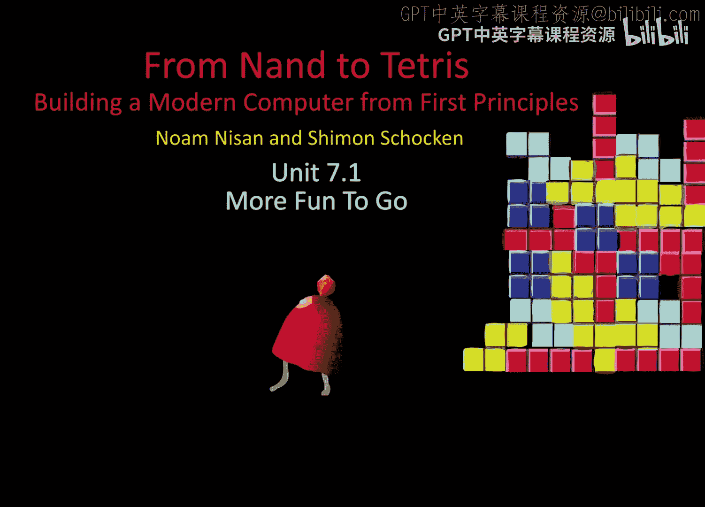

# 耶路撒冷希伯来大学《从零开始构建现代计算机2｜Build a Modern Computer from First Principles》中英字幕 p81 81_09_01_单元7-1_更多探索方向.zh_en -BV1DA4m1w7FU_p81-

Congratulations， we have finished building a modern general purpose computer system。

 hardware and software from the ground up。😊，So now that the task has been completed。

 we can look back and ask ourselves， how can we possibly make this computer better。

 how can we make it faster， more useful， more versatile。Well。

 that's exactly what we're going to do in this module in module 7。

Will present several extension and optimization ideas。

 and I bet that you guys can come up with similar ideas of your own。

Each one of these ideas can become the basis of a follow up Ntetriris extension project。

And in order to carry out each such project， you must first。😮，Beg with something called design， D ES。

 IGN design。You see， a good design holds the key to every successful hardware and software implementation project。

And so far in the course， the designers of Nanttotetriris were Nam and myself。

 we provided all the design documents， you know all the APIs， the standard implementation contracts。

 the test programs， the works， you guys played the role of system developers。

 working from our design。And indeed， Nor and I worked mighty hard to come up with well designed architectures and APIs。

 and we did it because we believe that implementing well designed systems is the best way to learn or at least begin to learn how to become a system designer。

 also known as a system architect。That's why we asked you to implement all these designs， you know。

 if you want to become a poet， you better start by reading some good poetry。

So what makes a good design good？Well， we can start with the obvious things， modularity， simplicity。

 elegance， clarity， beauty。😊，We didn't really talk during the course about all these things explicitly at least because。

You know， talk is cheap。Instead， we asked you to implement our designs and by doing so。

 we hope that you've developed an intuitive appreciation of what it takes to be modular， simple。

 elegant， clear， and beautiful。Now， you see once you get all these things in place。

 then the next design objective happens almost automatically。And this objective。

 which is probably the most important virtue of any hardware and software project or system。

 is the ability。To modify and extend the system with minimum husstle。

This is very relevant because you see that's what we want to do in this module。

 We want to talk about how to optimize and extend the hackckjack system。

And it's gratifying to know that the system that we are about to modify is well designed。

 It's gratifying， because。😊，Well designed systems， you know。

 lend themselves naturally to such modifications。So we'll be able to do everything in a manageable and predictable way。

For example， let's take multiplication and division。Presently。

 the heck value can only add and subtract。Therefore。

 even the trivial operation of multiplying by  two requires calling an OS function。

Which is very inefficient。Now， when you think about how to allocate your efforts among you know various possible optimization projects。

 you should always think about impact， you know， how can you get the biggest bank for the buck。Now。

 multiplication and division happen all the times in computer programs。

 and therefore it clearly pays off to try to optimize them。

So let's focus on how we can optimize multiplication because division is pretty much the same。

 very similar。Well， in I think it was unit 62， but I'm not sure， I think in unit 62。

 we presented a highly efficient bitwise multiplication algorithm， also in chapter 12 in the book。

So we presented this algorithm and then we went on to implement it using the Jack language。Now。

 if you want to speed up multiplication。We can take the very same algorithm and implement it not as an operating system function。

Written in Jack， but rather as a hardware chip written or specified in HDL。

Once you will have such a chip fully tested in place， you could integrate it into the heCC AU。

But this will also require extending the heck construction set。

Because you have to decide on some binary multiplication up code。 Otherwise。

 you won't be able to tell the A to multiply。Now， if you've extended the binary machine language。

 then you also have to extend the assembly language。

 you have to come up with some symbolic mneummonic for representing multiplication。And this in turn。

 requires that you also modify the asmbler that we built in Note Part1。You see。

 that's what design is all about。 You know， you have to。Decide what you want to do。

 and then you actually have to do it。So as you see。😊，Refactoring multiplication into the hardware。

 so to speak， entails， you know， a very nice sort of cross section surgery because。

It cuts through you and affects multiple layers in our computer architecture。

And because these layers are highly modular and well specified。

 every one of them or every one of these modifications can be done and unit tested separately。

Another thing which is missing in our AU is a bit shifting。

Bit shifting can really speed up you know things like multiplication division。

 as well as low level graphics graphical operations that manipulate pixels on the screen。

And so the trick once again， if you want to implement a bitshifting in hardware。

 is to design new chips and new instructions that carry out left shift and right shift operations at the hardware level。

And once we have these hardware capabilities。😊，We should consider modifying our translators to take advantage of them。

 to exploit them cleverly。For example。Whenever the compiler。Is has to multiply or divide。 I'm sorry。

 Let me rephrase it accurately。 When the compiler has to write code that multiplies or divides a number。

 which is a power of two。It can do so by generating code that uses bit shifting instead of standard multiplication。

You see， that's an example of what people mean when they talk about optimizing compilers。

And by the way， in this module， when we say compiler。

 we mean both the compiler and the VM translator。So you may have to modify either the compiler or the VM translator or both of them。

 you know this is something that you have to figure out yourself in any one of these optimization projects and by the way。

 the VM writer or I'm sorry the VM translator can really be optimized in many different ways。

Because right now it simply translates commands you know from VM to assembly without trying to generate a tight code and therefore you know even the simplest operations like adding one or subtracting one generates you know several assembly code instructions where in fact。

You could do it with the faracece， so that's maybe even know an example of yet another optimization project。

Now multiplication， division， bit shifting， VM optimization， you know。

 all these things are examples of optimizing existing functionality。

How about creating new functionality， for example， how about adding mass storage and network access to our computer？

That's what we'll discuss in the next unit。

