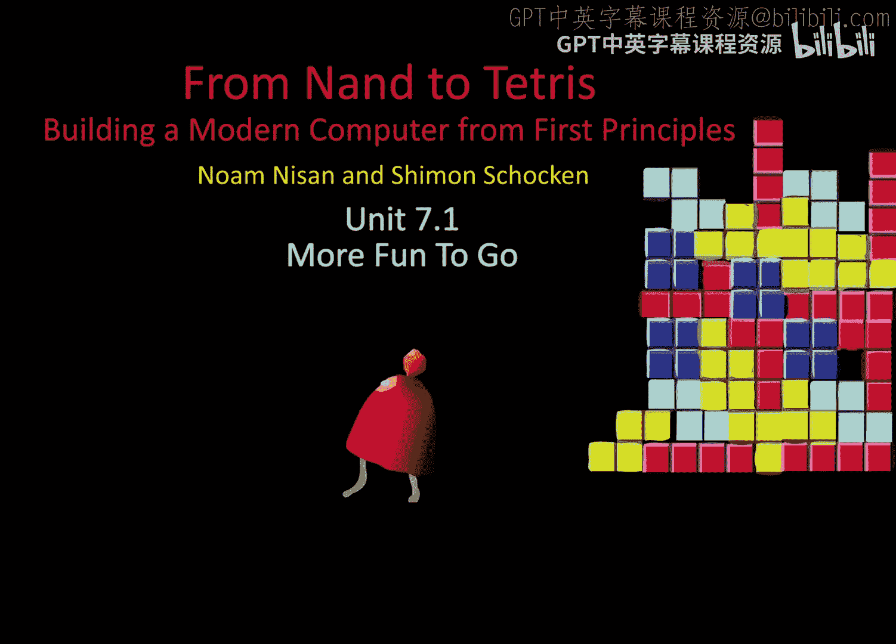

# 从零开始构建现代计算机2：单元7-1：更多探索方向 🚀

在本单元中，我们将回顾已构建完成的计算机系统，并探讨如何对其进行优化与扩展。我们将学习优秀设计的重要性，并审视一系列可能的改进方向，包括硬件加速、指令集扩展以及编译器优化等。

## 课程概述

恭喜你，我们已经从零开始构建完成了一套现代通用计算机系统，包括硬件和软件。既然任务已经完成，我们可以回顾并问自己：如何才能让这台计算机变得更好？如何让它更快、更有用、更通用？这正是我们将在本模块（模块7）中要做的事情。

我们将提出几个扩展和优化的想法，并且我敢打赌你们也能想出类似的想法。这些想法中的每一个都可以成为一个后续的 Nand2Tetris 扩展项目的基础。

## 优秀设计的重要性

为了开展每一个这样的项目，你必须首先从所谓的“设计”开始。一个好的设计是每一个成功的硬件和软件实现项目的关键。

到目前为止，在本课程中，Nand2Tetris 的设计者是 Noam 和我。我们提供了所有的设计文档，包括所有的 API、标准实现契约、测试程序等。你们扮演了系统开发者的角色，根据我们的设计进行工作。Noam 和我确实非常努力地设计出了架构良好、API 清晰的方案。我们这样做是因为我们相信，实现设计良好的系统是学习（或至少开始学习）如何成为一名系统设计师（也称为系统架构师）的最佳方式。这就是我们要求你们实现所有这些设计的原因。如果你想成为一名诗人，你最好从阅读一些好诗开始。

那么，是什么让一个好的设计变得优秀呢？我们可以从显而易见的东西开始：模块化、简洁性、优雅性、清晰性、美观性。在课程中，我们并没有明确地讨论所有这些事情，因为空谈无益。相反，我们要求你们实现我们的设计，并希望通过这样做，你们能对什么是模块化、简洁、优雅、清晰和美观建立起一种直观的欣赏。

一旦你把这些都做好了，那么下一个设计目标几乎会自动实现。这个目标，可能是任何硬件和软件项目或系统最重要的优点，就是**能够以最小的麻烦来修改和扩展系统**。这一点非常相关，因为这就是我们想在本模块中做的事情：讨论如何优化和扩展 Hack 系统。令人欣慰的是，我们即将修改的这个系统设计良好。这令人欣慰，因为设计良好的系统自然就适合进行此类修改。因此，我们将能够以一种可管理和可预测的方式完成所有事情。

## 优化方向探索

上一节我们讨论了优秀设计是系统可扩展性的基础。本节中，我们来看看一些具体的优化和扩展方向。

### 硬件加速：乘法与除法

目前，Hack 的 ALU 只能进行加法和减法。因此，即使是乘以 2 这样的简单操作也需要调用操作系统函数，这非常低效。当你考虑如何在各种可能的优化项目之间分配精力时，你应该始终考虑影响，即如何获得最大的效益。乘法和除法在计算机程序中频繁发生，因此显然值得尝试优化它们。

让我们专注于如何优化乘法，因为除法的情况非常相似。在单元 6.2（以及书中第12章），我们介绍了一种高效的按位乘法算法。我们当时用 Jack 语言实现了这个算法。现在，如果你想加速乘法，我们可以采用完全相同的算法，但不是将其作为用 Jack 编写的操作系统函数来实现，而是作为一个用 HDL 编写或指定的硬件芯片来实现。

一旦你有了这样一个经过充分测试的芯片，你就可以将其集成到 Hack 的 ALU 中。但这还需要扩展 Hack 的指令集，因为你必须决定一些二进制乘法操作码，否则你将无法告诉 ALU 进行乘法运算。如果你扩展了二进制机器语言，那么你也必须扩展汇编语言，需要想出一些符号助记符来表示乘法。这反过来又要求你修改我们在课程第一部分构建的汇编器。你看，这就是设计的全部内容。你必须决定要做什么，然后你必须实际去做。

因此，将乘法重构到硬件中，可以说，需要进行一次非常漂亮的跨层“手术”，因为它贯穿并影响了我们计算机架构的多个层次。由于这些层次高度模块化且规范明确，每一个修改都可以单独进行和单元测试。

### 硬件加速：位移操作

我们的 ALU 中缺少的另一个功能是位移操作。位移可以真正加速诸如乘除法等操作，以及处理屏幕上像素的低级图形操作。同样地，如果你想在硬件中实现位移，诀窍在于设计新的芯片和新的指令，以在硬件级别执行左移和右移操作。

一旦我们拥有了这些硬件能力，我们就应该考虑修改我们的翻译器（编译器/VM翻译器）来巧妙地利用它们。例如，当编译器需要编写代码来乘以或除以 2 的幂次方数时，它可以通过生成使用位移操作而不是标准乘法的代码来实现。你看，这就是人们谈论优化编译器时的一个例子。

顺便说一下，在本模块中，当我们说“编译器”时，我们指的是编译器和 VM 翻译器两者。因此，你可能需要修改编译器或 VM 翻译器，或者两者都修改。在任何一个优化项目中，这都是你需要自己弄清楚的事情。

### 优化 VM 翻译器

VM 翻译器实际上可以通过许多不同的方式进行优化。因为目前它只是简单地将命令从 VM 代码翻译成汇编代码，而没有尝试生成紧凑的代码。因此，即使是最简单的操作，如加 1 或减 1，也会生成好几条汇编指令，而实际上可以用更少的指令完成。所以，这可能是另一个优化项目的例子。

## 扩展新功能

以上我们探讨了优化现有功能的方向。那么，关于创建新功能呢？例如，为我们的计算机添加大容量存储和网络访问功能如何？这将是我们在下一单元讨论的内容。

## 总结

在本节课中，我们一起学习了在完成基础计算机构建后，如何思考系统的优化与扩展。我们认识到优秀的设计是实现可扩展性的关键。我们探讨了多个具体的优化方向，包括将乘除法、位移操作等关键功能从软件迁移到硬件实现，以及随之而来的指令集、汇编器和编译器/VM翻译器的协同修改。我们还提到了优化 VM 翻译器代码生成效率的可能性。最后，我们预告了下一单元将探讨为系统添加全新功能（如存储和网络）的设想。这些探索方向为你将所学知识应用于实际项目提供了清晰的路径。