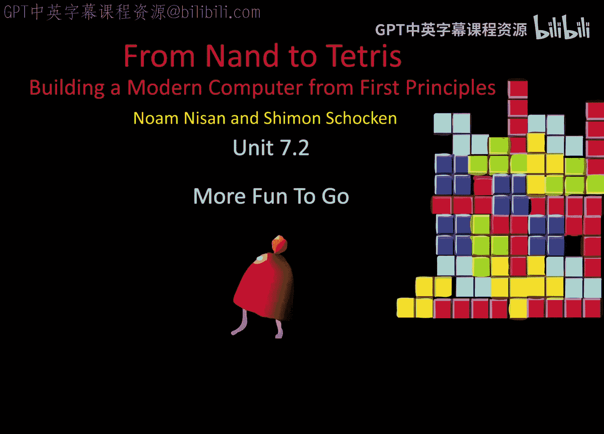

# 耶路撒冷希伯来大学《从零开始构建现代计算机2｜Build a Modern Computer from First Principles》中英字幕 p82 82_09_02_单元7-2_更多探索方向.zh_en -BV1DA4m1w7FU_p82-

So how should we go about adding mass storage and network access to the computer？Well。

 we can start by assuming that we already have devices like a hard disk and some network interface card。

You know， built up and sitting on the shelf。 And now we have to take these devices and somehow。

Integrate them into our computer architecture。 How can we possibly do it。Well。

Instead of using physical devices， we can realize simple versions of these devices as built in chips that can be added to our hardware assimulator。

And how to do this is something that I'm going to discuss separately later in this unit。 So for now。

 let us assume that we have a built in disc chip like you know flash memory unit that is capable of storing lots of bits persistently。

😊，What can we do with this new capability？Well， one thing which is natural to do is to use this new disk for saving and loading heEC programs。

And as usual， any such change， any such new capability and modification requires modifying several different layers in the overall architecture。

First。We must tinker with a heck hardware and allow programs to reside in a writeriable memory space rather than in the read only realm as we do now。

Second， we'll have to specify a simple file system and develop an operating system class that realizes obstructions like loading a file and storing a file。

 you using this new this device。Now， at this point。

 it will make sense to also introduce some sort of a command shell or a terminal window that will enable users to access and manipulate their files。

So as you see， as usual， one thing leads to another。Now。

 what about connecting the he computer to the internet， this should be cool。

 but how can we possibly do it？Well， once again， like we did with a disk。

 let us assume that we have available to us a built in network interface chip and we can integrate this chip into our hardware simulator。

😊，Now， this chip should be designed to interact with the heck hardware from one end and with some socket on your actual PC。

And you know， this is actually quite similar to the way the currently implemented keyboard chip operates and because you know it interacts with the actual physical keyboard on your PC。

 so that's what we need also from the interface card， we needed to be able to handle stream of bits。

 you know coming from the internet instead of from your keyboard。

And so in order to manage this new device， we will have to write a new operating system class that knows how to move bits from one place to another using some standard communications protocol。

Once we have these capabilities in place， we could develop all sorts of J programs that talk with this chip and provide a gateway to the internet。

For example， it will be quite cool to use J to develop a simple web browser based on HTTP。

So as you see。All the extensions that we discussed that focus on adding peripheral devices to the basic hardware。

 well all these extensions require that you first design and integrate a new built in chip like we did with the disk and the network interface that we just discussed So how do you go about it。

 How do you build such a built in chips。Well， when we develop the nanotetriris simulators。

We designed a simple and well documented interface for adding so called， built in chips。

And thanks to this interface， the simulated heckardo platform is open ended and extensible。

So if you wish to build a new built in chip like a hard disk or you a speaker， for example。

 if you're interested in music。Then you should start by first specifying and developing a standalone Java class that realizes the low level functionality that you want to use in this new device。

And if you want to learn more about how to develop such Java chips， if you will。

 you can download the simulator software from the Nanttetris website and simply read the documentation。

Our code is open source， Pew Java， and you are welcome to modify and extend it as you please。Now。

 there's one thing that goes without saying， but I guess I'll say it anyway。

Any one of the optimization and extension projects that we discussed requires very careful and pragmatic planning and realistic planning。

You should start by articulating the exact functionality that you seek to deliver with this new device or with this new extension。

And don't shoot too high， you know， focus on what is absolutely needed and ignore the rest。Next。

 you should identify every sort of subsystem and API in the existing architecture that has to be modified。

 both in the hardware on the software。Then you should specify the necessary APIs of the new capabilities that you develop and write some STub programs that test these new capabilities。

Only after making all these preparations should you start working on the actual implementation that you have to deliver。

And needless to say， but I'll say it anyway。Before implementing some reduced versions of mass storage or network interface or any other device that tickles your fancy。

 you must first read about these things in the internet and then once again settle on the minimum subset of capabilities that you absolutely need for your project。

 you know otherwise you'll get lost。And so in closing， I'd like to say something about sharing。

If you come up with a cool project and if you want to share it with other learners。

 we'll be glad if you'll let us know about it。You don't necessarily have to share everything with the rest of the world。

 you may want to just describe you know your project idea or the general approach or the specification or anything else that you want to share so that other people will have the benefit of building this project from your own design。

 you know just like we asked you to build our designs throughout this course。Now。In the next unit。

 we'll talk about some more extensions at the jack level。And high level languages in general。

And we'll also discuss something that comes up all the time in the discussion forums of Ntotetriris courses willll talk about how to build the hec computer and actually any other computer physically。

Rather than by a simulation， and we'll do this using a remarkable hardware technology called FPGA。

 So that's what we'll do。In the next unit。

