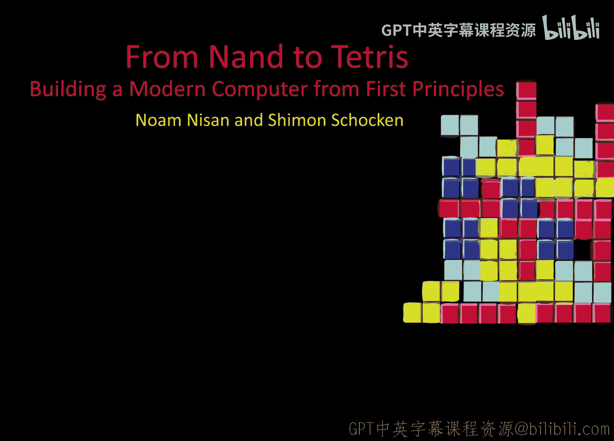

# 耶路撒冷希伯来大学《从零开始构建现代计算机2｜Build a Modern Computer from First Principles》中英字幕 p83 83_09_03_单元7-3_更多探索方向.zh_en -BV1DA4m1w7FU_p83-

In the previous units， we talked about some ideas for optimizing and extending both the hardware and software elements of the head computer and in this unit we willll continue with a few more ideas of this sort。

Let's start with Jack。There are many things that can be improved in the Jack language and some of these things were discussed in the perspective unit of modular 3。

 I believe， when we talked about the Jack language。Now， what can we do can， for example。

 we can make the syntax more friendly。We can introduce new commands like4 and switch。

We can extend the type system， we can add inheritance， we can do many different things。Now。

 each of these things requires know several different modifications。 First of all。

 we have to modify the language grammar。We have to invent some new commands like for and switch and document them in the grammar。

And once we do this， we also have to modify the compiler as parer and the code generator in order to handle these new features of the language and generate code that actually realizes these new language features。

Now， some of these changes are simple。For instance， you adding4 and switch are relatively simple。

Some are more involved and some are quite challenging。 For example。

 if you want to add real inheritance， you'll have to modify not only the compiler。

 but also the virtual machine。So that's one interesting direction to take to improve the current Jack language。

Another thing that can be quite interesting and actually could be a lot of fun is to implement a whole new high level language。

 an existing language or a new one that you may want to invent。😊，For example。

 how about developing a scheme interpreter， an interpreter for the scheme language。

 this could be a very nice project。So enough said about software extensions and let me go back to low level hardware。

One question that many learners ask us is how can we build a physical implementation of the heCC computer？

What will it take to actually commit the he computer to silicon？Well。

 this could be done essentially in two basic ways。The easy path is to well， easy quote unquote。

Is to emulate the heckjack platform on some existing device。 For example。

 you can try emulating our virtual machine on a cell phone。Or on some PC。

You can write a VM translator that translates VM programs to the instruction set of the host cell phone or the processor of the host PC。

So that's one option。The other option， which is more hardcore。

 is to actually build everything from scratch using real hardware。And in order to do this。

 you will need to do three things。First of all， you have to learn a subset of some industrial strength。

 how description language like VHDL or V log。And then you can use this language to rewrite all the HDL programs that we wrote in Nantotteris S1。

 so once you do this you will have， let's say， VHDL implementation implementations of the 30 plus chips that are needed for the chipset of the heCC computer。

Then you can take a programmable hardware platform。And commit these HDL programs to it。 And。

 you know， I happen to have one such platform in my pocket。So what you see here？

Is an FPGA board and FPGA stands for field Programmable gate array。

 these very fancy boards can be programmed to represent different computers and different digital devices。

And this of course is just one of them， there are many such boards in the market and you can get these boards and use them to implement heCC physically。

😊，Now， the FPGA technology is remarkably powerful， popular and affordable。

 you can get a nice board like the one that I just showed you for far less than $100。And actually。

 when I think about it， you can also build this computer in FPGA without spending a penny。

Just like we use the hardware simulator based on software in Nteris。

 you can use a freely available software based FPGA simulator on your PC。

And all the lessons that you will gain will be exactly the same as valuable so you'll be able to build the computer in FPGA without using FPGA。

 you'll be able to do everything on your own PC if you want。Now。

 I'm somewhat concerned that what I described so far sounds deceptively simple。In reality。

 this FPG implementation project is quite challenging。And it's challenging for several reasons。

 one of them is that it forces you to implement in FPGA all the built in devices that we took for granted。

 like the memory， the screenri and the keyboard driver。

 you know all these things that were available to us as built in chips have to be designed and implemented in FPGA。

And this is quite interesting and challenging。Now， the good news is that one of our colleagues， Dr。

 Denny Sidner， who is a very gifted teacher and engineer， has already done all this。

And so together with Denny， we are now working on a new course that teaches how to build the head computer and for that matter。

 any other computer using real hardware。So at some point in the future。

 we will offer this new course， Nantottetriris Part 3， I guess。

 in which you will learn how to build computers using atoms rather than bits。So as you see。

 we haven't said the final word yet。Stay tuned。