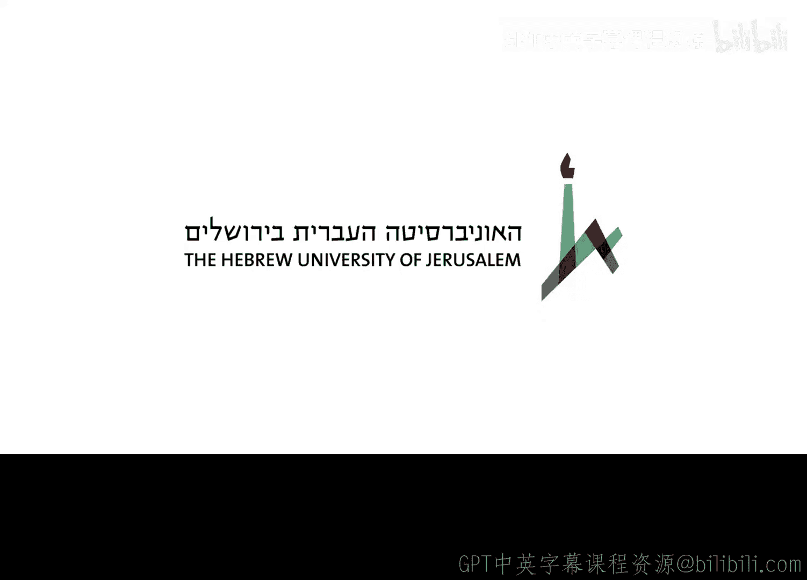
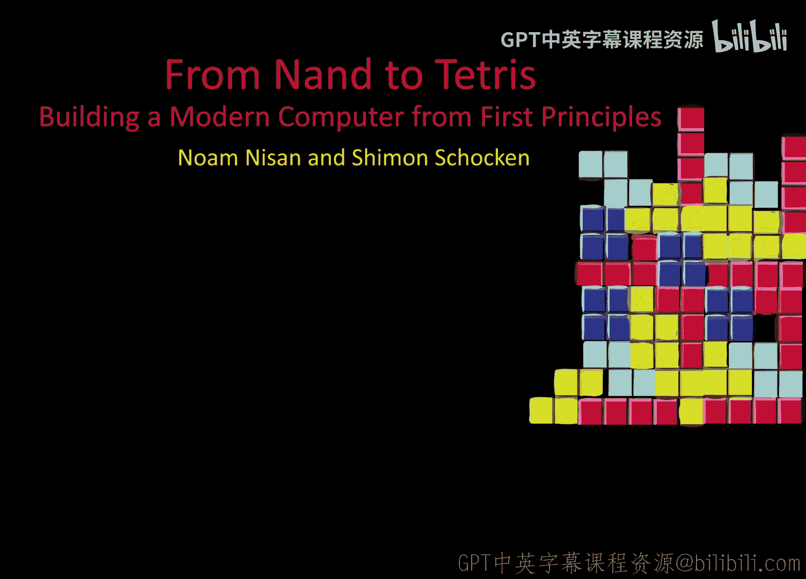

# 从零开始构建现代计算机2：单元7-3：更多探索方向 🚀

在本单元中，我们将继续探讨如何优化和扩展Hack计算机的硬件与软件，并介绍一些可供深入探索的实践方向。

上一节我们讨论了Hack计算机软硬件的一些优化思路。本节中，我们来看看更多具体的、可供探索的扩展与实现方案。

## 软件层面的扩展：Jack语言 🖥️

首先，我们可以从Jack高级语言入手进行改进。在课程第3模块的“视角”单元中，我们曾讨论过Jack语言的一些潜在优化方向。

以下是几个可以改进Jack语言的方面：
*   **语法优化**：使其对开发者更友好。
*   **引入新命令**：例如添加 `for` 循环和 `switch` 选择语句。
*   **扩展类型系统**：增强语言的数据类型支持。
*   **添加继承机制**：为面向对象编程提供更强大的支持。

实现这些改进需要完成一系列修改。首先，必须修改语言的语法规范，例如在文法中定义 `for` 和 `switch` 等新命令。随后，需要相应地修改编译器的语法分析器和代码生成器，以处理这些新特性并生成实现其功能的机器码。

这些修改的复杂度各不相同。例如，添加 `for` 和 `switch` 语句相对简单。而实现真正的继承机制则更具挑战性，它不仅要求修改编译器，还需要修改底层的虚拟机。

另一个非常有趣且富有挑战性的方向是，实现一门全新的高级语言。这可以是一门现有语言，也可以是你自己设计的新语言。例如，开发一个Scheme语言的解释器，就是一个非常棒的项目。

## 硬件层面的实现：从虚拟到物理 🔧

关于软件扩展的讨论就到这里，让我们回到底层的硬件。许多学习者常问的一个问题是：如何构建Hack计算机的物理实体？将Hack计算机真正“刻入硅片”需要做些什么？

实现物理构建主要有两种基本途径。

第一种相对“简单”的路径是，在现有设备上模拟Hack/Jack平台。例如，你可以在手机或个人电脑上模拟我们的虚拟机。这需要编写一个VM翻译器，将VM程序翻译成宿主设备（如手机或PC处理器）的指令集。

第二种更“硬核”的途径是，使用真实的硬件从头开始构建一切。要实现这个目标，你需要完成以下三件事：
1.  **学习硬件描述语言**：掌握一种工业级硬件描述语言（如VHDL或Verilog）的子集。
2.  **重写芯片设计**：使用该语言，重写我们在Nand2Tetris课程中编写的所有HDL程序。完成后，你将得到Hack计算机芯片组所需的30多个芯片的VHDL/Verilog实现。
3.  **部署到可编程硬件平台**：将上述HDL程序部署到一个可编程硬件平台上。

例如，现场可编程门阵列（FPGA）板就是这样一种平台。FPGA技术功能强大、应用广泛且价格亲民，一块不错的FPGA板价格远低于100美元。实际上，你甚至可以不花一分钱就在FPGA上构建这台计算机：就像我们在Nand2Tetris中使用基于软件的硬件模拟器一样，你可以在个人电脑上使用免费的、基于软件的FPGA模拟器来完成所有工作，获得的经验同样宝贵。

需要指出的是，上述描述听起来可能过于简单。实际上，FPGA实现项目颇具挑战性。其中一个原因是，它要求你在FPGA中实现所有我们曾视为理所当然的内置设备，例如内存、屏幕和键盘驱动芯片。这些在课程中作为内置芯片提供的部件，都需要在FPGA中自行设计和实现，这既有趣又充满挑战。

好消息是，我们的同事Denny Sidner博士——一位极具天赋的教师和工程师——已经完成了所有这些工作。目前，我们正与Denny合作开发一门新课程，专门教授如何使用真实硬件构建Hack计算机（乃至任何其他计算机）。在未来的某个时刻，我们将推出这门新课程（或许可以称之为Nand2Tetris第三部分），届时你将学习如何用“原子”而非“比特”来构建计算机。

## 总结 📚

本节课中，我们一起探讨了扩展Hack计算机软件（如改进Jack语言或实现新语言）与硬件（如在FPGA上进行物理实现）的多种可能方向。正如你所见，关于计算机构建的探索远未结束，仍有广阔的空间等待我们去发现和实践。敬请期待未来的更多内容！