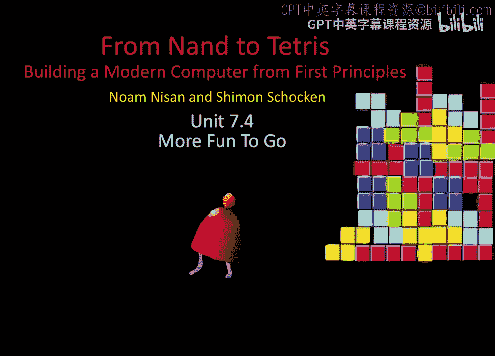

# 耶路撒冷希伯来大学《从零开始构建现代计算机2｜Build a Modern Computer from First Principles》中英字幕 p84 84_09_04_单元7-4_更多探索方向.zh_en -BV1DA4m1w7FU_p84-

Folks， I regret to say that every great journey comes to an end。So in closing。

 I want to say two things。First of all， as I said in the previous unit。

We certainly did not say the final word in antetriris。

And so if you want to stay in touch with us and you want to know about new courses， cool tools。

 new projects， and exciting future activities， then you're welcome to go to the Ntes website and join the mailing list。

Very simple to do。The second thing that Id like to talk about is my elusive Co instructor。

 Professor Nom Nissan， who somehow managed not to show up to any one of the lectures in this course。

So indeed， when we started working on the online version of Notetriris， we decided that I， Shimon。

 will be responsible for preparing and delivering the course lectures。

But now this solo performance puts me in a rather uneasy position because it may create the false impression that I am the main man behind Nantotetriris。

But in fact， you should know that most of the great ideas in this course came from the brilliant mind of Professor Norm Leesan。

And the fact that Noam decided to remain behind the scene throughout this course。

Reminds me of a lovely anecdote about Newton and Leibs。

 The two great mathematicians who lived and worked about 300 years ago in。😊。

Germany and England there respectively。It all began when Leibnates stumbled upon a hard problem in calculus that he could not solve。

So。Because he was clueless about this problem， he went on to publish the problem in some scientific journal and he challenged his fellow mathematicians to solve it。

 he also wrote as a footnote that he thought that it will take about six months to work out a solution。

But when Newton saw the problem in the journal， he solved it in something like one hour after dinner。

And he could not believe that Leibniz thought that the problem was that hard。

So Newton suspected some sort of a prank or a trick。

And he went on to send the solution to Leibizs without putting his name on it。

 He sent it anonymously。So now let's move from London to Hanover， Germany。

And imagine Professor Godfried Wililhelm Leibniz going through his mail。All of a sudden。

 he finds a short and elegant solution to his famous so called super difficult problem。

And the author of the solution is not mentioned anywhere。According to the story。

 Leibniz took one look at the solution and said， I can tell the lion by his paw。And in other words。

 the solution had no name on it， but it bore the unmistakable mark of Newton's genius。

Now what does this have to do with Nnto Tetriris， I hear you ask， well。

 during this course we had the great pleasure of sharing with you many beautiful architectures。

 algorithms， APIs and programming techniques。And even though Professor Nom Nissan was physically absent from all these expositions。

 I am sure that you guys could recognize the lion by his paw。So we hope that you enjoyed Ntetriris。

 we are grateful for the opportunity that we got of sharing with you the beauty and rigor of applied computer science。

 and once again let's keep in touch using the Ntetriris mailing list。So with that。Goodbye。

