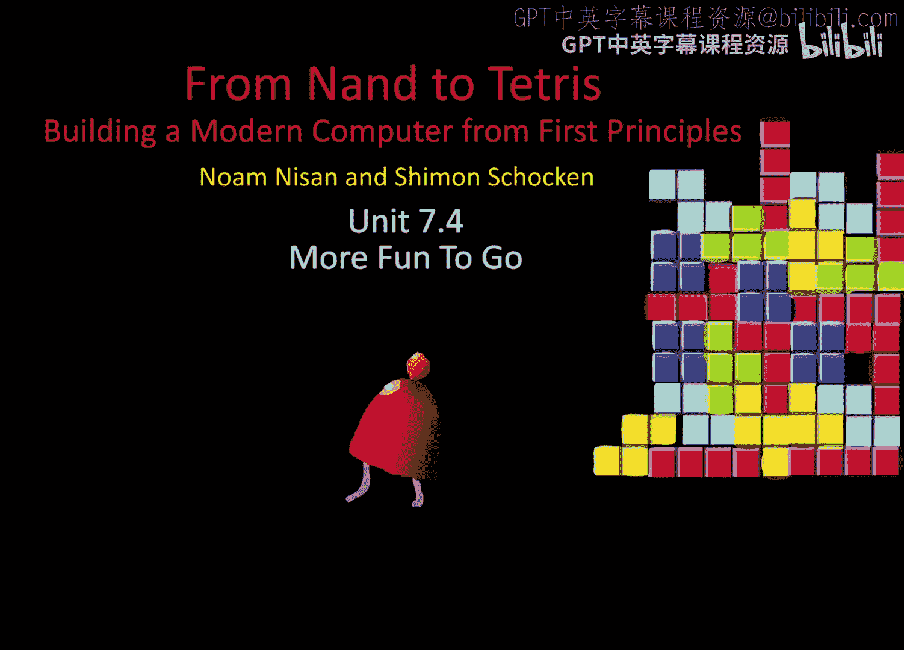

# 从零开始构建现代计算机2：单元7-4：更多探索方向 🚀

在本节课中，我们将为这门精彩的课程画上一个句号，并探讨课程结束后的学习方向与资源。我们将回顾课程的核心贡献者，并了解如何持续获取最新的项目与工具信息。

---

## 课程结束与致谢

朋友们，很遗憾，每一段伟大的旅程都有终点。在此结束之际，我想说两件事。

首先，正如我在上一个单元提到的，关于“Nand to Tetris”项目，我们远未说出最终结论。

因此，如果你想与我们保持联系，并希望了解新课程、酷炫工具、新项目和激动人心的未来活动，欢迎访问Nand to Tetris网站并加入邮件列表。操作非常简单。

## 幕后功臣：诺姆·尼桑教授

接下来我想谈谈的是我那神秘的联合讲师——诺姆·尼桑教授，他巧妙地避开了本课程的所有讲座。

事实上，当我们开始制作“Nand to Tetris”的在线版本时，我们决定由我——西蒙——负责准备和讲授课程讲座。

但这种单人表演让我处于一个相当不安的境地，因为它可能造成一种错误的印象，即我是“Nand to Tetris”背后的主要人物。

但事实上，你应该知道，本课程中大多数伟大的想法都来自诺姆·尼桑教授杰出的头脑。

诺姆决定在整个课程中保持幕后，这让我想起了一个关于牛顿和莱布尼茨的可爱轶事。这两位伟大的数学家大约300年前分别在德国和英格兰生活和工作。

故事始于莱布尼茨偶然遇到了一个他无法解决的微积分难题。由于他对这个问题毫无头绪，他将其发表在某科学期刊上，并向同行数学家发起挑战，看谁能解决它。他还在脚注中写道，他认为需要大约六个月才能找到解决方案。

但当牛顿在期刊上看到这个问题时，他在晚饭后大约一小时就解决了它。他无法相信莱布尼茨认为这个问题如此困难，因此牛顿怀疑这是某种恶作剧或诡计。他随后将解决方案匿名发送给了莱布尼茨。

现在，让我们把场景从伦敦移到德国汉诺威，想象一下戈特弗里德·威廉·莱布尼茨教授正在处理他的邮件。突然，他找到了对他那个著名的、所谓超级难题的简短而优雅的解决方案，而解决方案的作者并未在任何地方提及。

根据这个故事，莱布尼茨看了一眼解决方案，说道：“我凭爪子就能认出狮子。”换句话说，解决方案上没有名字，但它带有牛顿天才不可磨灭的印记。

现在，你可能会问，这与“Nand to Tetris”有什么关系？在本课程中，我们非常高兴能与大家分享许多优美的架构、算法、API和编程技术。尽管诺姆·尼桑教授在所有这些讲解中身体缺席，但我相信你们都能“凭爪子认出狮子”。

---

## 总结与展望

我们希望你们喜欢“Nand to Tetris”课程。我们很感激有机会与大家分享应用计算机科学的美丽与严谨。再次强调，让我们通过“Nand to Tetris”邮件列表保持联系。

就此，再见。