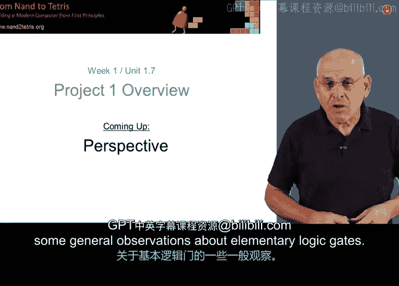

# 耶路撒冷希伯来大学《从零开始构建现代计算机｜Build a Modern Computer from First Principles》中英 - P11：11_02_08_单元-1-7-项目1概述.zh_en - GPT中英字幕课程资源 - BV1Zp421y7Ex

So now that you are familiar with HD L and hardware simulation。

 we are ready to get our hands dirty and actually go and。😊，Develop some chips。 So in this unit。

 we're going to give you all the information that you need in order to design the chips that we have to build in Project 1。

Before we go on， let us remind ourselves， what is the general spirit of this course。 Well。

 the story that we're telling you is that God told us， here's a logic gate。

 and now go and build a computer。And when we asked， how can we possibly do that。

 God said one step at a time。And in particular， the he computer that we are going to build in this course consists of something like 30 different chips。

 and we are going to build them one step at a time。And in the first project， we start with Nand。

 which is God given or， you know， given by us。 or， you know。

 we can think about it as some sort of an axiom that that you can assume。 And using Nand。

 we want you to build the following gates， not and orcs or and so on and so forth。

 So that's what you have to do for Project1。 And。Why these particular 15 gates that's a good thing to ask and the answer is twofold。

 first of all， every one of these gates is widely used in almost any construction of a digital device or some version of these gates。

And the second answer， which is more practical， is that these gates comprise all the elementary logic gates which are needed in order to build our computer。

 So project1， you know， lays out the foundation that we' are going to use in subsequent projects because in other projects。

 we're going to use these chips in order to build more complex and more more interesting functionality。

So once again， here are the chips that we have to build。

 and I have separated them into three categories just that， you know。

 we can discuss it in a more organized fashion。 So we have some elementary logicgates。

Widely familiar， not and or and so on。 We have 16 bit variants of some of the logic gates。

 and we have some multiway and also multiway 16 bit variants of of the previous gates。

And in order to make this all these new concepts more familiar。

 I will focus on some gates in every one of these categories and say a few words about them and this once again will' give you everything that you need in order to build any one of the gates in Project1。

 so without further ado， let's start to talk about multiplexes and d multiplexes。

So what is a multiplexer？A multixer is a gate that operates as follows。

 There are two inputs coming in， and we denote them A And B。

 and there is a cell input coming in so called from the bottom。 Of course， in reality。

 there's no bottom and left。 but I'm talking about this gate diagram here。 So three inputs come in。

 A B and cell。What does the multiplexer do Well， if cell equals0， the multiplexer outputs a。

 If cell equals1， the multiplexer outputs B。 That's it。

 that's the desired behavior of a multiplexer and here is the truth table of the multiplexer we have three inputs so we have eight different possibilities。

 and you can convince itself that the truth table is consistent with what we described before。

 we can also provide an abbreviated truth table of the multiplexer operation。 once again。

 if cell is0。 the multiplexer outputs A。 Otherwise it outputs B。

So a two way multiplexer enables us to select an output one out of two incoming inputs。

 and this is a fundamental operation that is being used over and over again both in digital design projects as well as in communications networks。

 So here's an example of how moO's logic comes to play in the context of building what is sometimes called a programmable gate Now what is a programmable gate。

 it's a gate that can behave in one of several different ways according to our will。

 So here's a simple program programmable gate that can act either as an end gate or as an or gate if the select bit is zero。

 the gate acts as end， if the select bit is one the gate acts as or。

And here's the truth table of the gate and you can convince yourself that it's consistent with what I said earlier and here is how I can actually build it。

 I can use two gates and end and an or provided of course that I have developed them previously。

 and I can feed the A and B inputs simultaneously to both end and or。

And you know we called this before fening out so the a input is fned out into both and and or and the same treatment is done with with the B signal。

 and then I use a single multiplexer to decide you know if I want to output the result of the end or the result of the or。

So the user of this gate that sees only the interface of the gate gets exactly what he or she wanted。

 a programmable gate。Here's the HDL code that implements this particular architecture。

 and if you want， you can stop the video and inspect this code and make sure that it's consistent with a gate diagram。

 So here's an example of aOOCs in the context of a digital design application。

 How do we build a multiplexer。 Well， we get you know all this information from the system architect and we also get a stub file and what we have to do。

 of course， is to write the HDL code。And it turns out that we can build a multiplexer using three gates and or a not which we wire in a certain clever way。

 And the result is the desired moO's logic。 So it's up to you to figure out how to do the wiring and actually implement the desired multiplexer。

All right， moving along， let us talk about D multixer。

A demxer looks like the inverse of a multiplexer。 It receives a single input。

And based on the selection bit， it either channels the input to an A output or to a B output。 Okay。

 so it's kind of a distributor of of a value into one of several possible channels in this example。

 we have it's a two way multixer。 So it's a relatively simple example。

All the other channels get zero okay and so the DmX is basically an inverse of of a max of a Dms is an inverse of a MOOCs if you don't like my pronunciation。

 and once again， it distributes a single input into one of several possible output channels。

Once again， just like we said about like what we said about the multiplexer。

 de multixing is also something which is widely used in digital design projects as well as in communication networks。

We are going to get， or you are going to get the stub file， and you actually have to。

 to implement the logic。In HDO。Al right， I'd like to give you an example of how multiplexing and de multixing can come to play in the context of communications networks。

 So here's a typical situation in building a network。And the situation is such that， you know。

 we may have several channels coming in。 let's say channels of music or several movies that we want to send over a single communications line。

 So， you know， the single line that goes here in the middle of the of the slide can be 5000 kilometers long。

 and it may be sort of an underwater line and or a satellite line and through this single line。

 I want to send multiple messages。 How can I possibly do it。 Well， if everything is digital。

 I can put a moOs in the sending end of our story and I can feed the moOocs。 an ongoing train of 0，1。

0，1，0，1，0，1。 this can be done using what is known as an oscillator。

And because the MOOs is going to get aitive repetitive train of 0，1，0，1， it is going to output blue。

 red， blue， red， blue， red in every cycle， the M MoOCs will output you know。

 one bit from one of the two inputs。At the receiving end of this story。

 I once again I put a different oscillator and therefore the Dms is going to distribute the incoming inputs according to the Dm's logic it will output blue。

 red， blue， red， blue， red， blue， red and so on， so this logic here。

 the Dms and the MOCs logic taken together enable me to braid or interleave several messages over a single communications line which may be very expensive and therefore it pays off to use it for multiple messages。

And by the way， another attractive thing about this scheme here is that it can be completely asynchronous right。

 they don't have to operate according to a master clock。

 every one of these two operations the encoding and the decoding operations can be done separately。

Alright， so we talked about MOCs and DOocs， which were by far the most complicated chips in the elementary logic gates that you have to build。

 And let's go on and talk about one example of out of the 4，16 bit chips that you have to build。

 So we'll talk about N 16。And then 16。Looks， you know， as follows， we have two inputs coming in。

 Both of them are 16 B buses， and we have a single 16 B bus coming out。 And basically。

 what we have to implement is a 16 B and operation。 So it looks like this， right。

1 and 0 should give us1。 I'm sorry，0，0 and 0，0，1 and1 finally gives us one and so on and so forth。

 we are going to get one， if and only if both inputs are one in the respective index that we are looking at。

 Now， there's something which is a little bit deceiv in this example here because。

The calculation of the logic here is not sequential。 Everything is being outputted boom， you know。

 in parallel。And this also gives you some tip on how to actually build it。 Okay。

 this is a straightforward extension of elementary end gates。

 You can read more if you want about how to handle buses of data in HDL。 and basically， you know。

 once you get this sub file， we can implement an end gate using a set of two way end gates。All right。

 so this has been what I wanted to say about the 16 beat variant that you have to implement。

 and finally I want to discuss one example of the multi wave variant。

 which happens to be actually quite a straightforward notion。Here's an example ofOOCs4way 16。

 it has four inputs coming in， every one of them is a 16 bit bus。

 we have a2 bit selection coming in and that is because you know you need two bits in order to select four different possibilities and we have the stopub file and we can build this thing using several MOOC 16 gates as well as perhaps some other gates as needed。

So what do we have to do in Project1 once again， we have to implement all these gates starting with nothing more than N and previously designed gates So you know once you build not you're welcome to use it once you built not an end。

 you're welcome to use any one of these two gates and so on and so forth。So how do we actually do it。

 How do we actually build every one of these gates。Well。

 we're going to give you some building materials and we're going to use SR as an example。

 So you know we have you have the gate diagrams from from the book or from the lecture。

 we are going to give you this HDL file， which is available to you and you can open it up in a text editor and we're also going to give you a test script in a compare file。

And here is the contract that we want you to play with or to play by the rules of this contract。

When you run。Your SO HDL， that is， you know， once you take this S file and implement it and add your own HDL。

 when you run the resulting SOR HDL file on the supplied SR test， you know， the test that we provide。

 your output file should be the same as the supplied compare file。If this will happen。

 you have built the chip to our satisfaction。Once again。

 if your chip generates the expected behavior that we have specified。

 then you are done with this chip and you can go on to develop the next one。

 So for every chip that you have to develop， were going to give you stub file。

 test script and a compare file。Allright， so the resources of Project1 are listed in the Nanttetriris website。

 you can look at the different files if you want， and there's no need to download anything because if you've downloaded the course softer suite。

 then all the necessary files that you need for this project are available in your projects slash01 directory and you're welcome to start working with these files and build Project1。

If you need some additional resources， you can look at what we did in the first week just to sort of get you warmed up for this project。

 there is the HDL survivalviv Guide tutorial and the Q&A forum you can consult with any of these resources in order to gain some confidence and actually go out and build Project1 in closing。

 I would like to say a few words about what we call the heCC Chipset API。

When you build a particular gay diagram like this one， you're going to use all sorts of。

Chhiip parts in this case， two end gates， single or gate and two converters or two not gates。

 And the question is， you know， how are you supposed to know what are the names of the input and output files。

 I'm sorry， the input and output pins of every one of the gates that that you want to use？ Well。

 the answer is that if。The gates that you use are so-called off the shelf gates or if if they are part of the heCC chippset API。

 we provide all the necessary information about how to use them and in particular。

 there is a document on the Nanttotetriris website that gives you the API of all the chips in in the heCC chipet。

 this document is actually part of the HDL survival guide。

 So whenever you're not sure you know what are the names of the inputs and outputs pins of a particular chippa。

Please consult this document and you will know how to use them。

Another thing that I'd like to say in closing before we end this unit is that you can always use what we call built in chips。

 for example， suppose you implement some chip called the foo and you want to use a chip part called a bar。

How can you do it if you haven't written bar before， You know， sounds a little bit impossible。

 but in fact， it is possible。 So once again， if you don't implement some chips that are part of the chip of of the heck chips that you can still use them as chip parts。

All you have to do。If we gave you the staub file of bar。

 you have to change the name of this file to something else。 For example。

 instead of calling it chip name do HDL， you can rename it chip name dot HDL1。Once you do this。

When you load F into the hardware simulator， the simulator will look for an HDL file that corresponds to the missing chip part。

 And if it will not find it， it will by default， revert to using the built in implementation of the missing chip。

So this gives us tremendous flexibility because it means that in principle we can build these chips in any order that we please。

 although we recommend that you build the chips in the given order that they are listed in Project1。

 so here are some general best practice advice for Project1 and for subsequent project as well。

 once again， we recommend that you build the chips in a given order because they are specified from the simpler to the more complex。

 if you don't implement something， you can put it aside and if you want get back to it later， and。

You can， if you want。Design some helper chips， you know， chips that we haven't specified。

 which will act like private methods in in highlevel programming。 However。

 this is really not necessary。 and we advise that you don't do it。

 There's no need to to invent any new chips， just use the chips that we provided and you should be fine in completing this project。

 And in general， you know， just like we always do in computer science。

 strive to use as few parts as possible， you know， try to create an implementation which is elegant readable and well done。

Now I'd like to end this unit with a few notes about frequently asked problems and questions that a student raised when working on project one。

 Well， first of all， you have to realize that when you create your HDL program。

You have to use some external text editor like noteppa or whatever editor of your liking。

 you cannot create HDL code using our tools， in particular。

 you cannot write code inside the simulator， once again do it in an external editor and once you save your HDL file。

 you can load it into our simulator。The next point that confusedfuse some students is that you cannot use a chip。

As a chip part in its own implementation， there's no recursion in HDL。 All right。

 so all the chips that you use when implementing。And new chip have to be some other chips that you've implemented before or some built and chips。

 which are always available as well。Now， when you run your HDL in a simulator。

 if everything works well， you will get a message at the bottom left of the simulation saying something like simulation completed successfully if something goes wrong and if there's a syntax problem with your HDL code or anything like that you will get an error message printed in red so once again some student some students tended to miss this these messages so pay attention to the top I'm sorry to the bottom left of the simulator when you simulate your chips Now in unit 16 nom explained the whole notion of multi bit buses and one thing that we would like to add to this discussion is that these buses are indexed from right to left so if a is a 16 bit bus then a0 stands for the right。

Most bit sometimes called the least significant bit or the LSB。

 and a 15 stands for the leftmost bit also called the most significant bit or the MSB。

 So this is just a convention that you have to keep in mind when you index your your multi bit buses。

And finally， we want to emphasize once again that we provide all sorts of resources with which you can consult when you write HDL code in particular the book has a whole appendix dedicated to HDL programming and this appendix is also available online in the Nanttotetri website and there's an excellent document called HDL survival guide which was written by Mark Ambrost and this is the first place that you have to go to when you get stuck with something and you need some advice。

 so this has been the end of our unit about Project1 overview and we are ready to go on to the last unit of this week in which we're going to say some to talk about some general observations about elementary logic gates。

