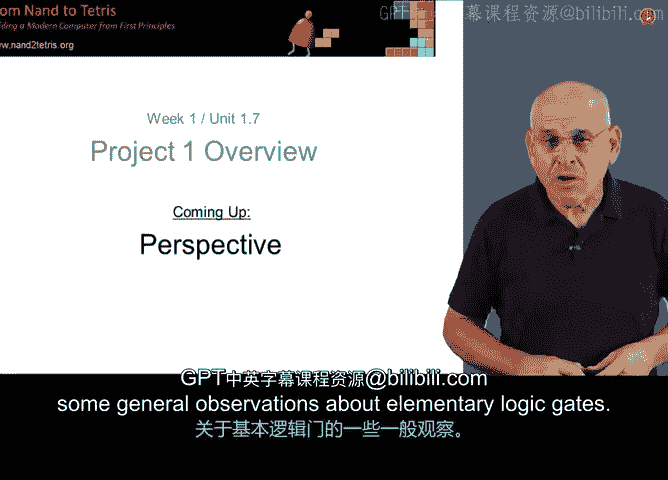

# 从零开始构建现代计算机：1-7：项目1概述 🧱

在本单元中，我们将概述项目1的目标与任务。你将学习如何利用给定的Nand门，逐步构建一系列更复杂的逻辑门，为后续构建计算机打下基础。

## 项目背景与目标

上一节我们熟悉了HDL和硬件模拟器，现在可以开始动手开发芯片了。本单元将提供设计项目1所需芯片的全部信息。

首先，让我们回顾本课程的核心精神。我们讲述的故事是：从一个给定的逻辑门（Nand）出发，逐步构建一台计算机。我们计划构建的计算机由大约30个不同的芯片组成，我们将一步一步地构建它们。在第一个项目中，我们从Nand门开始。你可以将其视为一个给定的公理或基础元件。使用Nand门，你需要构建以下门电路：Not、And、Or、Xor等。这就是项目1的任务。

你可能会问，为什么是这15个特定的门？答案有两个方面。首先，这些门中的每一个在几乎所有数字设备的构建中都被广泛使用。其次，更实际的原因是，这些门构成了构建我们的计算机所需的所有基本逻辑门。项目1为后续项目奠定了基础，因为在其他项目中，我们将使用这些芯片来构建更复杂、更有趣的功能。

## 项目1芯片分类

以下是项目1需要构建的芯片，我们将其分为三类以便更有条理地讨论：
*   **基本逻辑门**：广泛使用的门，如Not、And、Or等。
*   **16位变体**：某些逻辑门的16位版本。
*   **多路与多路16位变体**：前述门的多路及多路16位版本。

为了使这些新概念更易于理解，我们将从每一类中挑选一些门进行重点讲解。这足以让你掌握构建项目1中任何门所需的知识。

## 多路复用器与多路分配器

让我们从多路复用器和多路分配器开始。

### 多路复用器

多路复用器的工作方式如下。它有两个输入，我们记为A和B，还有一个从底部（在门电路图中）进入的选择输入。因此，共有三个输入：A、B和sel。

多路复用器的作用是：如果 `sel = 0`，则输出A；如果 `sel = 1`，则输出B。这就是多路复用器的期望行为。其真值表与上述描述一致。

一个两路多路复用器使我们能够从两个输入中选择一个输出。这个基本操作在数字设计项目和通信网络中被反复使用。

以下是一个展示Mux逻辑在构建“可编程门”中应用的例子。可编程门是一种可以根据我们的意愿以几种不同方式之一运行的门。这里有一个简单的可编程门，当选择位为0时，它作为And门运行；当选择位为1时，它作为Or门运行。

其真值表与上述描述一致。构建方法如下：使用两个门（一个And和一个Or，前提是你已经开发了它们），将A和B输入同时馈送到And和Or。然后使用一个多路复用器来决定是输出And的结果还是Or的结果。这样，只看到该门外部的用户就能得到他/她想要的可编程门。

以下是实现此特定架构的HDL代码。

那么，我们如何构建一个多路复用器呢？我们从系统架构师那里获得所有信息，同时获得一个存根文件。我们需要做的就是编写HDL代码。事实证明，我们可以使用三个门（And、Or、Not）以某种巧妙的方式连接来构建一个多路复用器。结果就是期望的Mux逻辑。你需要自己弄清楚如何进行连接以实现所需的多路复用器。

### 多路分配器

接下来，让我们谈谈多路分配器。

多路分配器看起来像是多路复用器的逆过程。它接收单个输入，并根据选择位，将该输入引导到A输出或B输出。它是一个将值分配到几个可能通道之一的分配器。所有其他通道输出0。因此，Dmux本质上是Mux的逆过程。同样，它将单个输入分配到几个可能的输出通道之一。

与多路复用器一样，多路分配也广泛用于数字设计项目和通信网络。

你将获得存根文件，并需要在HDL中实现其逻辑。

### 通信网络中的应用示例

我想举一个例子，说明多路复用和多路分配如何在通信网络的背景下发挥作用。这是构建网络时的典型情况：我们可能有多个通道进入，比如音乐频道或多部电影，我们希望通过单条通信线路发送。

这条单线可能长达5000公里，可能是一条水下线路或卫星线路。通过这条单线，我想发送多条消息。如何做到呢？如果一切都是数字化的，我可以在发送端放置一个Mux，并向Mux馈送一个持续的0、1、0、1序列（这可以使用振荡器完成）。由于Mux将接收到重复的0、1序列，它将在每个周期输出蓝色、红色、蓝色、红色。在接收端，我放置一个不同的振荡器，因此Dmux将根据其逻辑分配传入的输入，输出蓝色、红色、蓝色、红色等。

这里的逻辑，即Dmux和Mux逻辑结合在一起，使我能够在一条可能非常昂贵的单一通信线路上交织或交错多条消息，因此将其用于多条消息是值得的。顺便说一下，这个方案的另一个吸引人之处在于它可以是完全异步的，它们不必按照主时钟运行，编码和解码操作都可以单独完成。

## 16位变体示例：And16

我们讨论了Mux和Dmux，它们是你需要构建的基本逻辑门中最复杂的芯片。现在，让我们继续讨论你需要构建的16位芯片中的一个例子：And16。

And16看起来如下：有两个输入进入，它们都是16位总线，还有一个16位总线输出。基本上，我们需要实现的是一个16位的And操作。其逻辑是：仅当两个输入在各自索引位上都为1时，输出才为1。

这个例子中有一点需要注意：这里的逻辑计算不是顺序的。所有输出都是并行产生的。这也提示了你如何实际构建它。这是基本And门的直接扩展。你可以在HDL中阅读更多关于如何处理数据总线的信息。基本上，一旦你拿到存根文件，就可以使用一组两路And门来实现And16。

## 多路变体示例：Mux4Way16

最后，我想讨论多路变体的一个例子，这个概念实际上相当直接。

以Mux4Way16为例：它有四个输入，每个都是16位总线；有一个2位选择输入（因为需要两位来选择四种不同的可能性）；我们有存根文件；我们可以使用几个Mux16门以及可能需要的其他一些门来构建这个东西。

## 项目1实施流程

那么，在项目1中我们具体需要做什么？我们需要仅从Nand门和先前设计好的门开始，实现所有这些门。一旦你构建了Not门，就可以使用它；一旦你构建了Not和And，就可以使用这两个门中的任何一个，依此类推。

我们如何实际构建每一个门呢？我们将提供一些构建材料，并以Xor为例。你从书籍或讲座中获得了门电路图；我们将提供这个HDL文件（你可以用文本编辑器打开它）；我们还将提供一个测试脚本和一个比较文件。

我们希望你们遵守的规则是：当你运行你的Xor.hdl文件（即在你拿到这个存根文件并实现它、添加你自己的HDL之后），在提供的Xor测试脚本上运行结果文件时，你的输出文件应该与提供的比较文件相同。如果发生这种情况，你就按照我们的要求构建了该芯片。如果你的芯片产生了我们指定的预期行为，那么你就完成了这个芯片，可以继续开发下一个。

对于你需要开发的每一个芯片，我们都会提供存根文件、测试脚本和比较文件。

## 项目资源与最佳实践

项目1的资源在Nand2Tetris网站上列出。你可以查看不同的文件，但无需下载任何东西，因为如果你已经下载了课程软件套件，那么本项目所需的所有必要文件都已在你的projects/01目录中。你可以开始使用这些文件并构建项目1。

如果你需要一些额外资源，可以回顾第一周的内容来热身。还有HDL生存指南教程和问答论坛。你可以咨询这些资源中的任何一个，以获得信心并实际开始构建项目1。

在结束之前，我想谈谈我们所谓的Hack芯片组API。当你构建一个特定的门电路图时，你将使用各种芯片部件。问题是，你如何知道你想使用的每个门的输入和输出引脚名称？答案是，如果你使用的门是所谓的现成门，或者它们是Hack芯片组API的一部分，我们会提供关于如何使用它们的所有必要信息。具体来说，Nand2Tetris网站上有一份文档提供了Hack芯片组中所有芯片的API，这份文档实际上是HDL生存指南的一部分。因此，每当你 unsure 某个特定芯片的输入和输出引脚名称时，请查阅此文档。

我想在结束本单元之前说的另一件事是，你总是可以使用我们所谓的“内置芯片”。例如，假设你实现了一个名为Foo的芯片，并且想使用一个名为Bar的芯片部件。如果你之前没有编写过Bar，如何做到呢？这听起来有点不可能，但事实上是可能的。同样，如果你没有实现某些属于Hack芯片组的芯片，你仍然可以将它们用作芯片部件。你需要做的就是：如果我们给了你Bar的存根文件，你必须将此文件重命名为其他名称。例如，你可以将其从chipname.hdl重命名为chipname.hdl1。这样做之后，当你将Foo加载到硬件模拟器中时，模拟器将寻找与缺失芯片部件对应的HDL文件。如果找不到，它将默认使用缺失芯片的内置实现。

这给了我们极大的灵活性，因为这意味着原则上我们可以按任何顺序构建这些芯片，尽管我们建议你按照项目1中列出的给定顺序构建芯片。

以下是项目1及后续项目的一些通用最佳实践建议：
*   我们建议你按给定顺序构建芯片，因为它们是从简单到复杂指定的。
*   如果你没有实现某个东西，可以把它放在一边，稍后再回来处理。
*   如果需要，你可以设计一些辅助芯片（我们未指定的芯片），它们就像高级编程中的私有方法。然而，这确实没有必要，我们建议你不要这样做。没有必要发明任何新芯片，只需使用我们提供的芯片，你应该就能顺利完成这个项目。
*   总的来说，就像我们在计算机科学中常做的那样，力求使用尽可能少的部件，尝试创建一个优雅、可读性高且完成度高的实现。

## 常见问题与注意事项

现在，我想以关于项目1中常见问题和学生疑问的一些说明来结束本单元。

首先，你必须意识到，当你创建HDL程序时，必须使用一些外部文本编辑器，如Notepad++或你喜欢的任何编辑器。你不能使用我们的工具创建HDL代码，特别是不能在模拟器内部编写代码。再次强调，在外部编辑器中完成，保存HDL文件后，再将其加载到我们的模拟器中。

让一些学生困惑的下一点是：你不能在一个芯片的实现中将其自身用作芯片部件。HDL中没有递归。因此，你在实现一个新芯片时使用的所有芯片，必须是你之前实现的其他芯片，或者是始终可用的内置芯片。

当你在模拟器中运行HDL时，如果一切正常，你会在模拟器左下角看到一条消息，显示“simulation completed successfully”。如果出现问题，例如你的HDL代码存在语法问题，你将看到一条红色的错误消息。有些学生容易忽略这些消息，所以请注意模拟器左下角的信息。

在单元1.6中，我们解释了多比特总线的概念。我们想补充的是，这些总线是从右到左索引的。如果a是一个16位总线，那么a[0]代表最右边的位（有时称为最低有效位或LSB），a[15]代表最左边的位（也称为最高有效位或MSB）。这只是你在索引多比特总线时需要记住的一个约定。

最后，我们想再次强调，我们提供了各种资源供你在编写HDL代码时参考。特别是，书中有一个完整的附录专门介绍HDL编程，该附录也可在Nand2Tetris网站上在线获取。还有一份由Mark Armbrust编写的优秀文档，名为HDL生存指南。当你遇到困难需要建议时，这是你首先应该查阅的地方。

## 总结

本节课中，我们一起学习了项目1的概述。我们明确了项目的目标是从Nand门出发构建15个基本逻辑门，并将这些门分为三类进行了解释。我们重点讨论了多路复用器和多路分配器的原理、应用及实现思路，并举例说明了16位变体（And16）和多路变体（Mux4Way16）。最后，我们介绍了项目的实施流程、可用资源、最佳实践以及需要注意的常见问题，为动手完成项目1做好了充分准备。