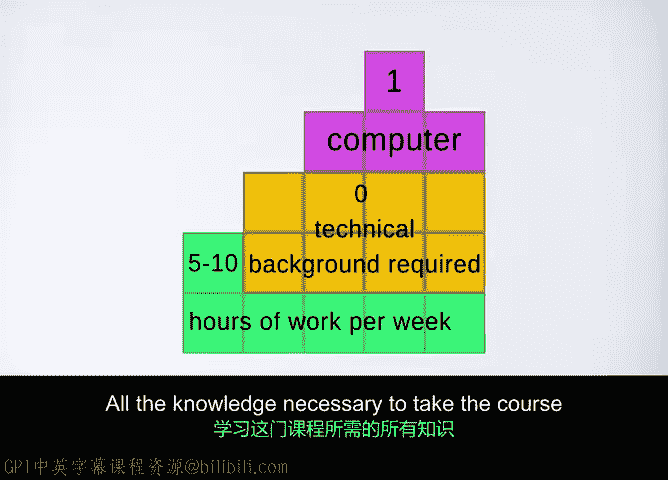

# 耶路撒冷希伯来大学《从零开始构建现代计算机｜Build a Modern Computer from First Principles》中英 - P13：13_03_04_宣传视频.zh_en - GPT中英字幕课程资源 - BV1Zp421y7Ex

Hi， my name is Shimon Shoquikin， and I'm professor of computer science at the IC Herzeah and at the Hebw University of Jerusalem。

😊，🎼And I'm Nor Nissan， a professor of computer science at the Hebrew University of Jerusalem and at Microsoft Research。

 We are very pleased to introduce N Peris， part 1。😊，🎼Anyone can take this course。

 including people who have no background in computer science or engineering。

🎼The cost consists of six weekly projects， each focusing on building a different module of the computer's hardware。

🎼In each project， you have to build a set of chips， and for each such chip。

 we provide a complete chip specification， and you then have to figure out how to build this functionality using chips that you've built before。

 But don't worry you will have to do no soldering whatsoever。 Instead。

 you will build all the chips using a hardware simulator。

 just like hardware engineers actually do in practice。🎼In the first three projects of the course。

 we start with a most elementary logic gate called Nand using detailed project materials。

 we will guide you through the process of building a chipset， a central processing unit。

 and a memory unit。🎼In the next two projects， you will integrate all the chips that you've built before into a complete general purpose computer named。

🎼We will then connect the computer to a keyboard， and a screen。🎼And poof。

 the computer will snap into action in the last project in the course。

 we develop an asssembler which enables writing programs using symbolic commands rather than binary code This will allow us to use the heCC platform to run all sorts of cool programs like Teris and practically any other programs that comes to your mind。

🎼And that's it from Nan to Tetriris in six weeks。The cost requires about5 to10 hours of work per week and assumes no previous background in computer science or engineering。

🎼All the knowledge necessary to take the course and build a computer will be given in the course itself。

🎼So if you wish to understand how computers work and how they' are designed。

 then sign up and let's build a computer。

