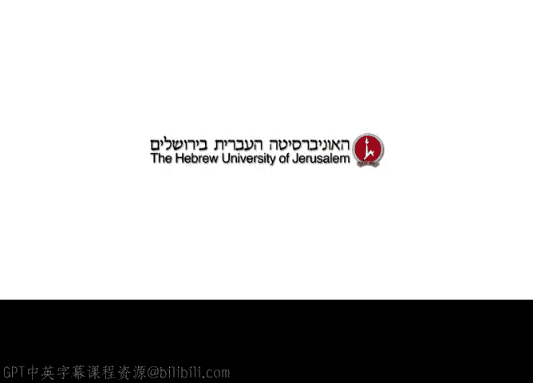

# 耶路撒冷希伯来大学《从零开始构建现代计算机｜Build a Modern Computer from First Principles》中英 - P14：14_04_02_单元-2-1-二进制数.zh_en - GPT中英字幕课程资源 - BV1Zp421y7Ex

Last week， we learned how to manipulate bits in a computer。 We have yes， we have no 1，0。

 and we know how to manipulate them。But what can we do only with one and 0。

 Can we represent more sophisticated things with them， Of course， mean we must。

 if we want to use our computer to do useful things。But what can you do with only two values 0 and 1。

Well， you definitely can put two of them together， and then you get four possibilities。

 three of them together， you get eight possibilities。 in general， if you have n of them together。

 you have two to the n possibilities。 and now you could represent any two to the n different things that you may want to。

For example， you can represent numbers。 and this is what we're going to be interested in。

 How are you going to represent integer numbers。Well，0 is easy。0，1 is easy。1。

2 is already the first problem， basically because we don't have yet another possibility。

 So we have to use 2 bits，0，1，0，3 is 1，1 for the next one， we already need another bit，1，0，0，4，4。

And in general， it seems we can represent any numbers that we want with some sequence of bits。Now。

 how did we connect the sequence of bits， the binary representation of an integer number to the integer number。

 What's going on， What's the general system。In order to understand that。

 we have to go back to second grade。EWhen we learned about decimal numbers。We see 789。

 What does that mean Where What does the digits，7，89 have to do with the value of the number 789。

Well， we learned that we have the positional system was the right most digit is the ones。

 The next one is the tens。 The next one is the hundreds。😊。

So we know that 789 is really9 plus 8 tens plus 7，100s and so on。 In general。

 the case position from the right is 10 to the K。So now exactly the same thing is going to happen also with binary numbers。

 but it's going to be much simpler because we only have0 and 1 rather than all the number digits between0 and9。

 Thus in binary notations， the different positions will be powers of two，1，2，4，8 and so on。

 supposeuppose you want to know， for example， what is a value of101 in binary notation。

 Well we know the rightmost bit is basically the ones。😊，The next one， the0 correspond to twos。

 and the third， the leftmost bit here is the fourth。 Al。

 we have 4 plus 2 plus 2 times 0 plus  one times 1。 Al， that's 5。 So our number is 5。And in general。

 what do we do in general， exactlyact the same thing。 You have any sequence of bits。

 and we're going to number them from the right。 most bit， which is going to be B 0， the next one。

 B1 and so on all the way to B N。 if we have n plus1 bits。

And the value of this thing is going to be B 0 times 2 to the 0 plus B1 times 2 to the 1 plus B2 times 2 to the two all the way until the n bit。

 which we have where we have B N times 2 to the N。 And this is going to be a number。

And that's how we can convert any sequence of bits。

 any binary representation of a number to the value of a number。

One thing that we should note at this point that if we look at the maximum number we can represent with K bits。

Well， we sum up from 2 to the 0 all the way to 2 to the k -1。 remember that the case bit。

 If we start counting from 0， the last bit is counted is indexed to k K K-1。

 So we have the sum of1 plus 2 plus 4 all the way to2 to the k -1。 Al together， we have two to the K。

 all that -1。 And that's the range of bits we can actually represent with k。

 the range of numbers we can represent with k bits。😊，Now， so far。

 we assumed we have an arbitrary lens number of bits that we can use to represent。 And of course。

 if we want to represent an arbitrary long number， we will need an arbitrary number of bits in computers。

 you usually have a fixed number of bits that is allocated。 and then， of course。

 you will only be able to represent a fixed number a fixed range of the integer numbers。😊，So。

 for example， if we only have 8 bits。What are the， what are the possible numbers you can represent？

 Well， you can represent something starting with 0，0，0，8 times 0，0。

0 and ending with a1 all the way up to 8 ones。The smallest number is。We have altogether 2056。

256 such possibilities。 The first one is index 0。 The last one is indexed，255。Now。

 that's not exactly true。 Really when we have8 bits usually we want to to want to reserve part of these all the possibilities to actually represent negative numbers。

 We're not going to actually talk about this now， but rather a unit from now。 but in general。

 half half of the 256 possibilities are going to be reserved for negative numbers and we're only going to be able to use the numbers between one between 0 and 127。

 and these are the positive numbers that we're going to be able to use out of these 256 possibilities of 8 bits。

😊，So far we saw basically， if you get a string of bits， how can you convert it to decimal numbers。

 Now， we're going to do the opposite thing。 Suppose you're given a number in decimal，87， for example。

 how can you represent as a sequence of bits。 This is also something which we should be able to do if we're going back and forth between decimal notation and binary numbers that are actually going to be represented as a computer。

Well， remember that we know that really the way we get a decimal from the binary is by summing up powers of two。

 So we start by figuring out what is the largest power of two that fits into our 87 number。

 and that is going to be 64。And then what is the next one， after we have 64。

 What is the next power of two that we can add to 64， and we still remain under 87。

 That turns out to be 16。 and so on。 we can keep on going。

 and we write the number 87 as a sum of binary of powers of two。

And it turns out that 87 is exactly 64 plus 16 plus 4 plus 2 plus 1。 And once we have that from this。

Representation of the decimal number as a sum of powers of two。

 We can quite directly actually get a binary representation。How do you do it， Well。

 every time we have a power that appears in the sum， we need to put a one in the bit there。

 And whenever the power is not part of the sum， we put a0 there。 So， for example。

 look at the rightmost bit that corresponds to the ones。 We do have a one。

 So that's going to be a one。On the other hand， if you look at the third bit from the right。

 which is correspond to the8s。 since we don't have8 in our sum here， we're going to have 00。

And that's basically a general way how you can take any number and convert it to binary。

So this concludes this unit where basically we discussed how you can represent integer numbers within a binary system。

In the next unit， we're going to actually discuss how can we actually perform arithmetic operations in particular addition。

 and these represented by numbers。 Once we get that under our belt。

 we will go back and discuss the issue of negative numbers in unit 3。

