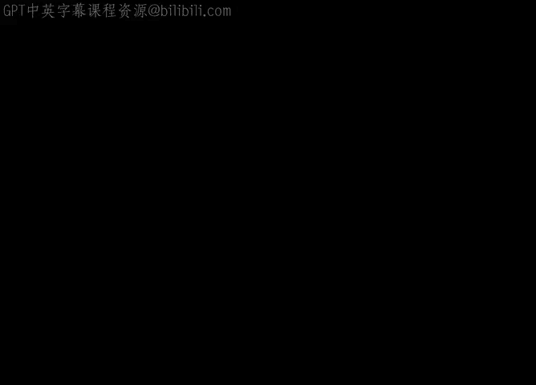
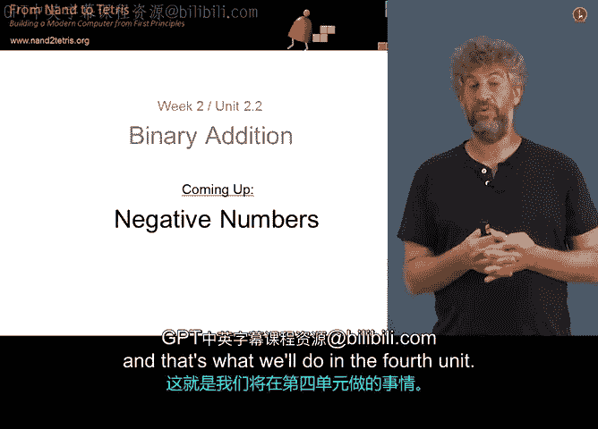

# 耶路撒冷希伯来大学《从零开始构建现代计算机｜Build a Modern Computer from First Principles》中英 - P15：15_04_03_单元-2-2-二进制加法.zh_en - GPT中英字幕课程资源 - BV1Zp421y7Ex

In the last unit， we saw how to represent numbers in computers using binary bits。

 but now we can represent numbers。 That's the important thing。

Now the whole point of representing something is if we want to manipulate it。

 what kind of manipulations do we want to do with numbers？ Well， we want to add them， subtract them。

 multiply them and so on。 This is what we're going to learn how to do in this unit。 Well。

 not all of them。 what we will really be talking about is how to add once we do that we'll basically get the whole all the other operations。

 almost for free。 It turns out that once we understand how to represent negative numbers。

 which we will do in next unit， we will be able to get subtraction for free and to understand which of two numbers is greater for free multiplication and divisions are more complicated。

 but nicely enough， we can actually postpone them to software。 we will not build in hardware。

 any multiplication or division circuitry。 but rather we will actually let software do it and things are much easier to do in software because you just have to write little programs rather than actually connect stupid little devices。

 So we get two sequences of binary numbers。😊，HowCan we add them？Well。

 one way we already know how to do and that's going to be very easy。 We convert them to decimal。

 We add the decimal numbers that we know how to do from second grade， we get a decimal number。

 we convert it back to binary that we just learned how to do and we get the answer。

 This is great and fine， but of course that's not what a computer does。

 The computer doesn't know how to add decimal numbers without first converting them to binary numbers。

 So we need to figure out how to actually do the addition of binary numbers and directly。

 without converting them to decimal。😊，And how are we going to do that， As usual。

 everything that I need to know I learned in second grade， so we need to go back to second grade。

 We need to add 5783 plus another number。 How do we do this kind of edition。 What did we learn Well。

 we start with the one with the right most digit， And we add3 plus 6， We get the9。

 and we're all very happy with that。😊，Thiss easy。 But now what happens when we do the next digit and we have a plus5。

Well， S 8 plus 5 is 13 and we cannot write 13 underneath the10 position because 13 is greater than 10。

 so we all learned this important and amazing trick of writing only three and having one as a carry to the 100th place。

 and then we know how to we can continue from there。😊，And then we can add the one to the 7 and so on。

 And after we finish with the leftmost digit， we have the complete result。

So exactly the same thing we're going to do in binary numbers。 only it's going to be much。

 much easier。So we take one plus 0， the rightmost two digits。And we need to add them。

 And that's easy。 One plus 0 is one。 We can write it down。 If we have 0 plus 0。

 that's also going to be very easy。 We can write them down。

Now the first time we get into a problem is we have one plus one because one plus one is two。

 two is more than what we can write in a single digit Boolean bit。

 So we need to actually do the same kind of trick write down zero and carry the one to the next position。

And now we can continue。 We need to add one plus 0 plus  one。 That's again。

 more than what we can write in a single bit because that's two。 So we write 0。 We carry one。

 Now we have one plus  one plus1。 The answer is 3。 So we write down one， and we carry another one。

 And that's how we continue until we get the final solution。 The final answer。

 And that's all there is to it。😊，And the rest of the unit will actually learn how to do this thing exactly do this thing completely mechanically in the sense of really understanding how every operation works in terms of binary operations that weve learned so far。

 but the basic principle is extremely simple just like we learned in second grade before we continue there is one thing I want to take out of the way and that is a question of overflow。

😊，Suppposed that we were somehow unlucky and the two leftmost bits of our the two numbers that we were adding were one。

So what is the problem with that the problem is that when we add them。

 we have a carry that needs to go to the left of the word size and there is no place to carry to put that carry bit because we finished our word size So what would do we do will we raise some warning or anything like that Well the answer is very simple What is usually done in computer systems is nothing。

 we just ignore any carry bits that does not fit into the word。😊。

A what does that mean really so if you try to look at it from a mathematical point of view。

 what it means is that addition that we are actually doing in our hardware is not real integer addition because we cannot go beyond the numbers that fit inside size the word size instead what we have is really addition mod2 to the widths of the word size。

😊，If you look at it mathematically， in other words， the answer is correct。

 but may except for the case that it may be off by exactly2 to the n where n is a word size。

 if the result was more than 2 to the n， the hardware automatically decreases 2 to the n。

 which is basically the carry that we just threw because there was an overflow。😊。

So that's what you usually do， and the rest of anyone using a computer。

 anyone using a computer and software needs to remember that if exceeds the word size。😊。

Then the results that you get is not the true integer result of the integer addition。

 but rather the truncated result after the overflow was already disposed of once we gut that out of the way。

 let's go back and try to understand how are we actually going to build this kind of an adder。

How can we actually get build hardware that gets two numbers as bits as input bits。

 and the output is another number。That actually represents the sum of the two input numbers。

We'll do that in three easy stages。In the first date， we'll just learn how to add two bits。

 Very simple。The second stage will learn how to add 3 bits。

It may seem there is a long way to go if we are progressing so slowly， but then in one big step。

 we'll be able to add any two numbers of any number of digits。 So let's start with that。

 So let's look at the typical operation were when we were adding two bits in the process we just looked at。

😊，How do we took a one plus one and we added it and we got a zero sum and a one carry。

 How did we do that？Well， the most important thing is to notice that the rest of the bits of all these two numbers do not matter at all when we're doing just this one bit slice of operation。

 whatever the other bits were， as long as what we're adding now is one plus one。

And as long as one additional important thing， the carry so far， the carry we had to this place was0。

 Whatever the other bits are， we still are doing the operation exactly the same。

 We're going to put right0 below these two ones， and we're going to have a carry of one。😊。

This tells us that now we have really just simple binary operation， taking two bits， A and B。

And producing two output bits， which depend only on them。

 which is one of them we're going to call the sums， the binary sum of these two things。

 and the other is the carry。And this is really the first step that we need to do。

 This will actually allow us to add2 bits。Now， this operation， really， which is the slice 11。

1 step of the process that we saw so far is thats naturally abstracted by a chip。😊。

And the chip gets two inputs， A and B， two outputs。

 and we know exactly for every combination of inputs， what the outputs is supposed to be。

 This chip is called the half adder and implementing it is the first thing that you do in the exercise for this week。

In fact， we're going to give you。The exact HDDL that describes the interface of this chip。

 and you're just going to have to do the implementation which actually does implement this operation that we now understand what it is。

And we're finished the first step of our journey journey to add numbers， adding two bits。Now。

 if you remember， the only real restrictions that we had when we were doing this addition of two Bs was the fact that the carry to this point was0。

 but that's not the general case。 What happens more generally if there may be a carry。

 Suppose now that we get another bit in the input called C。

 which describes the carry from the previous step which can be either0 or one Now。

 how do we do this edition。 Well， we know we and add the three number than we still get a sum in a carry Again。

 now we get a boolean gate， a chip， if you wish。😊，That we know exactly it's functionality。

 We have three inputs， A， B and C。2 output some and carry。

 and there are eight possibilities of the inputs。 And for each of them。

 we can very well know what the outputs are。 So that's another chip。

 And that chip is called a full adder。And again， you can just go and implement it。 And indeed。

 this is the second part of our journey to addition。And again。

 we're giving you the HDDL of this chip。 and please go ahead and implement it。

And now we're ready for the final step for doing everything。 We get two full numbers。😊。

And we want to add them。How are we going to do that？Well。

 we already know how to do every single step of the process。

 So we just have to repeat doing this single step。So let's look at what we did。 We first。

 let's color bits， the right most bit yellows， the next one green， the next one blue。

 this is just so we can talk about them in terms of colors， but of course。

 in the implementation there are no colors just different bits。So we start， of course。

 by adding the two yellow bits and adding the two yellow bits is just a half ater because we have no carry so far and we get a yellow sum and a yellow carry。

Now， the next step is we need to add the yellow carryry to the two green bits。 And from that。

 we get a green sum and a green carry。😊，Now it takes the green carry added to the two blue bits。

Each one of these colored steps is simply a full adder。 Now， the thing that takes that yellow carry。

 the two green bits and outputs a green carry in a green sum。 That's just a full adder。

 And that already we've implemented。 So to implement the wholeing。

 we just need to basically connect 16 of these full adders。😊。

Or maybe 15 full adders in one half adder for the right most bit。

 connect them together in the right way。 And you get exactly an adder。

And this is what you're supposed to do。This is our 16 B adder。 It accepts two numbers。 Now。

 Each one of them is a bus of 16 Bs。And outputs a single number that is supposed to be their sum as 16 B integers。

And again， we're going to give you the HDL for this。

 It just specifies that you're going to get two numbers。

 to 16 bit numbers as buses as an input and produce a single number。

 16 bit bus as output that is there sum in terms of twos representation of the number。

And you can go ahead and implement that。So we've just learned how to add two numbers in a very concrete sense of building the chips that actually do that。

The next unit will actually go back and actually look at how do we represent negative numbers。

 something that we still owe you from last unit。 Once we do that， it will turn out。

 it will get subtraction for free。😊，After we get that onto our belt。

 then we'll go to the capstone of this week's。This week's lecture。

 which is building a complete arithmetic logic unit。

And it turns out that most of the cleverness is already done。

 The most clever things we have in an A L U unit is just adding two numbers。But of course。

 we need a lot of logic around it。 And that's what we will do in the fourth unit。

