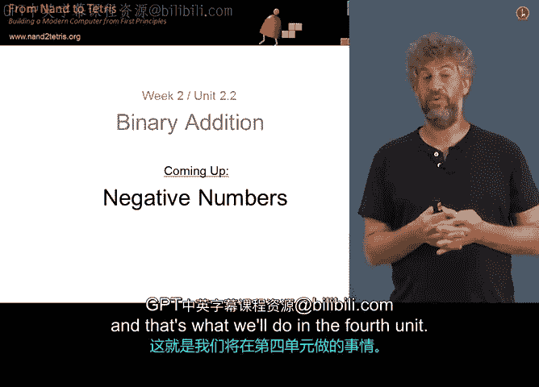

# 从零开始构建现代计算机：15：二进制加法

## 概述
在本节课中，我们将学习如何在计算机中实现二进制数的加法。我们将从回顾二进制表示法开始，逐步理解并构建一个能够直接对二进制数进行加法的硬件电路。核心在于理解并实现**半加器**、**全加器**，最终将它们组合成一个完整的**16位加法器**。

---

## 二进制加法原理

上一节我们介绍了如何在计算机中使用二进制位来表示数字。现在，我们有了数字的表示方法，接下来自然要学习如何操作它们。

对于数字，我们通常希望进行加法、减法、乘法等运算。本单元我们将重点学习如何实现加法。一旦掌握了加法，我们几乎可以免费获得其他运算。例如，在理解了负数的表示（下个单元的内容）后，减法也能轻松实现。乘法和除法更为复杂，但幸运的是，我们可以将它们推迟到软件层面实现，而不必在硬件中构建专门的电路。

那么，当我们有两串二进制数时，如何将它们相加呢？

一种已知的方法是：先将它们转换为十进制数，进行我们从小就会的十进制加法，得到结果后再转换回二进制。这种方法虽然可行，但计算机并非如此工作。计算机不会先将二进制数转换为十进制再进行加法。因此，我们需要学习如何直接对二进制数进行加法运算。

我们该如何做呢？和往常一样，我们需要的一切知识其实在小学二年级就学过了。让我们回顾一下如何做十进制加法，例如 `5783 + 某个数`。

我们是这样做的：
1.  从最右边的数字开始相加。
2.  `3 + 6 = 9`，这很简单。
3.  接下来处理下一位：`8 + 5 = 13`。我们不能在十位上直接写下13，因为13大于10。于是我们学会了那个重要而巧妙的技巧：写下`3`，并将`1`作为进位带到百位。
4.  然后我们将进位`1`加到`7`上，并继续这个过程。
5.  处理完最左边的数字后，我们就得到了完整的结果。

我们将对二进制数做完全相同的事情，而且过程会简单得多。

以下是二进制加法的步骤：
1.  取最右边的两个位相加，例如 `1 + 0 = 1`，直接写下结果。`0 + 0 = 0` 也同样简单。
2.  第一次遇到问题是在 `1 + 1` 时，因为 `1 + 1 = 2`，而一个二进制位无法表示2。于是我们采用同样的技巧：写下`0`，并将`1`作为进位带到下一位。
3.  继续这个过程：我们需要将进位`1`与下一位的两个数相加（例如 `1 + 0 + 1`），结果又是2，所以我们写下`0`，并产生一个新的进位`1`。
4.  再下一位可能是 `1 + 1 + 1 = 3`，我们写下`1`，并产生进位`1`。
5.  如此反复，直到得到最终答案。

这就是二进制加法的全部原理。本单元的剩余部分将学习如何完全机械化地实现这个过程，用我们迄今所学的二进制运算来理解每一步操作。

---

## 溢出问题

在继续之前，我们需要先解决一个潜在问题：**溢出**。

假设我们很不走运，要相加的两个数的最高位都是`1`。问题在于，当我们将它们相加时，可能会产生一个需要进位到“字长”之外的进位位，但我们的字长是固定的，没有地方存放这个进位位。

那么，计算机会怎么做呢？通常会发出警告吗？答案很简单：在计算机系统中，通常**什么也不做**，我们直接忽略任何无法放入字长的进位位。

从数学角度来看，这意味着我们硬件中实现的加法并非真正的整数加法，因为我们无法处理超出字长范围的数字。实际上，我们实现的是**模 2^n 的加法**，其中 `n` 是字长。

换句话说，得到的结果是正确的，除非真实结果超过了 `2^n`。如果真实结果大于 `2^n`，硬件会自动减去 `2^n`（这基本上就是我们丢弃的进位所代表的值）。因此，任何使用计算机和软件的人都需要记住，如果结果超出了字长范围，你得到的将不是整数加法的真实结果，而是溢出被处理后的截断结果。

解决了溢出问题，让我们回到正题，看看如何实际构建这种加法器。

---

## 构建加法器：三步走

我们如何构建一个硬件，它接收两串二进制位作为输入，并输出代表这两个输入数之和的另一串二进制位呢？

我们将分三个简单的阶段来完成：
1.  **第一阶段**：学习如何将两个位相加。
2.  **第二阶段**：学习如何将三个位相加（包含一个进位输入）。
3.  **第三阶段**：通过一个大的飞跃，实现任意位数的两个数相加。

这看起来进展缓慢，但请放心，第三步将让我们一次性完成任意位数的加法。

### 第一步：半加器

让我们看看在刚才描述的加法过程中，两个位相加的典型操作。例如，我们处理 `1 + 1`，得到了和为`0`，进位为`1`。

最重要的是注意到，当我们只处理这一个“位片”的操作时，这两个数的其他所有位都无关紧要。只要我们现在相加的是 `1 + 1`，并且**到目前为止的进位是`0`**，那么无论其他位是什么，我们都会进行完全相同的操作：在这两个`1`下面写下`0`，并产生一个进位`1`。

这告诉我们，现在这只是一个简单的二元运算：取两个位 `A` 和 `B`，产生两个仅依赖于它们的输出位。其中一个输出我们称为**和**，另一个称为**进位**。这是我们实现加法的第一步，它允许我们相加两个位。

这个操作很自然地可以被抽象为一个芯片。该芯片有两个输入 `A` 和 `B`，两个输出。对于输入的每一种组合，我们都确切知道输出应该是什么。这个芯片被称为**半加器**。

在实现上，半加器的逻辑可以用以下布尔表达式描述：
*   **和** = `A XOR B`
*   **进位** = `A AND B`

实现这个芯片是本周练习的第一项任务。事实上，我们会提供描述该芯片接口的HDL代码，你只需要完成实现其内部逻辑。

至此，我们完成了加法之旅的第一步：相加两个位。

### 第二步：全加器

回想一下，我们在做两个位相加时，唯一的限制是“到这一点的进位为`0`”。但这并非普遍情况。更一般的情况是，可能有一个来自上一位的进位。

假设现在我们有一个额外的输入位 `C`，它表示来自前一步的进位，可以是`0`或`1`。现在，我们如何进行这个加法呢？我们知道需要将这三个数相加，仍然得到一个和与一个进位。

这样，我们又得到了一个布尔门电路，或者说一个芯片。它有三个输入 `A`、`B`、`C`，两个输出（和与进位）。输入有八种可能性，对于每一种，我们都能确切知道输出是什么。这个芯片被称为**全加器**。

同样，你可以去实现它。这构成了我们加法之旅的第二步。我们也会提供这个芯片的HDL描述，请继续实现它。

### 第三步：16位加法器

现在，我们准备好进行最后一步，完成所有工作：将两个完整的数字相加。

我们如何做到这一点呢？我们已经知道如何执行加法过程中的每一个单步操作，所以只需要重复执行这个单步操作即可。

让我们用颜色来标记不同的位以便说明（实际实现中当然没有颜色，只有不同的位）：
1.  从最右边的黄色位开始相加。由于此时还没有进位，这只是一个**半加器**操作。我们得到一个黄色的和与一个黄色的进位。
2.  下一步，我们需要将黄色的进位与两个绿色的位相加。由此，我们得到一个绿色的和与一个绿色的进位。
3.  接着，将绿色的进位与两个蓝色的位相加，以此类推。

每一个带颜色的步骤，本质上就是一个**全加器**。例如，将黄色进位、两个绿色位作为输入，输出绿色进位与绿色和，这正是一个全加器，而我们已经实现了它。

因此，要实现整个加法器，我们只需要将16个这样的全加器（或者15个全加器加1个最右边的半加器）以正确的方式连接在一起。这样你就得到了一个完整的加法器。

这就是我们要构建的**16位加法器**。它接受两个数字作为输入，每个数字是一个16位的总线，并输出一个16位的总线，代表这两个数以二进制补码形式表示的和。

同样，我们会提供这个加法器的HDL框架，你只需要去实现它。

---

## 总结与展望

本节课中，我们一起学习了如何在非常具体的意义上实现两个数的加法，即构建真正执行加法的芯片。

我们首先回顾了二进制加法的基本原理，它与我们熟悉的十进制加法类似，只是基数变为2。接着，我们探讨了加法中可能出现的**溢出**问题，并理解了硬件处理溢出的方式。

然后，我们通过三个步骤系统地构建了加法器：
1.  **半加器**：用于相加两个位，产生和与进位。
2.  **全加器**：用于相加三个位（包括一个进位输入），是构建多位加法器的核心模块。
3.  **16位加法器**：通过串联多个全加器（和/或半加器），实现了对两个16位二进制数的加法。

下一单元，我们将回过头来解决上单元遗留的问题：**如何表示负数**。一旦完成，我们将能“免费”获得减法运算。

在掌握了加法和减法之后，我们将进入本周课程的高潮：构建一个完整的**算术逻辑单元**。事实证明，ALU中最巧妙的部分——加法——我们已经完成了。当然，我们还需要围绕它构建许多其他逻辑电路，这将是第四单元的内容。