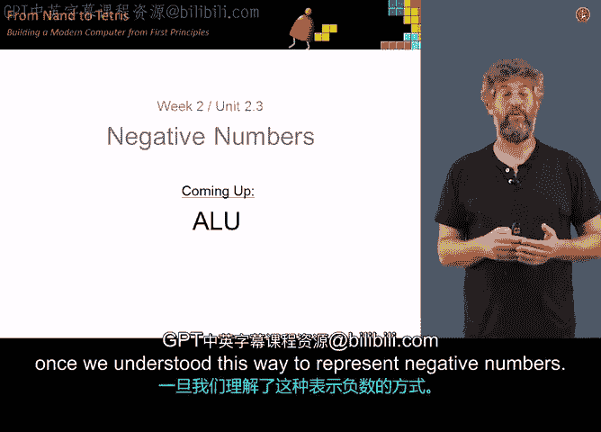

# 耶路撒冷希伯来大学《从零开始构建现代计算机｜Build a Modern Computer from First Principles》中英 - P16：16_04_04_单元-2-3-负数表示.zh_en - GPT中英字幕课程资源 - BV1Zp421y7Ex

In the last two units， we've seen how to represent integers as binary numbers using bits and how to manipulate them。

 how to add them。But so far， we only discussed positive numbers。 And， of course。

 our computers will have to deal also with negative numbers。 So how can we deal with them。😊。

So let's take for an example a case of four bits。 So we know there are 16 possible values there。

 and what we've done so far， we managed， we represented the integers between 0 and 15 or 16 numbers of them using the four bits in general。

 so far， if we had n bits。 we used them to represent the positive integers between 0 and2 to the n -1。

If we want to represent negative numbers， we will need to give up part of these 16 possibilities in order to represent negative numbers。

 So maybe eight of them will be positive， and eight of them will be negative or something like that。

So how can we do that？ Well， the simplest thing you may consider。

 and it was used sometimes was to basically take the first bit and use it as a sign bit。

 And then you remain you have3 more bits or n-1 more bits。 in general。

 to represent the actual number。 So this way， if it starts with 0。

 it's going to be just a positive numbers。 If the first bit is one， then the next  three bits。

 and it's going to be a negative number that is represented by the next  three B。 In this case。

 we can represent 0，1，2 all the way up to 7。 And then negative 0。

 negative1 all the way up to negative 7。😊，So this would be one possibility of representing negative numbers。

 possibility that is not very popular。 Why there are a bunch of problems with it。

 One thing that you may immediately notice， this is very inelegant。 We have negative 0。

 What is this negative 0 and why the difference in 0。

 What we learned in math was it 0 equals negative 0。 So， of course， we may， in principle。

 decide to have two representations of 0 in our computer。

 but that is inelegan and probably means if there is going to be trouble。 Usually。

 if you have something that's not elegant， it's going to bite you。And in fact， here。

 if you actually try to manipulate these kind of negative numbers using some kind of hardware。

 you'll get into trouble。 You'll need to explicitly deal with pluses and minuses。

 and the whole thing will be M mess。 So hardly anyone uses this anymore。😊。

Here is what people use instead。 They use a system called two complement。

 and it has a very simple idea。 If you want to represent a negative number， negative x。

 you just instead represent a positive number 2 to the n- x。 In our case of 4 bits 16 minus- X。

 which is going to be a positive number and you're going represent it like we've seen so far。 So。

 for example， in our case， here is the numbers， you have 0，12 all the way up to 7 as usual。 Now。

 if you want to represent， let's say negative 3。 Well， you present negative 3 by the integer 16-3。

 which is 13。 So if you look at the place 1，1，0，1， which is really the binary number 13。

 the value of that is negative 3。 So this is basically the tables that we have so far。

 And this system is called two complement representation。

 So let's look what we get in this representation。 First of all。

 the positive number that we have are half of what we previously had。 basically we're missing a bit。

😊，We can represent or not the numbers up to 2 to the n -1， but rather up to 2 to the n -1。

 all that -1。The negative numbers in this system， we get one more of them。

 So we get all the negative numbers between negative one and negative2 T Z and -1。And in our case。

 we get the negative numbers between negative 1 and negative 8。

 But we get only the positive numbers between 0，1 and 7。 And， of course， we have the0 as usual。

So the main thing that's nice about this trick is that we will basically get our addition and subtraction and almost all the operation that we need to do with numbers。

 almost for free。😊，So let's see， what does that mean。 Suppose that we want to add two numbers。

What I'm going to show now that if we just use the same edition circuitry that we built so far。

 will magically get the correct result。 And this is true not only this example， but in general。

 So let's look what happens if we just take negative2 plus negative 3 using our circuitry that was not designed for for negative numbers。

 but just design for positive numbers， as we've done in the last unit。😊，So here's what happens。

So negative 2 plus negative 3 is if we use twoth complement， that's really 14 plus 13。So 13 plus 13。

 we know how to add in binary。 We get the two binary numbers。And just。

 we add them using the previous circuitry。 So here's a sum。 If we just use the previous thing。

 here's the usual sum of these two numbers。 Now， notice that there was a carry bit。

 the one that is in green there that usually in our circuit， we threw away。😊，So what does that mean。

 So really， the output that we get is 1，0，1，1， and the most significant one was thrown away。

 So what does that mean。Well， the original result without throwing the carry bit。

 is really the number 27， which is what it should be the sum of 14 and 13。 Once we threw that away。

 we lost 16 because the next bits that was thrown away is equals 16。 So what we get is only 11。Now。

 what's nice about 11。 So basically， what our hardware computed was that 14 plus 13 equals 11。

What is nice about 11。 Well，11 in2th complement really represents the number negative 5。

 And this is exactly what we needed to do。 So amazingly。

 we got the correct result without doing anything new。😊，Now， how does that happen。

 Why does this magic happen， Will it always happen？ Well， as we saw in the last unit。

 our addition is anyway mod2 to the n。 That is because we throw the overflow bits the results that we get is correct up to an additive2 to the n the additive factor。

 And our representation is also mod 2 to the n。 And the sense that we present two numbers as equal negative 3 and 13。

 our equal up to an addition of exactly the same two to the n。

 And since both our representation and addition have the same convention， then they exactly fit。

 and we don't need to do anything else， but immediately our hardware that was designed as previously just for positive numbers just works like it is。

 So one thing we may still need to do is given a number， get its negation。

 So given as input X and the binary number could output its negative to the number。

 negative x again in two complements。😊，Why would we want to do that？ Well， for one thing。

 remember that we still didn't see any circuits that does subtraction。

But once we can solve this problem， then definitely。

 we have already solved the subtraction problem because if you want to do y minus x。

 you just need to add negative x to y。 In addition， we already know how to do。

 So once we can compute negative x from an input X， we've already solve the subtraction problem。

 And that's a good thing because we don't have to build new hardware for it。😊。

So the basic idea of how to do this kind of ne negation in two's complement is very simple。

 It uses a mathematical trick。 The2 to the n is actually 2 to the n -1 plus 1。

 And thus we can rewrite negative x， which is really2 to the n  x and twos complement as1 plus2 to the n -1- x。

 That may seem completely crazy。 What have we gained so far。

 But here's one very nice thing about this。😊，2 to the n -1。 If you look at that as an integer number。

 that is a binary number。 That's represented as bits as all bond bits。So it's just 1，1，1，1，1。

 and bits of one。What's so nice about that。 It's very easy to subtract a number from this because you never need to borrow anything。

 So in order to represent 1，1，1，1，1 in binary  any x， you just need to flip each one of the bits。

 It's very simple。 You never need to borrow from the next time。

 So this is a very simple boolean operation。 Just negation。Once you've done that now。

 we only need to add one。 And this is very nice because we already know how to add in general。 So。

 of course， we know how to add one。😊，So now we've seen that using this very simple trick， Basically。

 we can now do subtraction again， just by the fact that we know how to do addition。

So let's see an example。 Let's see how we can design a boan Boolean heart circuitry that takes as input X and produces its output negative X and its complement。

 for example， takes four as input and produces negative 4。So again。

 what would negative 4 be in twoth complement， It would be the bits 1，1，0，0， which represent 12。

 which is 60-4 is the way we are going to represent negative 4 in twos complement。

So how are we going to do that？ Well， our input is 0，1，0，0。That's 4。 Remember。

 the first thing that we did， we needed to do 2 to the n -1。

 the all ones bit and subtract our number from it。 So this is the first thing we do。

 We take the all one and subtract the number from it。 And then we just flip the bits。

 and we get the result。😊，Now we need to add one， so we just add one to it。

 and we know how to add one。 and we got the new number， exactly what we needed to get。

 are the number 12。 that is the number negative for。Now， in general。

 we need not worry too much how to add an one to a given number because we know how to add any numbers。

 but this is a special case。 So it may be worthwhile to actually note what happens。

 How do we add one to a number。 Well， if you look what happens if you just do addition， Well。

 you start adding one， if the left rightmost bit is 0。

 you just turn the0 to1 and you got your new number。 If it's one， you turn the one to a0。

 because you add one plus one， and then you have a carry and you move to the next bit from the right。

And again， if it's 0， you turn it to one。 If it's one， you turn it to 0。

 but you need to keep on going because you have another carry。 So in general， basically general。

 what you do for the special case of adding one to a given number， you start from the rightmost bit。

 You keep on flipping bits until you reach out zero that you flip to one。 And at that point。

 you stop。 And that is a very simple hardware to manipulate。 you don't to actually build。

 you don't need to write a completely general addition circuitry。 although you may。

And we got our result。So we finish now to say how we deal with negative numbers。

 And the most important point is that we don't need to do anything new really。

 we just need to understand what we're doing and everything that works for positive numbers will keep on working as long as we're careful enough about that。

 And now we're ready to actually design the arithmetic logic unit of a computer。

 And we will not really need to do any special thing。

 neither to subtract numbers nor to handle negative numbers。

 They will all be taken care of themselves once say we understood these way to represent negative numbers。

😊。

