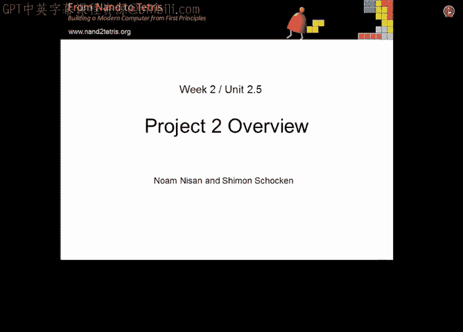
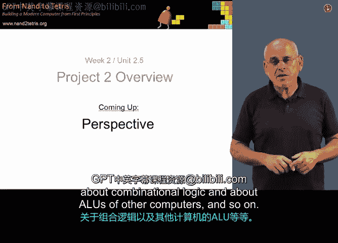

# 耶路撒冷希伯来大学《从零开始构建现代计算机｜Build a Modern Computer from First Principles》中英 - P18：18_04_06_单元-2-5-项目2概述.zh_en - GPT中英字幕课程资源 - BV1Zp421y7Ex

In this unit， we're going to describe all the chips that you have to build in Project 2 and give you some guidelines on how to actually implement them。

So when you set out to build the chips of Project two。

 you can certainly use all the chips that you build in Project one。

 you know these are the fruits of your hard labor so you can certainly plug them into your HDL implementations and using these building blocks you now have to build the following five chips ranging from halfeder all the way to AU basically this is a family of combinational chips from simple adders to more complex ones。

So let us start with the simplest chip in this family， the halfeder。

 The halfeder takes two bits and adds them up。And outputs both the sum of these two bits and the carry bit。

 which may be either 0 or one。 This is the truth table of the halfeder。

 and here is the stub file of this chip。And if you look carefully at this truth table。

 you will realize that the sum and the carry columns are identical to the outputs of two gates that we have already built in Project1。

So this tip is sufficiently， I think helpful to let you understand that building this gate is a rather trivial thing。

 you have to pick up two gates that you already built。

 plug them in in some way and what you get is a halfed functionality。

 which is kind of interesting because we use a logical device to affect something which is semantically in addition operation。

 something it happens all the time when you do digital design。

The next chip up the hierarchy is called full Eder and the full Eder is slightly more powerful than the halfeder。

 It is capable of summing up three incoming bits， so to speak， and it outputs the same thing。

 the sum of the three bits and the carry This is the truth table of the fulleder this is the stub file that you have to complete。

Now， in general， you can build a full adder using two halfeders。

 which you can put together and add some glue in the form of some other logic gates that combine the operations of these two halfeders and this by the way is the reason why this gate is called halfeder。

 not this one， but the one we saw previously because it takes two halfeders。

In addition to some other functionality to deliver the functionality of a full Eder。 By the way。

 this is not the only way to implement a full letter。 You can do it in other ways。

 So you're welcome to come up with any HDL implementation that makes sense。

The next chip that we'd like to talk about is a 16 bit adder。

 we begin to see some industrial strength addition so to speak。

 this is the stud file and if you think about it it can be built quite easily from a sequence of 16 regular adders or 16 full adders so you put these 16 adders one next to the other and you can pipe the carry bit of one adder to one of the inputs of the next adder up the significance letter so to speak going from right to left and notice that according to the chip specification。

 the most significant carry bit is simply ignored。Moving along the next chip is called incrementer。

 it's a simple version of an adder， it takes a single input called in。

 it adds one to the incoming value and delivers the result The subub filele is straightforward and you can build such an incrementer using the chips that you built already in doing so I just want to remind you that in HDL you can represent the single bit value0 and1 using the keywords false and true respectively。

Finally， we get to the most interesting chip in this project， the ALU。

 and we talked about the AU to a great detail in the previous unit。

 but just to repeat the main functionality of the AU。

 I'm giving you this section of the stub file that you will get from us。

 which documents what the AU is supposed to do once again all the operations here straightforward we've done them before using previously implemented chips。

 so now you have to put together all this functionality in order to deliver the required ALU functionality。

Two useful hints， I hope you can build this AU using a 16 bit adder in various chips that you built in Project1。

 and finally you can do all of the above， you can build all this functionality with less than 20 lines of HDL code。

 which is another manifestation of this simplicity and elegance of this non-trivial chip。

In terms of resources， you have to go to the Nanttotetri website and get the full description of Project2 once again I want to remind you that if you have downloaded the course software suite there's no need to download anything else during the course。

 you now have a directory on your computer called Project slash02 which includes all the files which are necessary for Project2 there are a few more resources that I described in Project one which are relevant to this project also so finally some best practice advice much of it repeats what I said in Project one so I don't want to to read it allowedlo but you certainly have to go through it before you set out to work on the project now there's something new that we have to say about Project2 the best practice advice is not to use your HDL implementations and instead use their builtin version。

Which are automatically available when you use our hardware simulator。

So let me repeat and explain how we do it。 If you look at your project two files。

 you will see that they include only six chips。Beginning with a half header and ending up with AU。

 And yet， I just told you that you are welcome to use previously defined shapes like and or moOs and so on。

😊，You can use these chips precisely because they are not listed。

 they are not available in your project2 directory。

 because the simulator works in such a way that if it tries to evaluate the chip part and it doesn't find it in the current directory。

 it reverts to using it built- in version of this chip so this setting is ideal for our purposes。

 you just use the chips that we gave you and you use any previously defined chips as chip parts and the simulator will kick in and use the automatic versions whenever it's necessary。

So this has been an overview of Project2 and all the chips that you have to build in this project。

 and the next unit as usual at the end of each week。

 will be perspective in which will give you some more information about combinational logic and about A use of other computers and so on。

