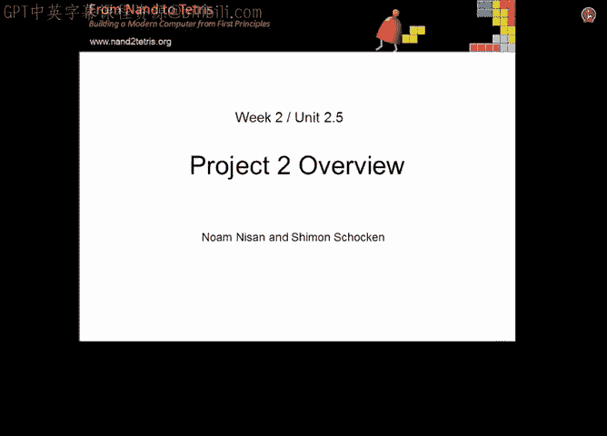
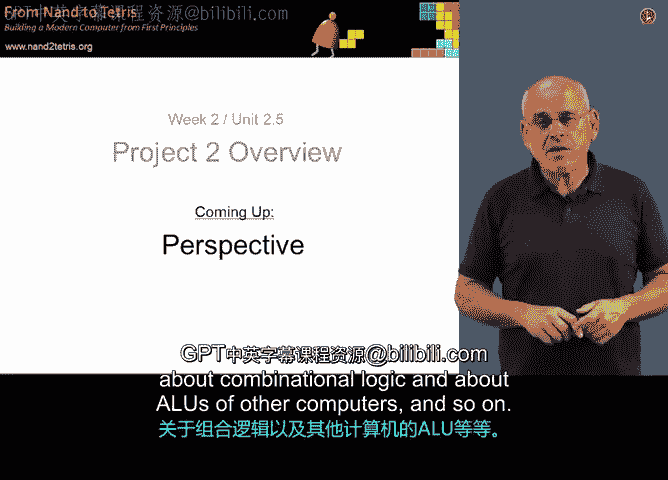

# 从零开始构建现代计算机：P18：项目2概述 🧩

在本节课中，我们将学习项目2中需要构建的所有芯片，并提供一些实现指南。我们将从最简单的半加器开始，逐步构建更复杂的组合逻辑芯片，最终完成一个功能完整的算术逻辑单元。

上一节我们介绍了组合逻辑芯片的基本概念，本节中我们来看看项目2的具体任务。

## 项目2芯片概述

在项目2中，你需要构建一系列组合逻辑芯片。你可以使用在项目1中已经构建好的所有芯片作为基础模块。利用这些模块，你需要构建以下五个芯片，从半加器到ALU，构成一个从简单加法器到更复杂芯片的家族。

以下是需要构建的芯片列表：

*   **半加器**：最简单的加法器芯片。
*   **全加器**：能处理三个输入位的加法器。
*   **16位加法器**：具有工业级加法能力的芯片。
*   **增量器**：将输入值加1的专用芯片。
*   **算术逻辑单元**：项目中最核心、最复杂的芯片。

## 芯片详解与实现指南

### 半加器

半加器是加法器家族中最简单的芯片。它接收两个比特位作为输入，将它们相加，并输出这两个位的和以及可能产生的进位位。

其功能可以用以下真值表描述：

| 输入 a | 输入 b | 和 sum | 进位 carry |
| :----: | :----: | :----: | :--------: |
|   0    |   0    |   0    |     0      |
|   0    |   1    |   1    |     0      |
|   1    |   0    |   1    |     0      |
|   1    |   1    |   0    |     1      |

观察这个真值表，你会发现**和**与**进位**的输出列，与我们在项目1中已经构建的两种逻辑门的输出完全一致。因此，构建这个门电路相当简单：你只需要选取两个已经构建好的门电路，以某种方式连接它们，就能获得半加器的功能。这很有趣，因为我们用逻辑设备实现了一个语义上是加法操作的功能，这在数字设计中很常见。

### 全加器

全加器在功能上比半加器更强大一些。它能够对三个输入位进行求和，并输出这三个位的和以及进位。

以下是全加器的真值表：

| 输入 a | 输入 b | 输入 c | 和 sum | 进位 carry |
| :----: | :----: | :----: | :----: | :--------: |
|   0    |   0    |   0    |   0    |     0      |
|   0    |   0    |   1    |   1    |     0      |
|   0    |   1    |   0    |   1    |     0      |
|   0    |   1    |   1    |   0    |     1      |
|   1    |   0    |   0    |   1    |     0      |
|   1    |   0    |   1    |   0    |     1      |
|   1    |   1    |   0    |   0    |     1      |
|   1    |   1    |   1    |   1    |     1      |

通常，你可以使用两个半加器，再加上一些其他逻辑门作为“粘合剂”来组合这两个半加器的操作，从而构建一个全加器。这也是之前那个芯片被称为“半”加器的原因之一——因为它需要两个，再加上一些其他功能，才能实现一个“全”加器的功能。当然，这不是实现全加器的唯一方式，你可以采用任何有意义的HDL实现。

### 16位加法器

现在，我们开始构建具有工业级加法能力的芯片：16位加法器。思考一下，它可以很容易地由一系列全加器构建而成。

具体方法是：将16个全加器依次排列，并将一个加法器的进位位输出，连接到下一个更高有效位加法器的输入之一（通常是从右向左连接）。需要注意的是，根据芯片规范，最高有效位的进位位直接被忽略。

### 增量器

增量器是加法器的一个简单变体。它接收一个名为`in`的单一输入，将该输入值加1，然后输出结果。

其存根文件很直接。你可以使用已经构建好的芯片来构建这样一个增量器。在此提醒一下，在HDL中，你可以分别使用关键字`false`和`true`来表示单比特值0和1。

### 算术逻辑单元

最后，我们来到本项目中最有趣的芯片：ALU。我们在上一个单元已经详细讨论过ALU，但为了重申其主要功能，这里再次给出存根文件中的相关部分，它记录了ALU应该执行的操作。

所有操作都是我们之前使用已实现芯片完成过的，现在你需要将所有功能组合在一起，以交付所需的ALU功能。

两个有用的提示：
1.  你可以使用一个16位加法器以及项目1中构建的各种芯片来构建这个ALU。
2.  你可以用少于20行的HDL代码完成上述所有功能的构建，这再次体现了这个非平凡芯片的简洁与优雅。

## 资源与最佳实践

在资源方面，你需要访问Nand2Tetris网站获取项目2的完整描述。再次提醒，如果你已经下载了课程软件套件，在课程期间就无需下载其他任何东西。你的计算机上现在有一个名为`projects/02`的目录，其中包含了项目2所需的所有文件。我在项目1中描述的一些其他资源也与此项目相关。

最后是一些最佳实践建议，其中大部分重复了我在项目1中说过的话，因此不再赘述，但在开始项目之前你肯定需要仔细阅读。

对于项目2，我们有一些新的建议：**最佳实践是不要使用你自己的HDL实现，而是使用其内置版本**。这些内置版本在你使用我们的硬件模拟器时会自动可用。

让我重复并解释一下我们是如何做到的。如果你查看项目2的文件，你会发现它们只包含六个芯片（从半加器到ALU）。然而，我刚才告诉过你可以使用之前定义的芯片，如`And`、`Or`、`Mux`等。你之所以可以使用这些芯片，恰恰是因为它们没有被列出，也不在你的项目2目录中。因为模拟器的工作方式是：如果它试图评估一个芯片部件但在当前目录中找不到它，它会转而使用该芯片的内置版本。这种设置对我们的目的来说是理想的：你只需使用我们给你的芯片，并将任何之前定义的芯片用作部件，模拟器会在必要时自动调用其内置版本。

本节课中我们一起学习了项目2需要构建的所有芯片，包括半加器、全加器、16位加法器、增量器和ALU，并了解了实现它们的基本思路和最佳实践。下一单元，照例在每周结束时，将是“视角”单元，我们将为你提供更多关于组合逻辑以及ALU在其他计算机中应用的信息。