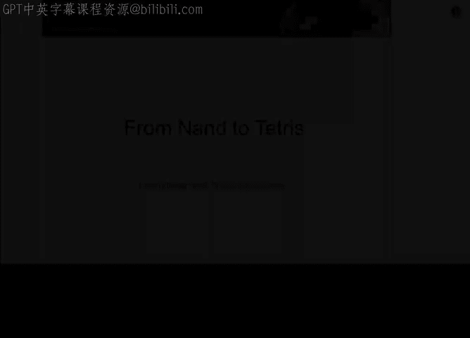
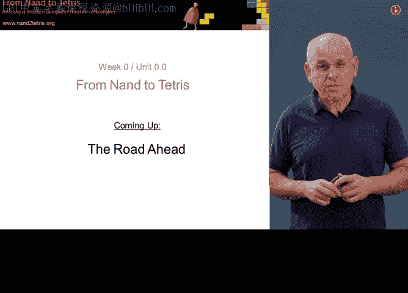

# 耶路撒冷希伯来大学《从零开始构建现代计算机｜Build a Modern Computer from First Principles》中英 - P1：01_01_02_单元-0-0-引言.zh_en - GPT中英字幕课程资源 - BV1Zp421y7Ex

Hello and welcome to Nant to Tetriris。 My name is Shimon Shoen。

 and I'm a professor of computer science at I DC Herzeia and visiting professor at the Hebw University of Jerusalem。

 Hi， I'm Norni Sun， a professor of computer science at the Hebrew University of Jerusalem and the researcher at Microsoft together will' teach this course。

 and。😊，And the first thing that we are going to want to do in this unit is to give you the overall picture of what this course is all about。

 Well， in this course， we are going to build a complete general purpose working computer from the ground up hardware and software。

 And we are going to divide this huge enterprise into two separate courses。 in the first course。

 which is going to be seven weeks long。 This course。

 we are going to build the hardware of the computer。

 And in the second course that will be offered later。

 we are going to to complete the picture and build the software hierarchy that sits on top of the computer that you will build in the first course。

 So that's what we're going to do in the next seven weeks。

 we are going to focus on building the hardware of the computer， which we call heck。😊。

So it's going to be a great journey consisting of 7 weeks，6 projects。

 one computer and 0 prerequisite knowledge。 We assume no knowledge whatsoever in computer science or engineering。

 Everything will be given to you in the course itself。😊。

So this has been our first unit in Nan to Tetriris。

 and coming up is the road ahead a more detailed description of what we're going to do in this course。

