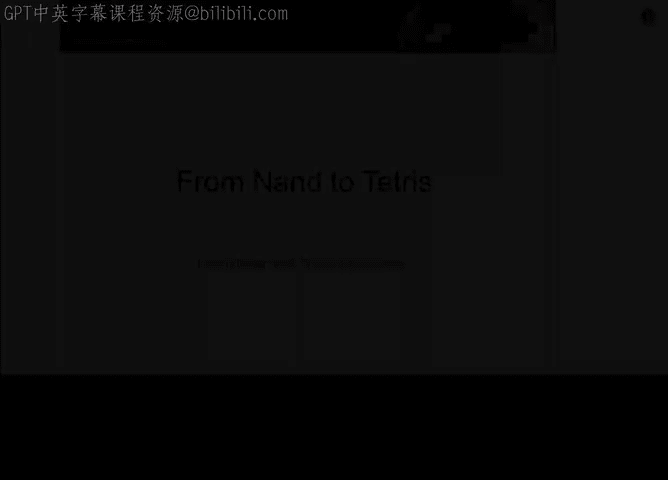
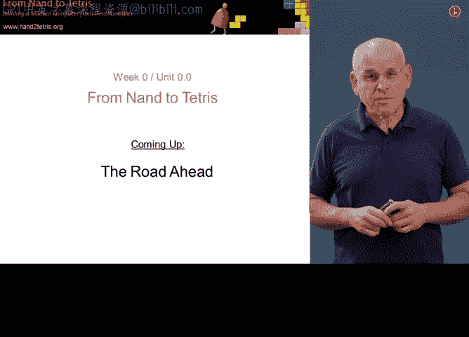

# 从零开始构建现代计算机：0-0：引言 🚀

在本节课中，我们将了解《从零开始构建现代计算机》这门课程的整体目标与结构。我们将一起探索如何从零开始，一步步构建出一台功能完整的通用计算机。

大家好，欢迎来到《从零开始构建现代计算机》。我是 Shimon Shoen，我是 IDC Herzliya 的计算机科学教授，也是耶路撒冷希伯来大学的客座教授。

大家好，我是 Norni Sun，耶路撒冷希伯来大学的计算机科学教授，同时也是微软的研究员。我们将共同教授这门课程。

在本单元中，我们首先要做的，是向大家展示这门课程的整体蓝图。

在这门课程中，我们将从零开始，构建一台完整的、通用的、可工作的计算机，包括硬件和软件。

我们将这个宏大的工程分为两门独立的课程。在第一门课程中，我们将构建计算机的硬件部分，这门课程将持续七周。

在后续将提供的第二门课程中，我们将完成整个蓝图，构建运行在你于第一门课程中构建的计算机之上的软件层次结构。

这就是我们在接下来七周里要做的事情：我们将专注于构建计算机的硬件部分，我们称之为 **Hack**。

这将是一段精彩的旅程，包含 **7周**、**6个项目**、**1台计算机**，并且**无需任何预备知识**。我们假设你没有任何计算机科学或工程学的基础知识。课程本身将提供你所需的一切。

以上便是我们在《从零开始构建现代计算机》中的第一个单元。接下来，我们将展望前方的道路，更详细地描述我们在这门课程中将要完成的任务。

---

本节课中，我们一起学习了这门课程的核心目标：从零开始构建一台名为 **Hack** 的完整计算机。我们了解到，整个学习过程分为硬件和软件两大部分，并且课程设计为无需任何先验知识即可入门。