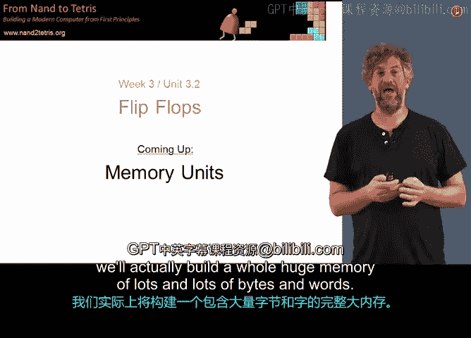

# 耶路撒冷希伯来大学《从零开始构建现代计算机｜Build a Modern Computer from First Principles》中英 - P21：21_05_03_单元-3-2-触发器.zh_en - GPT中英字幕课程资源 - BV1Zp421y7Ex

In our previous unit， we discussed how we are dealing with time and sequential logic in computing systems。

 What we'll do in this unit is actually talk about the actual elements。

 the chips that will allow us to do provide this kind of functionality。😊，So let us say。

 let us recall how we started the last unit where we saw that the way we deal with time we have integer time units at every time unit T。

 we want something that can depend with value to compute some kind of function and the output and some kind of function and the value at the previous time unit。

 a time t -1。 So what kind of element do we need in order to provide such a functionality。 Well。

 the missing element。 We need something at a very basic point is we need something to actually remember one bit of information move one bit of information from time t -1 to time T。

 This is what we have missing。 We have lots of combinatorial logic so far that can do any kind of manipulation that we want within a single time unit。

 but actually moving information from time t-1 to time T is something that is still missing。😊，Now。

 if we look about that kind of thing in the way in this abstract way that we're thinking about these discrete time units。

At the exact time， when we switch between time unit t -1 to time unit T。

 this new element was to remember the bit。😊，At that point。

 it has to remember what happened previously and carry it on to the next stage。 Without that。

 we cannot have this kind of functionality。Now， this means that at this transition point between two consecutive time units。

 it must have state， it must remember whether it's now remembering zero or is it now remembering one。

 that means it has to be in two different physical states in its implementation。

These two physical states， it must be able to move between them。

 according to the logic of the previous time unit， Me me。

 which means it needs to be able to flip between these two kind of different two different physical states。

 and and elements that can do that thing that can flip change situation between two different kind of states are called flip fls。

 They flip to 0 and then can flop back to one。 And the point is that this flipping and flopping is something they remember。

 It's not just a function of the current input。 But it's something internal to them。

 They remember between time units。😊，So let us view though the basic flip flo that we will be using in this course。

 which is called the clock D flip fl。 This flipflop has a single input in a single output。

 and it basically remembers the input from last time unit and outputs it in the next time unit。😊。

So if we again look at the diagram of our time units and assume that our input looks like this。

 It starts with a value of1。 It's time unit 1 goes down to 0 for time units 2 and 3 and then goes up to 1 and down to 0 again。

Then when we look at what the D fliprop will do at any time unit。

 it will actually return the values that was in the input in the previous time unit。 So at time1。

 we don't exactly know what our output will be because we haven't specified what happened in the previous time unit。

 So for us， it's gray。 we just don't know what the output is。 But once we get to time unit2。

 Then we know exactly what the output needs to be。 It needs to be exactly what the input was a time 1。

😊，Similarly， at time unit 3， we know it has to be0 because that was what was the input was at time2 and so on。

 at every time point we are having simply the previous signal that was fed as the input shifted one time unit to the right。

 And this is what the clock D fliplo does。😊，And this is going to be the only element that will provide all the sequential logic that we need in this course。

 And from this we need all the kinds of the sequential circuities that we need。 Me。

 counters and so on。 One thing that I'd like to mention at this point is the meaning of the little triangles that we see at the bottom is the bottom of the deep flipfl diagram。

 The meaning of this is that we have a sequential chip， chips that depend on time。

 As opposed to all previous chips are all combinatorial chips that we had so far。

 whose output only dependent on their own inputs at any given point in time。 Here。

 we have a chip whose output also depend on what happened previously and states that kept inside this chip。

😊，This is the only point that we care for， this logical dependency of time。

 although it's probably also interesting to note that in any physical implementation of a deep flip flop。

 this means that the implementation will also need some kind of access to this clock that we mentioned in the last unit that actually breaks down the physical continuous time into discrete time units。

😊，Again， we won't care about us because we are living in our abstraction of discrete time。

 So from our point of view， this is just a way to remember that this chip has state and can remember and and depends and whose output also depends on what happens in previous time units。

Now， at this point， let us say just say one word about the implementation of a def flip fl。

In this course， we're going to deal with it as a completely primitive operation。

 This is something given to you that cannot be manufactured from anything else。

 but just you're going to use it just like you view the N gate and from the fliprop and the N gate。

 you'll provide you'll actually build everything in the course。In many other courses。

 you actually follow what happens in most real life hardware。

 you can actually construct a flipflop from Nand gates when you actually take the N gate and put them into some kind of a loop between each other。

 This kind of loop basically has them amplifying the same signal again and allows them to get stuck either in a zero or one state and with some additional logic。

 you will also be able to manipulate this state from the outside。😊。

This kind of logic usually has two steps。 The first step is one is what I've just described having this kind of cycle that allows the to somehow remember information。

 And the second type step is to actually have some kind of logics that actually provide isolation between subsequent time units。

We will not describe in this course how this is done。

 even though it's extremely elegant and beautiful， because we basically think it's confusing。

 We do not think that is the right way to think about a logical circuit。

 We think that it's it's completely worthwhile to keep separating your head the combinatorial logic。

 which happens instantaneously and the sequential logic。

 which we don't want us to thinking about how it is constructed from lower levels combinatorial stuff。

 but rather think about it as its own primitive block。 So now that we can remember one bit from this。

 we can build everything else。 In fact， there's a generic paradigm of how we're going to build all our logic in the computer。

 and it's going to be a combination of remembering information via this basic D flip flops。

 And then manipulating them using combinatorial logics that we built in the first two lectures。😊。

So in particular， the usual way we do things is we have an array of D flip flops。

 which basically compromise all our memory in the system。😊。

Their output is going to be fed into some combbininatorial logic together with the new input that you get in this time unit。

 And all of this is going to change the state that we have in the dip flipops for the next time unit。

This is a general way we're going to build everything， whether it's a memory or a counter。

 for example， if it's a counter， we're going to remember a number in all these flip flops and the combinatory logic will basically add one to the counter。

 And this way， every time unit， the new value that we have will be one more than the old unit。😊。

Let us say， actually now look at the first bits that we're actually going to the first device。

 the first chip that we're going to actually be built from a D flip fl。

 And this is a device that actually builds remembers a bit forever。

 So the D flip fl provided the basic functionality of remembering a bit for one time unit。😊。

If we want to build a memory， we want something that we can remember a bit forever。

 We store it with tell now start remembering this bit。 And then it keeps on remembermebering a bit。

 Such a device， such as chip is defined by the following API by the following chips that we have that we call the bit chip。

 It has two input。 an input bit and a load bit。😊，Once we。Take the load bit and put a one into it。

 We want to remember the input bit at exact time。 When the load bit goes down to 0。

 we want to the the chip to keep remembering the last time that the last input that was loaded into it for infinity until a new load operation is performed。

 So this is basically the logic that we have。 If load the time t -1 is one。

 Then we want the next out the out the time T to be exactly the input at time t -1。😊，Otherwise。

 we want the output at time T to just keep on being what it is now。

 basically the old value that we remember， the same as al tian -1。

How can we build such a chip from our humble D flip flop？ Before we look at that。

 let us see what this bit chip needs to do。 So again。

 let's look at two possible signals for load and for in。 So， for example。

 we asked for loading in time units 1 and time units 4。While input is。

 let's say it's one in the first time unit， and then it goes down to 0。So let's see。

 what do we expect the output of this bit gate to be。 Well， in the first time unit。

 we don't know the history。 So we have no idea what the output is。 Let's put it in gray。Now。

 in time unit 2， it's supposed to be since we asked for a load at time unit 1。

 what we want in time unit 2 is for the output is to be exactly like the input at time unit 1。

Because we have a load the time 1， the value of inner time 1 is1。

 The output at time 2 should be  one。Now， after that。

 load goes down to 0 for the next two time units。 So basically。

 what we want is we want the same output to the same output to remain。

Just because low is is going to 0， even if input changes。

So we're going to keep on maintaining the same value。For the next two time units。

 until load goes up to one。 And then we'll have to see what we're going to do。

Now notice that for this time units， whatever input was， whether input went up or down。

 it does not matter。 in any case we will not change the output of our chip。Now。

 let's see what happened as a first time unit。 It's a first time unit， load goes up to one。

Load loads up to one。 So now we're asking the chip to load the value again。

 and the value that we load is a value of n right now， which is the value at time 4， which is 0。

 Notice that we have to load the time 4， But this will only affect the output at time 5 because the output at time 5 is basically change to the input at time 4 only if load the time 4 as to do it。

 So that means that a time 5， our output will go down to 0 as planned。

 So this is the intended functionality of the one bit register。 How can we do that。

 How can we pipe and pipe the value that we remember。

 So it will keep on being remembered until we we ask to change it。😊，Well。

 here' is the first naive approach。 We'll take the output what we currently remember。

 And let's plug it back into the input of a D flip fl。 And this way， a D flip fl。

 unless we tell it to load a new value， we just keep on having the same value looping inside it if you wish。

😊，This is a very basic correct idea in general。 But， of course， this is not a real chip。

 How do we connect。 How do we put the real input in if we want to also put the output of the D flip fl back into itself。

 How does this connection done。 So this doesn't quite work。

 really need a way to combine these two possible sources into the flip fl， One source。

 which is the output from the previous stage。 and another source， which is a new input。

 And which one of them we want to actually plug into the flip fl depends， of course。

 and whether the load bit is set or not。 But we already know exactly how to combine two sources into one output。

 And this is exactly the multiplex。😊，So if we actually take the input and feed it into one input of the multiplexer。

 take the previous output and feed it into another input of the multiplexer and then load。

 choose between them。 This is exactly the correct functionality。

 We can actually see how that works by following step by step。

 So let's try to follow this implementation and see how it works real time。 Again。

 let us take two possible example inputs load and in that we get from some other source that we don't care about and see what our new implementation does when it feds these two signals and inputs and what it produces its output。

😊，Let us start with time step 1。 A time step1， There is one point piece of information that we don't know。

 We don't know what the previous state of the flip fl was， what the previous output was。

 because it's not specified in this example。 So for us， it's going to be a question mark。

 All the other bits， we can complete。 We know that in is one because that's what we see in our input。

 we know that load is one and so on。 Now， notice that the multiplexor here， because load is one。

 And because in is one， even though we don't know what is the input to its other input to its down to its lower input。

 we still can tell very well what the output is， what the output of the multiplexor is。

 and that's going to be one。😊，Now， is we know what the input to the D plot at time unit 1 is。

 So even though we don't know the output at this point time unit， we know everything about the input。

Now we can see now this implies exactly what is going to happen in the next time step in the next time step。

 the one that was the input of the D flip fl is going to be passed and is going to be the output of the D flip fl in the next time unit。

 exactly when we switch between time units。😊，Now， we can fill up the rest of the information about what happens in the second time unit in the second time unit。

 we know what in is。 That was our input。 We know what load is。 We have the previous out。

 so we can calculate exactly what the multipleer does。

 and the multipleer basically basically picks the previous output from the from the old value of the DFF。

😊，And then we exactly， we， again， we know what's the input to the to the D flipfl is going to be。

 It's going to be， again， a one。And this， we can keep on doing step after step。

 At each point in time， we know the previous values。 We know what load is。 We know what in is。

 We can compute what the next situation is。 And at every given point in time。

 we can write down the values and all the different wires。

 just like we did did in combinatorial logic。And as we see。

 this implementation actually provides the required functionality。

 the functionality of whenever load is being pulled too high。

 we load the input from in and keep it until the next time that a load is S。

So at this point weve we've looked at what is the basic units that allows us to do sequential logic in a computer。

 and we've built the first interesting element from it， one bit memory。

Once we have one bit memory and the next unit willll actually build a whole huge memory of lotss and lots of bytes and words。

😊。

