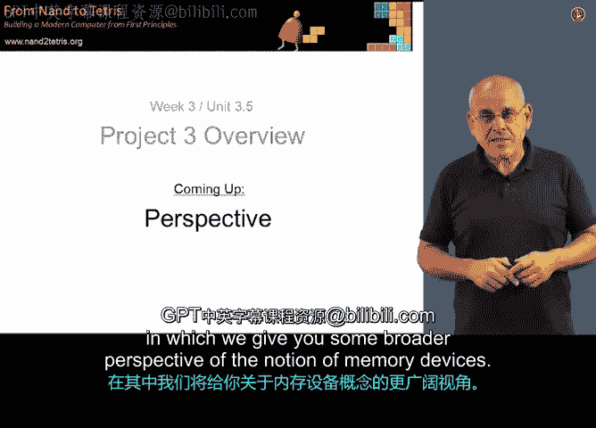

# 从零开始构建现代计算机：3-5：项目3概述 🧠

在本节课中，我们将学习如何运用之前所学的存储器理论与实践知识，实际动手构建实现这些功能的芯片。

## 概述

项目3将基于项目1和项目2中已设计好的所有芯片，以及一个可供自由使用的基础D触发器。基于这些基础模块，我们需要构建一系列芯片。这些芯片在前面的单元中都以不同方式出现过，现在我们将亲手实现它们。

## 芯片构建任务

我们将要构建的芯片，除程序计数器外，其余构成了一个复杂度递增的时序芯片家族，从1位寄存器一直到包含约16K个寄存器的随机存取存储器。

以下是需要构建的芯片列表：

*   **1位寄存器**
*   **16位寄存器**
*   **RAM8**：包含8个寄存器的RAM设备
*   **RAM64**
*   **RAM512**
*   **RAM4K**
*   **RAM16K**
*   **程序计数器**

## 从基础寄存器开始

上一节我们介绍了项目任务，本节中我们来看看如何从最基础的芯片开始构建。

### 1位寄存器

我们首先构建一个1位寄存器。其示意图和文档说明已在此处重复展示，我们之前讨论过它。其HDL存根文件并无特殊之处，实现方式在之前的单元中已有描述，你可以按照说明在HDL中构建此芯片。

### 16位寄存器

接下来，我们可以将一组这样的单比特寄存器组合起来，构建一个16位寄存器。其HDL代码框架已展示，你需要做的就是创建正确的连线，从而得到一个16位寄存器。

## 构建RAM设备

现在我们已经准备好继续前进，构建我们的第一个RAM设备——包含8个寄存器的RAM8芯片。

### RAM8芯片

这是该芯片的API接口说明，这是描述其输入和输出引脚的存根文件。

现在，我们来看看如何实际构建这样一个RAM设备。这里有两个非常重要的提示：

1.  你必须将输入值**同时**馈送到所有八个寄存器。你需要使用HDL语句将这个输入值分发到RAM设备中的所有寄存器。
2.  然后，你需要使用一些**多路复用器（Mux）** 和**解复用器（DMux）** 逻辑，来选择你希望受特定读或写操作影响的确切寄存器。

简而言之，你将信息发送给所有寄存器，但只通过Mux和DMux功能选中其中一个。具体的实现细节留给你来完成，否则挑战性会不足。掌握了这些细节，你就具备了构建此RAM设备所需的一切。

### 构建更复杂的RAM芯片

我们已经实现了前三个芯片，现在准备在层次结构中构建更复杂的RAM64、RAM512等芯片。

我们的做法是：从刚刚讨论的RAM8芯片开始，将八个这样的RAM8芯片堆叠在一起，得到的结果就是我们称为RAM64的芯片。然后，我们可以取八个这样的RAM64芯片组合起来，得到层次结构中的下一个芯片——RAM512。我们可以再进行两个性质相似的步骤，最终得到最复杂的RAM芯片——我们称之为RAM16K的芯片。这基本上是一个递归上升的过程。

那么，具体如何操作呢？首先，我们注意到一个RAM设备可以通过将更小的RAM部件组合在一起来构建，这可以用HDL描述。我们可以将每个芯片的地址输入（图中未显示，但在背景中）视为一个由两个逻辑字段组成的二进制值：一个字段用于选择你想要操作的确切RAM部件，第二个字段用于选择该RAM部件内你想要通过读或写操作来影响的具体寄存器。结合这两个技巧，你就能构建任意长度的RAM设备，并使用Mux和DMux门来实现我刚才描述的这种分层寻址方案。

同样，这里的提示足以让你使用HDL独立完成实现。

## 构建程序计数器

这基本上完成了RAM设备的构建，我们接下来构建本项目中的最后一个芯片——程序计数器。这是一个完全不同的芯片。

程序计数器实际上就是一个计数器。它有一个输入值、一个输出值和三个控制位。这个计数器的整体行为有些复杂，我们在之前讨论计数器时已经讲过。这里我只强调关于它的四个最重要方面：

1.  作为一个计数器，我们需要能够将其**重置为零**。
2.  我们需要能够将其**设置为其他值**（如17或19等）。
3.  我们需要能够告诉芯片**开始计数**，即在每个周期变为之前的值加一。
4.  在某些情况下，我们可能希望告诉它**停止计数并保持**当前值。

你需要实现正确的功能逻辑，来影响这四种操作中的每一种。事实证明，你可以使用一个寄存器芯片、一个增量器芯片以及一些之前描述过的其他逻辑门来实现。

## 项目实践指南

综上所述，这就是你在项目3中需要完成的任务。和往常一样，你需要访问Nand to Tetris网站，在项目网页上找到许多额外的操作细节。

再次强调，如果你已经下载了课程软件套件，则无需额外下载任何东西。所有必要的文件都已在你计算机的 `project/03` 目录中，你拥有硬件模拟器，可以开始独立构建所有这些芯片。

和往常一样，必要时查阅这些资源是明智之举。此外，之前项目中给出的所有最佳实践建议在这里同样适用，你最好在开始构建项目前阅读一下。另外，和往常一样，你将需要使用在之前项目中实现的芯片，而最佳实践是忽略你自己的HDL实现，转而使用内置的实现。

最后，关于本项目，我想强调另一点：本项目的HDL文件存储在名为A和B的两个独立目录中，这个结构应保持不变。为什么这样做呢？如果你回想一下，我们的RAM设备是由更小的RAM部件构建的，而更小的RAM部件又由更小的RAM部件构建，如此反复，就像一个俄罗斯套娃系统。如果你将一个巨大的RAM芯片（比如RAM16K）放入硬件模拟器，模拟器会开始评估所有芯片部件，并以某种递归向下钻取的方式进行，一直深入到单比特寄存器。事实证明，这对于硬件模拟器（它只是一个普通的计算机程序）来说，可能需要处理太多内存或太多对象。因此，通过将这些RAM芯片放在两个独立的目录中，我们强制模拟器在某个点停止使用HDL文件，并开始使用这些内置芯片的Java实现，这将使模拟运行得更快、更顺畅。所以，请保持目录结构不变。

## 总结

本节课中，我们一起学习了项目3的完整概述。我们明确了需要构建的芯片家族，从基础的1位和16位寄存器，到通过分层和递归方式构建的复杂RAM设备（RAM8、RAM64、RAM512、RAM4K、RAM16K），最后是功能多样的程序计数器。我们还讨论了关键实现技巧（如使用Mux/DMux进行寻址）和重要的项目实践指南（如目录结构的意义）。现在，你已经准备好开始动手，将这些理论知识转化为实际运行的硬件了。