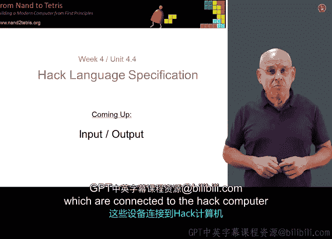

# 从零开始构建现代计算机：4-4：Hack语言规范 🖥️


在本单元中，我们将完成对Hack机器语言的描述和规范说明。

## 概述

上一节我们介绍了Hack计算机的硬件平台和指令类型。本节中，我们将深入探讨Hack机器语言的完整规范，包括其符号化表示与二进制编码之间的映射关系，并了解一个完整的Hack程序是什么样子。

## 指令的两种表示形式

与所有机器语言一样，Hack程序可以用两种不同的“风味”或语言来编写。你可以使用助记符和友好的符号进行符号化编写，也可以使用约定的二进制代码来编写。

如果你用符号编写程序，就需要有人将这些程序从符号翻译成二进制代码。一旦程序以二进制代码指定，你就可以将此代码加载到计算机中并实际执行。

我们将用整整一周的时间来讨论这个翻译过程，以及一个被称为“汇编器”的特殊程序。因此，这里不会花太多时间讨论翻译过程，但需要知道，在构建这台计算机时，这是一个必须面对的挑战。

## A指令的语法

以下是A指令的符号语法和二进制语法。

符号语法是我们之前见过的：`@value`。这个值可以是一个最大为 `2^15 - 1` 的数字，或者是一个引用该数字的符号（关于符号的讨论将推迟到后面的单元）。例如：`@21`。

以下是同一指令的二进制形式。我们以一个特殊的代码 `0` 开始，它告诉计算机这是一条A指令。然后，我们使用二进制代码指定与符号指令中相同的值。最终我们得到类似这样的示例：

```
0 000000000010101
```

第一个 `0` 有时被称为操作码。然后是代表我们想要加载到A寄存器中的值的15位。这里，`000000000010101` 恰好等于二进制的21。

## C指令的语法

接下来是C指令。正如你所回忆的，C指令的符号定义非常用户友好：我们有一个可以存储到特定目的地的计算，以及一个可选的跳转指令。这是符号表达的巨大优势。

如果我们想用二进制表达它，就必须决定一些约定的代码。在设计这种语言时，我们已经完成了这项工作。以下是同一符号指令的16位规范：

```
1 1 1 a c1 c2 c3 c4 c5 c6 d1 d2 d3 j1 j2 j3
```

第一个 `1` 是操作码，它告诉计算机这是一条C指令。因为我们只有两种指令类型（A指令和C指令），所以只需要一位来表示操作码（0或1）。因此，操作码 `1` 表示这是C指令。

接着是两个未使用的位，按照惯例我们将其设为 `1`。

接下来的七位共同指定了要执行的计算。这些是稍后将发送给ALU的控制位，告诉ALU它必须执行哪种计算。

随后的三位代表目的地。

最后三位代表我们在符号上用 `jump` 一词表示的跳转条件。

这就是C指令二进制形式的各个字段。

## 符号到二进制的映射

现在让我们讨论C指令的符号表达式与其二进制表达式之间的映射关系。

### 计算字段

首先从计算字段开始。这里有一个表格，将符号计算助记符与其二进制等价物联系起来。

表格左侧是符号，右侧是二进制代码，底部还有一个 `a` 位。

例如，假设计算是 `D+1`。我们查表，在表格中间某处找到 `D+1`，并看到它列在 `a=0` 的列中。因此我们知道 `a` 位应为 `0`。然后我们查看表格中该行的其余部分，看到 `c` 位应为 `011111`。这就是我们如何用二进制表示 `D+1` 操作。你只需查表即可得到。

### 目的地字段

目的地字段的概念非常相似。我们有一个映射，左侧给出符号助记符，下一列给出其二进制代码等价物，它们非常方便地从 `000` 到 `111`，因为我们有8种可能的目的地。

同样，如果有人给你一个特定的目的地，比如 `M`，你可以在表格中查找它，并立即看到它对应于二进制代码 `011`。

### 跳转字段

最后，让我们关注跳转字段。概念与目的地字段几乎相同。左侧是助记符，下一列有8种不同的二进制组合。同样非常方便，我们有8种不同的跳转条件，因此它们的二进制等价物也恰好从 `000` 排列到 `111`。

这基本上总结了符号和二进制代码之间的映射关系。

## 完整的C指令规范

如果你想将其全部整合在一起，我们可以在一张幻灯片中完成。这是C指令的完整规范，既有符号版本，也有二进制版本。如果你必须编写一个计算机程序来从一种语言翻译到另一种语言，你可以开始看到如何使用此逻辑来编写该程序。顺便说一下，这是我们将在本课程最后一周要做的事情。

## Hack程序概览

现在我们了解了具体指令在二进制和符号形式下的样子，让我们继续讨论Hack程序的整体概念。

以下是一个Hack程序的示例。在课程的这个阶段，你不需要理解这个程序。我们只是给你一个程序外观的初步概览，并可以做一些快速的观察。

首先，一个Hack程序是一系列Hack指令的序列。这个程序是使用符号指令编写的。

允许使用空白。如果你认为这能提高程序的可读性，可以在任何地方插入空行。

欢迎使用注释，并且可以随意使用。

最后，我想说这不是编写Hack代码的好方法。有更好的方法来编写代码，使用更少的数字和更多的符号，这是我们稍后将在课程中做的事情。现在，我只是想让你看到一个典型的Hack程序的示例。

如果我们想在计算机中运行这个程序，首先必须将其翻译成二进制代码。因此，我们需要一个人类汇编员或计算机程序来进行翻译。一旦程序以二进制代码表达，我们就可以将其加载到计算机中并执行。如果程序编写正确，它将有望做一些有用的事情；如果没有，我们可以返回，调试程序，重新编译或重新汇编，重新运行，等等，直到我们满意为止。

## 总结



本节课中，我们一起学习了Hack机器语言的完整规范。我们探讨了A指令和C指令的符号与二进制表示，以及它们之间的映射关系。我们还看到了一个Hack程序的基本结构。在下一个单元中，我们将讨论如何使用这种语言来控制连接到Hack计算机的输入/输出设备。