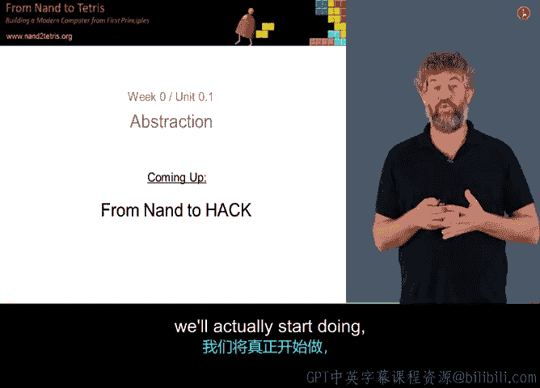

# 耶路撒冷希伯来大学《从零开始构建现代计算机｜Build a Modern Computer from First Principles》中英 - P2：02_01_03_单元-0-1-课程路线.zh_en - GPT中英字幕课程资源 - BV1Zp421y7Ex

We're going to start this course by describing the main mental tools that we're going to use in this course。

 And， in fact， the main mental tools that computer science uses all the time that will allow us to design an extremely complicated artifact step by step。

 Many of you have probably taken a programming course。 Many of you may have not。

 but many you have usually in such a course， in the first class and the first lesson。

 you start looking at a very， very simple program。 sometimes called hello world。

 And this is a program that just print hello world on the screen。😊。

Usually you start discussing the various a fluff around the commands basically stating， oh。

 here's a program。 and this is how it's supposed to be written。

 you talk about various commands in the program， for example。

 the fourth line or the fifth line in what you see in front of you basically tells the computer to print a string hello world on the screen and that's really what the program does。

 and you discuss all that things and that's how you start a programming course。

 a programming 101 course。😊，Now， when you think about that， that's very problematic。

 There are a lot of things that are under the hood here。First of all， there's this amazing thing。

 What you see as a program is just a bunch of letters。 So， for example， if you have the P letter。

 this is a letter P。 It's not doing doing anything。 It's just a letter。 And in fact。

 we know that in computers， the letter P is represented by a number。 And turns out to be 112。

 So you have a number 112。 And then you have a number 114 for R and so on。

 And somehow these letters are supposed to do something。 How does does that happen。😊，Well。

 you are told something about compilers that translated to a different language and the other language。

 a computer hardware work can execute。 But how does that work。HowHow does it even work。

 All that is swept under the rug when you start introduction to computer science or to programming。

Similarly， if you look at even the simplest program， the simplest command， for example。

 print hello world。 How are you supposed to do that。

 Printing hello world on the screen actually involves setting a bunch of pixels on your screen to be more lighter or darker。

😊，And's a lot of pixels。 And you have to， to actually put the pixels that are lighter in a very special order to somehow represent the letter H。

 and then the letter E。 How is that or does all that happen， That's an extremely complicated thing。

 And yet， you just use it。 That is also swept under the rug。 Again。

 you're told about standard libraries and operating systems that do all that for you。

 But you don't really worry about them。😊，Why don't we have to worry about them。

The main secret of computer science is the fact that you really don't have to worry about them。

You can really start and do programming1 on one， as many students have done throughout the years without worrying about all these very basic questions。

How does that happen， How come you don't need to worry about how。

 Because it's enough to worry about the what， It's enough to know what the programming language is supposed to do。

 and you don't need to worry about what happens behind it。 because you're only using it。

 You're not now actually trying to duplicate it。 The how of something is called the implementation。

 how do you actually make it happen， that's called to implement it。

 The what is called the abstraction， That is， if you sell the computer language is supposed to do such and such。

 you don't need to worry about how it is done。 But the such and such the exact specification of the such and such。

 that's the abstraction that we have。 that's the interface that you get to work with。

 and you only need to worry about that when you actually program。

 when you are taught in programming 101 that you actually can run that program。

The whole point is that you only need to worry about the abstraction。

 that when you write that command， it's supposed to write hello world on the screen。

 And the whole point is that you don't need to worry about how that is done。

 It's enough to know what it does。 This is not a bug in the way that we teach programming languages。

 It's actually the main point of programming languages。 Don't worry about the rest。

Just worry about what it's supposed to do and trusted someone else worried about the house。So。You。

 you may worry here。 Is this is a scam。 So if no one worries about how something is done。

 only per people are only enjoying the whats the nice things that are done。

 How is it ever going to be implemented， Who is going to worry about the how。Well。

 it could be someone else， which is always nice to know that someone else can do that。

 It could be you later or earlier。😊，If it's later， you don't need to worry about it now。

 which is very nice because now you can focus on the task at hand。

 which is using the programming language。Even if it was you earlier that you already implemented the programming language in the past。

 This allows you to forget。 It allows you to forget all the details。

 all the works that you put into actually implementing it。

 And just remember what is the thing that you did。😊，So it's an extremely important thing。

 And that's the most。In most potent tool of computer science that once we can separate concerns。

 One we can separate， we can forget a lot of details about implementation and only remember a very clean what。

 a very clean interface， a very clean description of what is done there。

 Then you get this mental saving of not having to have everything in your mind in the same time。

 Can repeat that many times and many different multiple layers of abstraction。 one above the other。

 So， for example， suppose we have already built the blue stage box。 we can forget its implementation。

 worry only about its interface when we try to implement a green box above it。😊。

Once we finish with the green box， can again， we can forget its implementation。

 worry about only the interface when we implement the yellow， the orange box above it。

When we finish that， we can forget against implementation。

 when we try to implement a purple box above the interface of the orange box。 This way。

 we have multiple stages。 Each one of them very simple。 and yet at the end。

 we get a fantastically complex artifact composed of many simple stages。

 This is exactly what we'll do in this course。 Here is a high level description of the different abstraction layers we have in this course。

 We start with very basic simple gates。 We build more complicated chips from them。 And from them。

 we build even higher， more complicated chips like a CPU。 And then we put them into a computer。

 and that continues as a software layer that we'll cover in part two of the course。

 where we build more and more complex software artifacts above these hardware artifacts。😊，Every week。

 we will worry about a single level of abstraction。 We take the lower level as given。

 We only remember what it does。 We forget what， how we did it。

We implement the higher level of abstraction， the next level of abstraction。 We test that。 it works。

And then Presto， we finished the week。 We can move to the next week where we already know that this level works very well。

So the lower level we can take is given in the next week because we just finished implementing it。

The next level we are going to actually guide you give you very explicit guidance how you're going to implement the next level of abstraction。

 Given the fact that you have already have the previous one。😊。

And then we also give you a testing suite that allows you to really test that what you did this week works。

😊，So that you can be sure that next week， everything will keep on functioning。

So by the end of the course， what have we achieved by the end of the course。

 after a few weeks as actually every week building upon the previous layer。

 we get a complete functioning computer。 a computer that starts with very basic building blocks called Nand gates。

 which are very， very simple logic gates and ending with the computers that can run almost any program。

 For example， the Tes that gives this course its name。 In the process of doing it。

 you've gained a lot of very important computer science tools。 First of all。

 you've gained the experience of working with abstractions。

 you've gained an experience of working with a main workinghor of computer science at every point in time forgetting about what you don't need to remember about the how and working about the next level of abstraction。

 This is the main thing we always do with programmers and you've experienced it。😊，You also。

 by the way， once you did all these different steps， you learned that every step。

 what you need and the different steps in building a computer are the real the interesting pieces of information you need to know。

 you need to understand in order to understand how a computer is actually constructed。

And the end of the day， you sort of now have a complete understanding。

 You have built a complete functioning computer。 You understand all the levels。 So finally。

 the myth of how a computer works is no longer mystical。You understand it。

All this accomplishment is going to be， is going to happen in 14 weeks。😊，And in two parts。

In the first part of the course， which is what we currently have on Coursera。

 which is going to last seven weeks。 We're going to build the whole hardware platform of a computer。

 We're going to start with a very simple logic N gate。

 and we're going to create a computer that can run assembly machine programs。😊。

And this is what you do in the first in the first part of the course， seven weeks。

 seven different steps， each step very simple， and you get a working hardware platform in the second part of the course。

 which is going to be called non-surprisingly from N to Tetriris part2。

 we're going to start with the same hack computers that we've built in the first part of the course and continue adding a software hierarchy that will allow us to actually run any type of application that we write in a highlevel programming language。

 for example， an application like Tetriris that gives this course its name。

 but also any other type of applications that you may want to write。😊。

The second part of the course is not available on Coursera yet。 If you're really。

 after doing this course， you cannot wait for it。 You can always go to our book。

 which has all the information， including part 2 and keep on working directly from the book。

What we're going to do in the next two units is explain a little bit more。

 talk a little bit more about the roadmap ahead， which tells us。

 first of all what are we going to do in this course in the hardware part。

 what are the main steps that we're going to do and then also what are the main steps that are going to be done in the second part of the course。

And after that， in the next week， we'll actually start doing going step by step。

