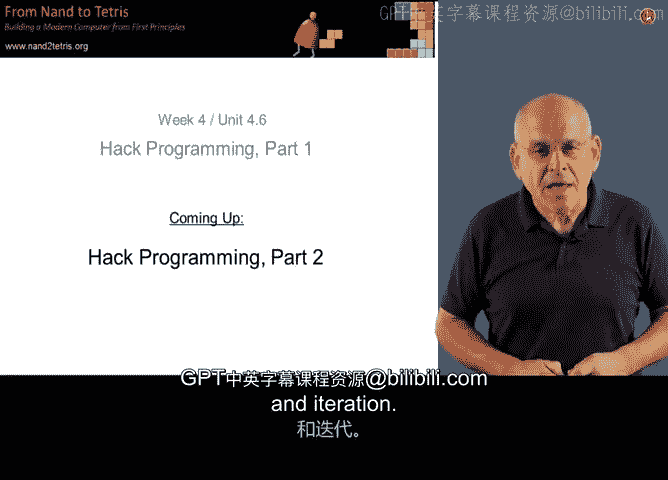

# 耶路撒冷希伯来大学《从零开始构建现代计算机｜Build a Modern Computer from First Principles》中英 - P31：31_06_07_单元-4-6-Hack编程第一部分.zh_en - GPT中英字幕课程资源 - BV1Zp421y7Ex

Now that you are familiar with the heCC programming language。

 it's time to see what we can actually do with this language and so in the next three units we're going to talk about the general subject of lowlevel programming and in particular programming in the heCC machine language Now before we get started I'd like to give you an overview of the two instructions that we have in the hec language so we have the a instruction which is used to set the value of the a register to a particular value and we have the C instruction which is used to do three different things。

 we can compute a certain expression we can store the value of this computation in some destination and optionally we can based on the value of this computation we can decide to jump and execute something which exists in a different region of the program。

 we can perform a goto operation。Now this language as you clearly see in this slide is symbolic。

 it consists of pneummonics and computers don't understand the symbols other than zero and1 and therefore before we can execute anything which is written in symbolic hec machine language we have to first translate it into binary code and this is something which is typically done by a program called asemmbler and what we see here is this program in action。

 it takes a file which is written in symbolic language and it translates it into another file written also in symbols but these symbols are only zeros and ones。

 having produced the target code in binary code， we can actually take this file。

 load it into the hec computer and finally execute the intended program。

So this is the heck asmbler and in week six of this course， we will actually build such an assembler。

 but for now I just want to remember that it is available to you if you want to use it。😊。

The other option of translating symbolic programs into binary code is to use the supplied CPU emulator I can take you can take any program that you write in a symbolic hack language load it directly as is into the CPU emulator and the CPU emulator is just it's a Java program and it has an icon that allows you to load files into the instruction memory as you load these files into the instruction memory。

 the CPU emulator gives you this very nice service of translating the programs on the fly into machine language so once this happens you can actually executing the program in the CPU emulator and the result is that the CPU emulator is a very friendly tool for debugging and executing hec programs in Sulation and therefore we recommend。

That if you want to play with a code snippets that you will see in the subs units。

 we recommend that you do it using the supplied CPU emulator。All right， so moving along。

 what do we mean when we talk about lowlel programming Well， surprisingly enough。

 we mean a whole bunch of issues that you find in any programming language。

 things like working with memory and variables and branching iteration， pointers， inputs and outputs。

 these are idioms are widely used in any programming language and the heck machine language is no exception。

 So in this unit we'll begin to talk about registers and memory and in subsequent units we'll talk about the other subjects which are slightly more advanced。

All right， so。Registers and memory is the bread and butter of lowle programs and that's what you do all the time。

 you manipulate registers which are either the two standard register that we have D and A which reside inside the CPU if you recall the data register can hold a single 16 bit value the A register can hold either a data value or an address depending in the context in which the programmer wants to use this register and finally we use the letter M or the mneummonic M to refer to the currently selected memory register。

If you recall the a register has this nice side effect that when you load it with a particular value。

 it ends up selecting one register from the RA， this register in our language is called M so we can then say something like m equals minus1 or m equals 0 and so on and so forths Allright so these are the registers of interest that we' are going to manipulate and here are some examples of what we actually what actually can be done with these registers。

Let us assume that you want to store the number 10 in register D Well it turns out that there's no direct way to do it if you look up the language documentation there's no C instruction that lets you do something like that so we have to do it indirectly and what we do is we set the A register to 10 and then we say D equals a。

Simple。Moving along， what about incrementing the value of D Well。

 it turns out that this actually can be done directly in one instruction only because once again。

 if you look up the documentation of the C instruction。

 you will see that you can tell the ALU to compute the value of D plus1 and then you can take the result and store it in D so effectively we perform a D plus last operation。

What about setting D to the value of Ram 17 Well， whenever you want to access a particular memory register。

 you first have to address the memory， you have to select this register。

 so we preempt this operation with an at 17。And now having selected the register of interest。

 we set it or we set D to the value of this register。Likewise， we can do the reverse operation。

 we can do Re 17 equals D， and we do exactly the same， but in reverse。Moving along。

 what about setting Ram 17 to 10 Well I can do this using a combination of what I did before I first of all I acquire the constant 10 somehow you know using these two instructions and then I set Ram 17 to the value of D which by now is 10。

What about setting Ram3 to Ram5 well once again we can do it using similar operations and if you want you can stop the video。

 take another look at this at all these five code examples and convince yourself that they do what they intend to do。

All right， so let us take these。Memory manipulation operations and registers manipulations。

 and put them in the context of an actual program。 So here's a program which is designed to take two values which are stored in Ram 0 and Ram 1。

 Ed them up and save the result in Ram 2。 Now， why these particular three words， Ram 0，1 and 2。 Well。

 this is an arbitrary choice。 We just decided that we use the first two words in the memory for input。

 so to speak。 and the third memory word for the output of of this program。 So how do we do it。 Well。

 you may have guessed we use very similar operations to what we did before。 And。😊。

If we run this program， hopefully it will compute the sum of Ram0 and Ram1。Now， before we go on。

 I'd like to remind you that instructions in the heck language have implicit line numbers。

 You don't see them when you write the program， but。These numbers kind of lurk in the background。

And when you translate this program and load it into memory。

 there are some interesting observations that we have to make。 First of all， white space is ignored。

😊，And the only instructions that get into play， so to speak are the real instructions。 You know。

 the instructions that have line numbers in this in this example here。And in addition。

 it's important to remember that what we see here in the instruction memory is a symbolic view of this program。

 you know this program as such cannot execute on the computer because the computer cannot handle symbols other than0 and1。

 but if you play it with our CPU emulator you know that you can tell the emulator to show you the contents of the instruction memory in binary and if you do it you will see the program in this manifestation and in this state the program can actually execute on the computer。

But typically once again， it's much easier to think about the program。

 talk about it and debug it when the program is written in symbolic form。

 and therefore we recommend that you when you try to understand what the program is doing。

 do it symbolically and only when you're ready to run it if you want。

 you can take a look at the binary code but it's very difficult to decode what the binary code is doing anything so we are fortunate to have all these symbols to make our programs more readable。

😊，All right， so with that in mind I'd like to invoke the CPU emulator and give you a demo of how this program is actually executing。

So the purpose of this demo is to illustrate how to write a little program in the hackCC symbolic language and then run it on the CPU emulator。

So I have two windows opened up here。 One is the CPU emulator。

In the foreground and in the background， I have a simple text editor that I can use to write my program。

 so let's write it。We'll begin with some comments， which are which describe what this program is doing。

 So let's say。嗯。Eds up。Two numbers。And let's give some。

Usage advice to the person who is going to use this program。Put the values。呃。That you wish to add。

In Ram 2， in Ram。0， and。Ram1。And。Let's add here。Some more information。Ram2 becomes。Ram。0。Plus， Ram1。

Alright， very nice。 So let us begin to write the program。

 I use some indentation for purposes that will become clear。In subsequent units。 So I do at A。

 I'm sorry， at。0。😔，D equals M。At one。D equals the。Plus， M。And now we can put the result in2。

M equals D。And that's the end of the program。 Let's save the program。

Using something that you cannot see now because it's far away on the screen。

So we want to save the program。 We'll give it the most imaginative name。Deも。Block AM。We save it。

And now we can go back to the CPU emulator and load the program， so。I click the load button， and。

Let's see。I should have。A directory called program examples。 And here it is。 And demo is。Right here。

 So I pick them all。I load it。And here's the program that I wrote。 Now。

 notice that the program contains only the real instructions。 If you go back to the source。

 we see that we have， you know， comments， white space and so on。 So when you load a program into。

Into the emulator， you get to see or actually the only instruction， the only lines that get loaded。

 so to speak are the real instructions。 And as these instructions are being loaded into this Gui here。

 they're also being translated into machine language。 and I can see that if I change。

The representation here to binary。 And I see the program。

 as it really is inside the roomm in binary code。 But once again。

 it's much more convenient to see this program in， I'm sorry in。In symbolic code。Okay。

 so I was told that I have to put some valuess in 0 and 1。 So I go ahead。And put the value5 here。

 and。7 there。And then I begin to run the program。 So let's see we execute the first command。

 and we see that。Nothing happens yet， but a became 0。

And then we do the equals m and we see that the D register now contains 5， which is very nice indeed。

Then we do at1， and we see that a contains one。Let's do D equals d plus M。 We see that D became 12。

Then we set a to2。We do M equals D， and we see that lo and behold Ram2 contains 12。

 which is exactly what we wanted to get。 So the program seems to be working。

Before we end this demonstration， I would like to present the fast forward control and also use this opportunity to show you something bizarre that may happen if you don't take proper action。

So I have loaded the same program into the simulator， and now I'm using different test values。

350 and minus-40。And then I will use the fast forward control to run the program。Unattendant。

 so to speak。 and we see that the program runs properly。 and， in fact。

 it comes out with the right result，3，50 plus-40 is indeed 310。

 but we see that the computer is continuing to execute the so called program。Where， in fact。

 the program has ended already， right， As far as we are concerned， the program has ended。

 But as far as the computer is concerned， the program actually continues。

 and it seems that things are getting out of control。

So having seen the demo that we just went through and having seen also the problem that we encountered at the end of this demo。

 let us see what can we do in order to terminate a program properly now to remind you the problem that we had is that the flow of control became kind of uncontrollable and basically you know we told the computer to execute every instruction and everything was just fine。

 but then other so-called instructions， came into play and the computer basically went out of control。

Now， if I were a hacker， if I were a bad hacker and I would have seen this pattern of execution。

 I would say， well， you know maybe I can write some malicious program and put it somewhere downstream in this memory and then I would let the user run hisz or hair program naively。

 the user will you know happily run his program， the program will actually do what it's supposed to do。

 but then unknowingly the computer will continue executing and then boom。

 you know my program will go to work and will start to do some bad things like deleting random files on the user's computer。

So what can we do in order to avoid this potential problem by the way。

 this particular attack is callednob slide andnob stands for null instructions or null upcodes and what we have here in instructions six onward are null instructions and a bad hacker can use these instructions to slide the flow of control to an area of the memory that he controls and then something bad can happen what can we do to avert this problem and in general what can we do to terminate a properly。

Well， one thing that you have to understand is that computers never stand still。

 They always do something。 you know， even when you don't touch the keyboard。

 there are many processing processes running in the background。So in the head computer。

 because we don't want the computer to do something crazy。

 we might as well cause the computer to do something that we control so what we can do is we can end the program with an infinite loop we can add two commands like at6 and then in seven jump to6 so we have once again at six and then in seven jump to6。

 jump six， jump six and so on and we have this infinite loop and everything is under control because this is something that we intended our program to do so as a best practice advice。

 we recommend that you end every one of your programs with an infinite loop。Allright。

 before the end of this unit， I'd like to say a few things about another feature of the language that we haven't yet discussed。

 And by saying this， I'm basically going to complete the specification of the hec machine language。

 The language features several built in symbols。 and here they are。 First of all。

 we have a set of 16 so-cal virtual registers or to say its more accurately。

 we have a set of 16 labels that we use as if they represented virtual registers。

 And these labels range from R 0 to R 15。And the contract is such that whenever the assembler or。

 you know， the translator sees a label like R 3， it will replace it with a number 3。 That's all。

So you ask yourself， you know， why do we need these fancy labels Well。

 here's an example where these labels can come to play。

This is a very simple piece of code in which we set Ram 5 to 15。

Now let's read carefully what is going on here in the first pair of instructions。

 we use the A register as a data register， we put the number 15 into a and then we move it into D。

In the second pair of instructions， we do something remarkably different。

 we use the at5 command to address the memory to select memory register number5。

 and then we do M equals D。So there's something， you know， troubling about this code。 First of all。

 we do two very different things， but we use exactly the same syntax at number。

That's one thing which is a little bit， I think， disconcerting and the other thing which is somewhat troubling is that when you read a single A instruction。

 you have no idea what the programmer wanted to do until you see the next instruction。

So how can we make this thing more readable Well， our advice is that whenever you want to address one of the first 16 registers in the memory use the label convention and then anyone who reads your program will know exactly what you want to do including yourself because you know machine language programs are difficult to read and comprehend and therefore we have to make every effort to make the more readable so that next time you see your program a week from now or two weeks from now you will know what the program is doing so in the second example that you see on the right it's a very small difference compared to the left one but it's much more readable and also effectively the program will do exactly the same thing because once it will get translated the R5 will change to five and then we are back to where we were before so this is the motivation why we recommend to use these so-called virtual registers。

There's one thing that you have to worry about and this is the fact that like many other programming languages。

 heck is case sensitive， and uppercase R5 is not the same as lowercase R5 and we recommend that you remember this observation here because。

If you forget it， it can cause all sorts of very exotic bugs。And in the future。

 if you have a program that has no syntax problems and you have no idea what this program is doing。

 there's a good chance that you misspelled one of your symbols。

 so keep this in the back of your mind when you run your own symbolic programs。

What other symbols do you have in the language Well we also have screen and keyboard。

 which we discussed previously in one of the units。

 they stand for the base addresses of the screen and the keyboard memory maps。

And we also have a set of six additional symbols that we don't really use in this course。

 so let me wrap up the symbols， the built- in or the predefined symbols in the heCC language。

 we have 16 virtual registers， we have two symbols that stand for base addresses of input output maps。

 and we have a set of six symbols。Which are used by people who want to write virtual machines and compilers for high level languages that will operate on top of the hec platform。

Now this is something that we actually do in the second part of this course called Nantoteris Part2。

 but we won't use these six registers in the present course。All right。

 so this has been a brief overview of working with registers in memory and in the next unit we are going to talk about branching variables and iteration。

😊。

