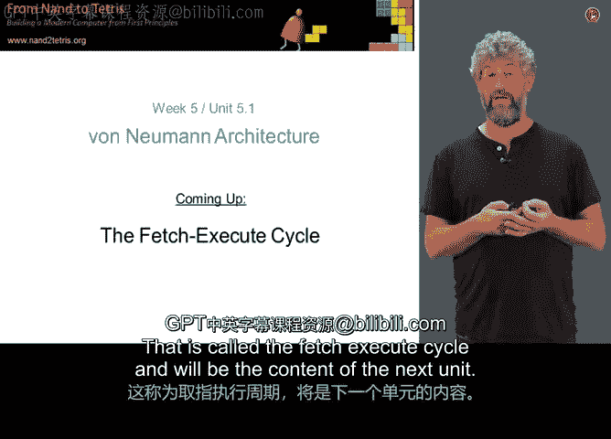

# 耶路撒冷希伯来大学《从零开始构建现代计算机｜Build a Modern Computer from First Principles》中英 - P36：36_07_02_单元-5-1-冯·诺依曼架构.zh_en - GPT中英字幕课程资源 - BV1Zp421y7Ex

Last week， we described what the computers that we're building in this course is supposed to do This week。

 we get to the more difficult task of actually doing it。

 implementing a computer that can actually do everything that we promised previously。

So let us recall the kind of thing that we said that our computer is going to do The most amazing thing was that one computer is able to run any kind of program。

 any kind of software that is it's supposed to be able to get instruction from the software and then just execute them so we get a single machine that is very flexible and can do everything that idea was called the universal Turing machine in theoretical in the theoretical world and the architectures that actually implements it is called the Van Neumman architecture and this is what we're going to build today。

😊，So last week we were very happy to get such an amazing device to actually do whatever we tell it to do This week we're going to have to pay the price and actually see how can you do such an amazingly flexible thing So we already saw the general architecture of how this can be implemented。

 we're going to have a large piece of memory that's going to be used for two things first of all。

 to store all the kinds of the data that we're going to use in the computation。

 but more interestingly the memory will hold a program。

 a sequence of instructions that are going to be executed one by one。😊，Beyond that。

 we're going to have the central processing unit， which actually carries out these instructions and runs them and controls everything。

So let us now look more closely how this actually happens， how the central processing unit is built。

 and how does all the control back and forth work， and this is what we're going to describe in a general way。

 this unit and later we'll actually talk much more specifically about the computers that we're building for this project。

So generally speaking， our compute， our CPU is going to be composed of two main ingredients。

 two main components， one of them is what you often call the arithmetic logic unit。

 it's actually a piece of hardware that actually is able to add numbers， subtract numbers。

 maybe do logical operations and so on。The second element is there are going to be a bunch of registers。

 a bunch of places where we can store data， data that we're going to use for the rest of the computation。

 So this is going to be basically the core of the elements that the CPU is built of。

The memory itself， as we said， has two parts， the parts that stores the program and the star that stores the data。

To try to understand how all these things work together。

 it's best to actually consider is a flow of data， what kind of information needs to pass within the computers from side to side。

 And this is what we're going to actually now try to do。

 Try to describe the various pieces of information as that go from side to side in this computer and how we control them。

😊，So basically there are I would say three types of information that usually pass browse the system and one of them is the data when we have numbers that need to be added。

 of course the numbers needs to be moved from one place to another， from the data。

 a memory to the registers to the actually arithmetic logic unit is going to do something with them in back。

The second type of information that we need to control is what's called addresses。

 What instruction are we actually executing now， What piece of data within the memory do we need to access now。

 These are in addresses。 And of course， there's going to be there is going to need to be a bunch of wires that actually do all the control that actually tell each part of the system what to do at this particular point。

 and this is called the control。 Sometimes all these three pieces of each one of these pieces of information is actually going to be implemented by wires by a set of wires。

 sometimes called a bus。 So we're going to have in a typical computer we're going to have a data bus an address bus and sometimes a control bits are called a control bus。

 sometimes they're just called control wires。 So let's look at the different pieces that we have in our computer and see exactly what kind of information they get and emitit。

😊，Let us start with arithmetic logic unit。 This is the conceptually the simplest and clearest part of the C of our computer。

 It basically needs to be able to accept numbers and add them， subtract them。

 do some logical operations on them。 So it's very simple。

 We need simply need to have some information from the database connect into the L and then information and then feeds the output of the L back into the database。

 That's going to be and from 0， of course， it's going to have to go to other places that also connect to the database like the memory or the registers。

😊，There is one other piece of info plus other type of piece of information that the A AL U will need to be connected to。

 This is a control bus。 And one hand， of course， the A U needs to know what kind of operation it does it every time。

 So it has to re gett information from the control bus specifying the type of operations that it does。

And on the other hand， according to the results of the arithmetic or logical operations that it does。

 it's going to be able to have to be able to tell the other parts of the system what to do。

 for example， if it sees that a certain number is greater than zero that can controls the jump in the next instruction What's the next instruction will be this control will happen through the control bits。

 So we're going to also have to take some information from the ALU and feed it back to control the rest of the system。

😊，Let us consider now with the registers， the registers conceptually are very simple。 again。

 we store intermediate results in the registers， so we're going to have to be able to take data in from the database into the registers and then also take data from the registers and feed them back into the database and of course。

 where would they go from the database to other parts of system such as the ALU。😊。

So this is the first thing that， of course， we will have to connect all the registers to the database。

The second piece of information is sometimes， as we've discussed previously。

 some registers are used to specify addresses。 the way we actually achieve indirect addressing into a RA or jump into a wrong address。

 the way we do it is usually we put numbers， addresses into a register。

 and then that specifies where we want to access。 So we're going to also have to have registers control connected to the address bus which controls again。

 the memories that which actually then feeds into the memory。😊。

So that's the second type of information well need to have。

 we will have some registers that are address registers。

 either exclusively or both address and data registers。

 and these will need to feed into the address bus。The last piece of the last piece that we need to talk about is the memory。

 So on one hand， the memory。😊，Nes， we always need to specify what address of the memory are we going to be working with。

 And that is specified， of course， by the address us。 That's the whole point。

And of course once we actually work with a certain address we're going to be need to be able to read it or write into it。

 get information from it or put information into it， so of course the data。

 the input and the output of the memory unit will have to be connected to the database。

Let us look slightly more closer inside， there there are two pieces to the memory。

 there is a data memory and there is a program memory。

 let's talk a little bit about each part of these。😊。

Looking at the data memory that it's going to need to get an address of a data piece that needs to be operated upon。

 And of course， then very simply， we need to write and read into it。Looking at the other part。

 which is the program memory， we're also we're going to need to put the address of the next program instruction into into the program memory because this is where we're taking our program instructions we need to be able to put an address into the program memory address and then get the instruction from there Now the instructions that we get from the program memory both may have data in it。

 for example， it may have numbers that we need to add and so on。

 but also it's an important thing is the program actually tells the rest of the program instruction。

 tell the rest of the system what to do so we need to be able to actually take information from the next instruction from the data output of the program memory and feed it into the control bus So that's another important piece of information that we need to do another important connection that we need to have inside the computer。

😊，So so far， we talked about all the different pieces inside all the different components that a computer is going to be composed of and how they're connected to each other versus in in the sense of which information moves from where to where。

What we're going to do in the next unit is actually look more closely at the enormous loop at the basic things that our hardware is supposed to do。

 That is take instruction from the memory， from the program memory and actually executed using the rest of the system as appropriate。

 That is called the fetch execute cycle and will be the content of the next unit。😊。

