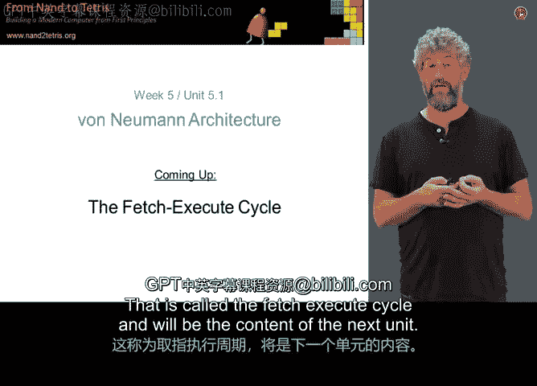

# 从零开始构建现代计算机：5-1：冯·诺依曼架构 🖥️

在本节课中，我们将学习计算机的核心设计思想——冯·诺依曼架构。我们将了解计算机如何通过统一的架构来运行任何程序，并深入探讨其内部主要组件（如CPU、内存）是如何通过数据、地址和控制信号协同工作的。

上周，我们描述了本课程要构建的计算机应该具备的功能。本周，我们将面对更艰巨的任务：实际实现它，构建一台能够执行我们之前承诺的所有功能的计算机。

让我们回顾一下我们所说的计算机将要完成的任务。最令人惊叹的一点是，一台计算机能够运行任何类型的程序或软件。这意味着它应该能够从软件获取指令并执行它们，从而得到一个非常灵活、无所不能的单一机器。这个思想在理论界被称为“通用图灵机”，而实际实现它的架构被称为“冯·诺依曼架构”，这正是我们今天要构建的。

上周，我们很高兴能拥有这样一个神奇的设备来执行我们的指令。本周，我们将付出代价，看看如何实现如此灵活的功能。我们已经看到了实现这一点的通用架构：我们将有一大块内存，用于两个目的。首先，存储计算中要使用的各种数据。但更有趣的是，内存将保存一个程序，即一系列将要被逐一执行的指令。

除此之外，我们还将拥有中央处理单元，它负责实际执行这些指令、运行它们并控制一切。

现在，让我们更仔细地看看这是如何实际发生的，中央处理单元是如何构建的，以及所有来回的控制是如何工作的。我们将以一般性的方式描述这个单元，稍后我们会更具体地讨论为本项目构建的计算机。

一般来说，我们的CPU将由两个主要部分组成。其中一个通常被称为算术逻辑单元，它实际上是一块能够进行数字加法、减法以及逻辑运算等操作的硬件。第二个元素是一组寄存器，即我们可以存储数据的地方，这些数据将用于后续的计算。这基本上就是CPU构建的核心元素。

如前所述，内存本身有两个部分：存储程序的部分和存储数据的部分。

为了理解所有这些部分如何协同工作，最好考虑数据的流动，即计算机内部需要传递哪些类型的信息。我们现在就要尝试这样做，描述计算机中传递的各种信息以及我们如何控制它们。

基本上，系统内通常传递三种类型的信息。其中一种是数据，当我们需要对数字进行加法运算时，这些数字需要从一个地方移动到另一个地方，从数据内存到寄存器，再到实际执行操作的算术逻辑单元，然后再返回。

我们需要控制的第二种信息被称为地址。我们现在正在执行哪条指令？我们现在需要访问内存中的哪块数据？这些都是地址。当然，还需要有一组电线来实际执行所有控制，告诉系统的每个部分在特定时刻该做什么，这被称为控制信号。有时，这些信息中的每一种都将通过一组电线（有时称为总线）来实现。因此，在一台典型的计算机中，我们将有一条数据总线、一条地址总线，有时控制位被称为控制总线，有时它们只被称为控制线。让我们看看计算机中的不同部分，确切了解它们接收和发出什么类型的信息。

让我们从算术逻辑单元开始。这是计算机概念上最简单、最清晰的部分。它基本上需要能够接收数字并对它们进行加法、减法以及一些逻辑运算。这很简单。我们只需要让来自数据总线的信息连接到ALU，然后将ALU的输出反馈回数据总线。当然，它还需要连接到数据总线上其他部分，如内存或寄存器。

ALU还需要连接到另一种信息，即控制总线。一方面，ALU需要知道每次执行什么类型的操作。因此，它必须从控制总线获取信息，以指定其执行的操作类型。另一方面，根据其执行的算术或逻辑运算的结果，它需要能够告诉系统的其他部分该做什么。例如，如果它发现某个数字大于零，这可以控制下一条指令的跳转。这种控制将通过控制位发生。因此，我们还需要从ALU获取一些信息，并将其反馈回来以控制系统的其余部分。

现在让我们考虑寄存器。寄存器在概念上也非常简单。我们在寄存器中存储中间结果，因此我们需要能够从数据总线将数据输入寄存器，然后从寄存器取出数据反馈回数据总线。当然，数据会从数据总线流向系统的其他部分，例如ALU。

因此，第一件事当然是，我们必须将所有寄存器连接到数据总线。

第二种信息是，有时，正如我们之前讨论的，一些寄存器用于指定地址。我们实现间接寻址或跳转到错误地址的方式，通常是将数字（地址）放入寄存器，然后由该寄存器指定我们要访问的位置。因此，我们还需要让寄存器连接到地址总线，地址总线又控制着内存。

这就是我们需要拥有的第二种信息。我们将有一些地址寄存器（专门用于地址或同时用于地址和数据），它们需要连接到地址总线。

我们需要讨论的最后一部分是内存。一方面，内存总是需要指定我们将要处理的内存地址。这当然是由地址总线指定的。这是关键所在。当然，一旦我们实际处理某个地址，我们需要能够读取它或写入它，从中获取信息或将信息放入其中。因此，内存单元的输入和输出当然必须连接到数据总线。

让我们更仔细地看看内部。内存有两个部分：数据内存和程序内存。我们来分别谈谈这两部分。

对于数据内存，它需要获取要操作的数据块的地址。然后，很简单，我们需要对它进行读写。

对于另一部分，即程序内存，我们需要将下一条程序指令的地址放入程序内存，因为这是我们获取程序指令的地方。我们需要能够将一个地址放入程序内存地址，然后从那里获取指令。我们从程序内存获取的指令可能包含数据，例如，它可能包含我们需要相加的数字等。但同样重要的是，程序指令告诉系统的其余部分该做什么。因此，我们需要能够从程序内存的数据输出中获取下一条指令的信息，并将其输入控制总线。这是我们需要在计算机内部建立的另一个重要连接。

到目前为止，我们讨论了计算机将要组成的所有不同部分，以及它们之间如何通过信息流动相互连接。

在下一单元中，我们将更仔细地查看硬件应该执行的基本循环：从程序内存获取指令，并使用系统的其余部分适当地执行它。这被称为“取指-执行周期”，将是下一单元的内容。

本节课中，我们一起学习了冯·诺依曼架构的基本原理。我们了解到，计算机通过统一的内存来存储程序和数据，并由CPU（包含ALU和寄存器）执行指令。数据、地址和控制信号通过总线在组件间流动，共同协作以执行复杂的任务。下一节，我们将深入探讨指令执行的核心循环——取指-执行周期。