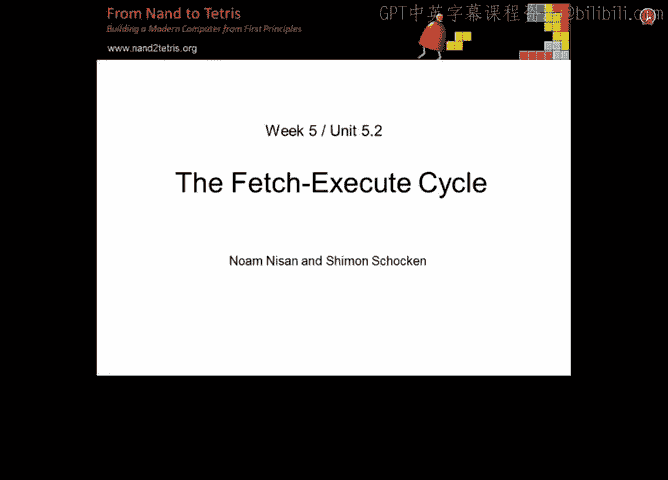
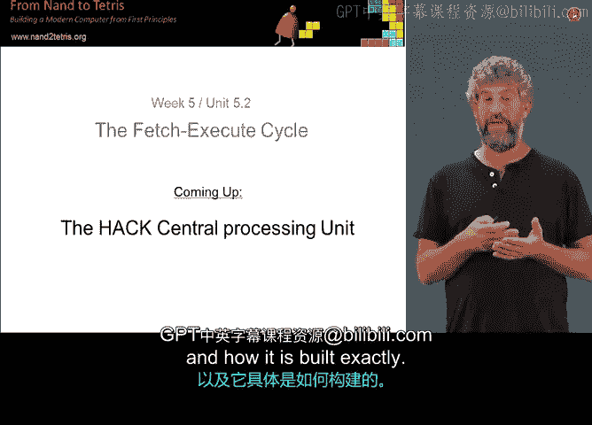

# 耶路撒冷希伯来大学《从零开始构建现代计算机｜Build a Modern Computer from First Principles》中英 - P37：37_07_03_单元-5-2-取指执行周期.zh_en - GPT中英字幕课程资源 - BV1Zp421y7Ex

In this unit， we're going to talk about the very basic things that a computer does。

 which is execute one instruction after the other。We're going to look more specifically at how exactly is that done。

Well， really， it's very simple。 You first fetch the instruction that you need to execute。

 and then you just execute it。And then， you repeat。And that's the only thing that a CPU does。

 fetch an instruction， executed， fetch another instruction， executed， and so on and so forth。

So let us look specifically at each of these two stages。

 what it exactly happens there and how does that translate into what happens in hardware。

So let's first talk about fetching。 So how do you get the next instruction that you need to execute？

 Well， where is the next instruction located at it's in the program memory， it's in the memory。

 where in the memory in the address that's specified by our program counter proud。

 So we need to basically put the location of the next instruction of the instruction that you want to execute next。

😊，Into the address of the program memory。And then we need to read the contents of that memory。

 and then we'll get the basic instructions that we need to execute。

 the code of the instruction that we need to execute。

The next instruction will usually just be the one after the one that we just did in the previous step。

 that is if we now finished instruction number eight。

 usually the next instruction will be instruction number nine。

 sometimes we already know that we jump and we're going to want to execute a different instruction。😊。

So how do we actually go about putting the address of the next instruction into the address input of the program memory？

 Well， we're going to have to put it somewhere and that's going to be into some counter into some register and that is usually called the program counter。

 So basically the hardware that execute the fetch， if you wish part of the cycle is the following there is a program counter when we need to jump into a new location。

 or we need to just increase and go to the next instruction。

 we need to manipulate the program counter。 So it will have the address of the next instruction。

 the output of the program counter feeds into the address specification of our program memory and then out of the program memory output comes the actual code of the instruction that we need to execute。

 So that is basically what happens in the fetch part of the fetch and execute cycle。

 So now once we have the code of the instruction。😊，Now we need to execute it。

 So the instruction code itself has all the specifics of what we're going to do now。

 which calculations are we supposed to do， Are we touching this register that register and so on and whether we want to need to jump afterwards and so on。

So usually， all that information is coded somehow inside the instructions that we already have。

 because that we got it in the instruction part in the fetch part of the cycle。😊，And usually。

 the way it's coded is in a simple way。 So that is basically different parts of the instruction。

 bits actually controls the different parts that we need to do right now。

 Sometimes it's more complicated。 Sometimes it's more simple。 but that's a basic idea。

 So the basic execution， executing the current instruction basically mean taking the bits from the instruction code that specify what to do and actually doing what needs to be done。

Looking at it in the hardware phase， from the hardware point of view。

 the instruction we already got from our fridge。 that's going to now feed into the control bus of our CPU of our computer。

 and that control bus basically controls everything。

 It tells the ALU what instruction to compute to add number subtract them or so on。

It also tells where do the data pieces come from， Do they come from。

 which register or from the data memory or so on。 So we basically have the instruction memory that we just fetched。

 basically tells us exactly each part of the system what to do right now in the execute cycle and that really controls whether we read from the data memory。

 whether we read from the registers， what do we compute， where to write and so on。 Of course。

 there are many details， how is that is exactly done。

 how does the bits from the instruction specifically tells the AU what to do。

 which register to choose and so on。 That is best viewed through the lens of a particular computer。

 specifically we will actually get into these details when we talk about our computer about the hack computer and that is what you're going to be doing in the next few units where you're actually going to see how we actually control each and every part of the system from the instruction bits。

😊，So we're not going to delve deeper into the specifics of this part。

 which is really the most more most of the work that is done in by the computer。 But rather。

 I want to take a step backwards and look at a certain problem that I've sort of glossed over so far。

 And that is the fact that we really have a clash between the fetch cycle and the execute cycle。

 You see both the program and the data reside in memory。😊，In the fetch cycle。

 basically we need to get from the program memory， the next instruction。

 so we need to put into the address of the memory， the address of the next instruction and get the instruction as output。

On the other hand， in the execute cycle， we need to access data that also resides in memory。

 so we need to put into the address of the memory， the address of the data piece that we want to operate on。

 which has nothing to do with the program piece that gave us the instruction。

And because we have a single memory that is a clash。

 because what are we going to put into the address。

 are we going to put there the address of the instruction or the address of the data piece。

 we need to do both， and that's a problem。So how do we solve that。Well， basically。

 we're going to do one after the other。 That is the usual way。 How do we do one after the other。

 There's going to be a multiplexer that feeds into the address of the memory。

In the first part of the cycle， in the fetch cycle。

 we're going to actually set the multiplexer to plug into the address input of the memory。

 the program counter that is the location of the next instruction， while in the execute cycle。

 the multiplexer will actually set the memory to actually point into the data address that we need to access and of course。

 the output of the memory will now go into both places。

 both into the the parts of parts of the system that needs the instruction and into the parts of the system that are used inside when executing to actually put information there。

😊，Now， you may wonder， okay， so how do we do both of them together？ Well， when you look at it。

 you really need to remember the instruction from the fetch cycle to be used for the execution cycle。

So that is what we're going to do when we actually are in the fetch cycle。

 we put the address of the next instruction， we get the next instruction。

 and then we need to remember it inside an instruction register。

 and that instruction register is exactly what is remains holding the value of the instruction that we're now executing in the execute cycle。

😊，And then of course， in the execute cycle now we have the instruction already stored in this register and we can work with all the information that we need for the execute cycle using the data memory that is being addressed in the second part of the cycle。

 So this is the usual way it's done。😊，Now， there is a shortcut。

 and that is simply keeps the two different parts of the memory separate。

 That is have one unit holding the data memory and another unit holding the program memory。

 Each one of these units has its own address。 And then we don't need to worry about between switching between them。

 as we've just shown。This shortcut makes everything simple。

 It is sometimes called the Harvard architecture， but we just view it as a variant of the Voon Nean architecture and keep using it due to its simplicity。

 So now we've basically finished， talking about the general architecture of computers。

 How in general you actually construct a computer。 What we're going to switch in the next unit is talking specifically about our he computer and how it is built exactly。

😊。

