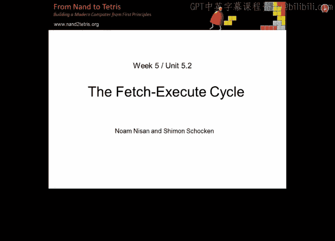
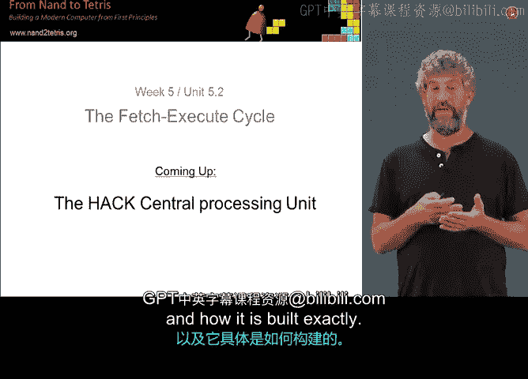

# 从零开始构建现代计算机：5-2：取指执行周期 🔄

在本节课中，我们将要学习计算机最核心的工作流程：**取指-执行周期**。这是CPU不断重复的基本操作，理解它是理解计算机如何工作的关键。

## 概述

计算机的核心任务非常简单：它不断地**获取**一条指令，然后**执行**这条指令，如此循环往复。这个循环就是“取指-执行周期”。我们将深入探讨这两个阶段在硬件层面是如何实现的。

## 取指阶段

上一节我们介绍了计算机的基本概念，本节中我们来看看指令是如何被获取的。

要获取下一条需要执行的指令，首先需要知道它在哪里。指令存储在程序内存中，具体位置由**程序计数器**指定。因此，我们需要将下一条指令的地址放入程序内存的地址输入端，然后读取该地址的内容，从而得到需要执行的指令代码。

通常，下一条指令就是当前指令之后的那一条。例如，刚执行完第8条指令，下一条通常就是第9条。当然，有时程序会“跳转”去执行其他位置的指令。

以下是取指阶段在硬件层面的实现方式：

*   **程序计数器**：这是一个寄存器，用于存放下一条指令的地址。
*   **地址输入**：程序计数器的输出连接到程序内存的地址输入端。
*   **指令输出**：程序内存根据地址输出对应的指令代码。

这个过程就是取指-执行周期中的“取指”部分。

## 执行阶段

现在我们已经获取了指令代码，接下来需要执行它。

指令代码本身包含了所有需要执行的操作细节：应该进行何种计算、访问哪个寄存器、执行后是否需要跳转等等。这些信息通常以一种简单的方式编码在指令的不同比特位中，每个比特位控制着CPU的不同部分。

从硬件角度看，执行当前指令意味着：将从取指阶段得到的指令代码输入到CPU的**控制总线**。这个控制总线负责指挥一切：

*   它告诉**算术逻辑单元**进行何种运算（如加法、减法）。
*   它指定数据的来源（来自哪个寄存器或数据内存）。
*   它控制数据的写入位置。

简而言之，刚刚获取的指令代码精确地告诉系统的每个部分在执行周期中该做什么。当然，具体的实现细节（指令比特如何精确控制ALU、选择寄存器等）最好通过一个具体的计算机架构来理解，我们将在后续关于Hack计算机的单元中深入探讨。

## 一个关键问题：内存访问冲突

在深入细节之前，我们需要后退一步，审视一个被暂时忽略的关键问题：**取指周期和执行周期之间存在冲突**。

这是因为程序和数据都存放在内存中。在取指周期，我们需要从程序内存获取指令，因此需要将指令地址输入内存。而在执行周期，我们需要访问数据内存，因此需要将数据地址输入内存。由于我们只有一套内存系统，这就产生了冲突：我们该把指令地址还是数据地址输入到内存地址端？

## 解决方案：分时复用与哈佛架构

那么如何解决这个冲突呢？通常有两种方法。

**第一种是分时复用**。我们按顺序进行这两个操作。具体实现是使用一个**多路复用器**来选择输入到内存地址端的内容：

*   在取指周期，多路复用器选择**程序计数器**的输出（即下一条指令的地址）。
*   在执行周期，多路复用器选择**数据地址**。

同时，内存的输出会同时连接到需要指令的部分（如指令寄存器）和需要数据执行操作的部分。这里的关键是，我们需要一个**指令寄存器**来记住在取指阶段获取的指令，以便在执行阶段使用。

**第二种方法是一个更简单的捷径：将两种内存分开**。即使用两个独立的存储单元：一个作为**程序内存**，另一个作为**数据内存**。它们各自有自己的地址输入，因此我们无需像上述那样在两者之间切换。这种架构有时被称为**哈佛架构**，我们将其视为冯·诺依曼架构的一种变体，并因其简单性而采用。

## 总结

本节课中我们一起学习了计算机工作的核心循环——**取指-执行周期**。我们了解了：
1.  **取指阶段**：CPU通过程序计数器从内存中读取下一条指令。
2.  **执行阶段**：CPU解码并执行该指令，控制数据流和运算。
3.  **内存冲突与解决**：由于指令和数据共享内存导致的访问冲突，可以通过**分时复用（使用多路复用器和指令寄存器）** 或采用**独立的程序与数据内存（哈佛架构）** 来解决。

至此，我们已经完成了对计算机通用架构的讨论。从下一个单元开始，我们将具体探讨我们的Hack计算机是如何精确构建的。