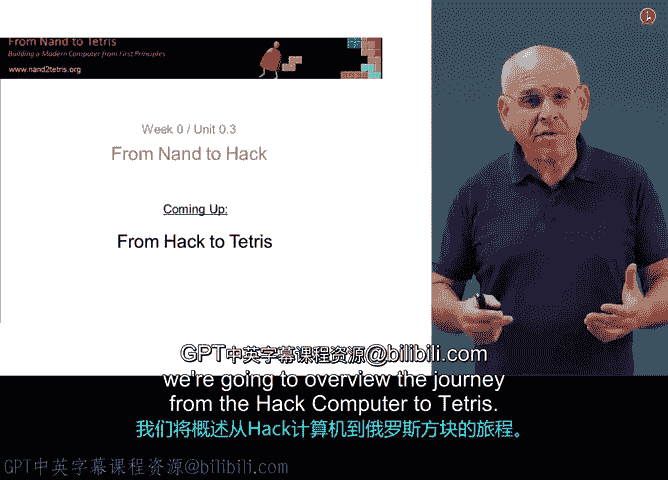

# 耶路撒冷希伯来大学《从零开始构建现代计算机｜Build a Modern Computer from First Principles》中英 - P3：03_01_04_单元-0-2-从NAND到Hack.zh_en - GPT中英字幕课程资源 - BV1Zp421y7Ex

In the previous unit， Noam gave you an overall description of the Nanttotetriris journey In this unit。

 we're going to focus on what we're going to do in this course。

 which is building a computer called he。 So here's the computer in a very broad description or sort of a diagram that captures only some of its very main elements。

 It's going to have ro， a CPU， A Ram and many other chips。And once we build this computer。

 we're going to connect it to a standard keyboard and to a display unit。 And at this point。

 you can start executing programs and enjoy the computer that you actually built。😊。

Which kind of programs， Well， anything that comes to your mind。

 you can write a program that plays Pong or a program that plays space invaders or Socoban or。

 of course， Tetriris。 And these are actually examples of programs that were previously written by students who took this course。

 So here is the general picture of this course。 And I'm basically repeating things that Nom said before。

 We start with some general idea of a program that we want to write。 We write the program。

 we compile it， we translate it further into a machine language。 We load the code into our computer。

 The computer is going to use all sets of all sorts of chips that we built which are based on elementary logic gates and the whole thing ends up with the hardware itself。

 So basically what we did。 is we built a softer hierarchy that sits on top of some hardware platform。

 And as Nom explained， we decided to split this enterprise into two different parts。

 The first part is called。😊，tepar 1 and the second one， which we offered later。

 is called Nanttoterispar 2。 And in this particular course。

 we are going to focus on the hardware only beginning at the very low level of the hardware itself of electronics and logic gates and we are going to do it bottom up。

 So here we are at the very low level of of everything in in applied computer science。

 And this actually is not computer science。 This is electrical engineering and solid state physics and so on。

 and all sorts of things that neither Nor and I understand much about。 And therefore。

 we are going to obstruct the way this hardware and focus instead on。

The most elementary logic gate that we can think of， which is called Nand。 You know。

 Nand is something that I can describe in 10 seconds， and I will do it in one of the following units。

 But for now， let us assume that it's simply a basic logic gate。

 We take this Nand gate and from it using a certain art called combination and logic。

 We're going to build a whole set of elementary logic gates like end ors or and so on。

 Then we will take these gates。 and from them we're going to use both combinational logic and sequential logic。

 which is a different art of design， which takes into consideration times and and time and clocks and from it。

 we're going to build things like registers and Ram units and a CPU。

 And then we'll take this chipset that will build and well design from it。

 a fullblown computer architecture called heck。😊，Now。

 in order to write programs that can execute on this machine and do it in a convenient way。

 we're going to also introduce an assembler into the picture。

 and we're going to develop also an asssembbller for the hec machine language。Now。

I've introduced all sorts of concepts that may sound very unfamiliar。 Don't worry about it。

 Everything will be explained as the course progresses。 Now， many of you are probably wondering。

 how are we going to actually build all these chips。 Well， as it turns out， hardware engineers today。

 don't do anything with their bare hands。 They develop computers using computers。 in particular。

 they use something called hardware simulator to design and test and debug the hardware that they want to build。

 And that's exactly what you will do also in this course。

 What we see here is a screenshot of our hardware simulator。

 A piece of software that you're going to download freely from our website。

 and then you're going to install it in your computer。

 and you will do all the projects in this course using your computer and software that we will supply。

 So let us give you an example of how we are going to actually do it。Here's an example of a Xor chip。

 which is one out of about 30 different chips that we are going to build in this course。

 And what you see here is an abstract description of how Kor operates。

 So basically you're going to take this obstruction。 Think about it。

 and along with all sorts of tips and guidance that we' are going to provide。

 you will come up with some logic diagram that enables you to buildCor using lower level gates that you built before。

Then you will take this diagram and specify it using a language that we will teach you。

 which is called harder description language。The result will be something called HDL program。

 You will take this HDL program。 You will combine it with some test scripts that we will provide。

 and then you will debug， test and complete your HDL program using the hardware simulator that I described before。

 So that's what we're going to do with every one of the chips that we' are going to build in this course。

 And the result is going to be the heCC computer。 Now we're going to separate this journey into six different projects。

 So let me say a few words about every one of them。

In the first week we're going to build some elementary logic gates。

 15 gates altogether as you see here in the slide in the second week we are going to build an arithmetic logic unit in ALU which is the centerpiece of the CPU that we will build later in the third week we' are going to build memory systems you know starting with registers and going all the way up to RAM and RomeM units in the fifth week we are going to take all the chipset that we built so far and use it to design an actual computer。

In week four， before we build the computer， we will write some programs in the hec machine language in order to get in order to get a feeling of what this computer is going to do and in the last week in the course we are going to introduce an asemler for the heEC machine language and actually develop it in two different ways。

 one for people who have background in programming and one for people who don't So these are all the projects that you're going to work on in this course and the result of your effort is going to be the hec computer a general purpose computer that can run any program that comes to your mind。

Tras and you know， practically anything else。Now， I'm sure that many of you are wondering。

 what do I have to know in order to take this course。 Well， the answer is。

 we assume no previous knowledge whatsoever in computer science engineering or mathematics。

 All the necessary knowledge that is required to build the computer and to take this course is going to be supplied in the course itself。

 This is a selfcontained course。 You're going to learn a lot in seven weeks of exciting projects。

 So this has been the unit in which we describe the journey from Nand to the he computer。

 and in the next unit， we are going to overview the journey from the he computer to Tetriris。

