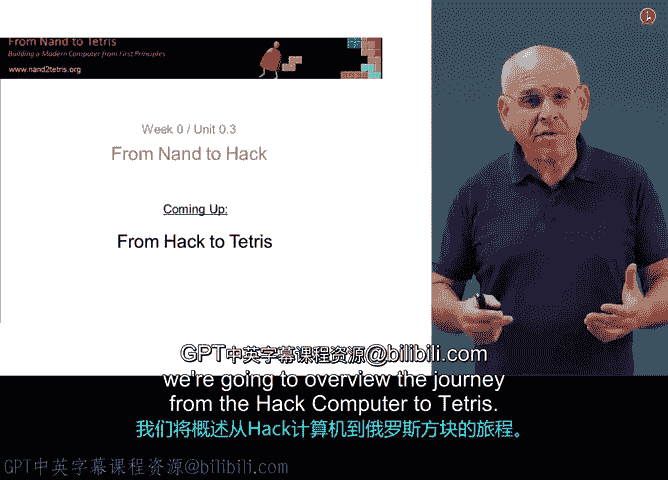

# 从零开始构建现代计算机：P3：03_01_04_单元-0-2-从NAND到Hack 🧱➡️💻

在本节课中，我们将要学习如何从最基础的逻辑门开始，一步步构建出一台名为“Hack”的通用计算机。我们将了解整个课程的结构、使用的工具以及最终的目标。

---

在上一单元中，Noam 概述了从 Nand 到 Tetris 的整个旅程。在本单元中，我们将聚焦于本课程的核心任务：构建一台名为“Hack”的计算机。

下图以非常概括的方式描绘了这台计算机，它仅包含了其主要组件。它将拥有 ROM、CPU、RAM 以及许多其他芯片。一旦我们构建好这台计算机，我们将把它连接到一个标准键盘和一个显示单元。此时，你就可以开始执行程序，并享受你亲手构建的计算机了。

可以运行哪些程序呢？任何你能想到的程序。你可以编写一个玩《Pong》的程序，或者玩《太空侵略者》、《推箱子》的程序，当然，还有《俄罗斯方块》。这些实际上是之前选修本课程的学生们编写过的程序示例。

这就是本课程的总体蓝图。我基本上是在重复 Noam 之前说过的话。我们从想要编写的程序的大致想法开始。我们编写程序，编译它，进一步将其翻译成机器语言。我们将代码加载到计算机中。计算机将使用我们构建的所有芯片，这些芯片基于基本的逻辑门，而整个系统的底层是硬件本身。

本质上，我们所做的是在一个硬件平台之上构建了一个软件层次结构。正如 Noam 解释的那样，我们决定将这项事业分为两个不同的部分。第一部分称为“从 Nand 到 Tetris 第一部分”，第二部分稍后提供，称为“从 Nand 到 Tetris 第二部分”。在本课程中，我们将只专注于硬件部分，从硬件本身、电子学和逻辑门的最低层级开始，自底向上地进行构建。

因此，我们现在处于应用计算机科学中一切事物的最低层级。这实际上不是计算机科学，而是电气工程、固态物理学等等，涉及许多我和 Noam 都不太了解的知识。因此，我们将对这个硬件进行抽象，转而专注于我们能想到的最基本的逻辑门，它被称为 **Nand**。

Nand 是一个我可以在 10 秒内描述清楚的东西，我将在后续的某个单元中介绍。但现在，让我们假设它只是一个基本的逻辑门。我们拿这个 Nand 门，并使用一种称为**组合逻辑**的技术，从中构建出一整套基本的逻辑门，例如 **And**、**Or** 等等。

然后，我们将使用这些门，并运用**组合逻辑**和**时序逻辑**（这是一种不同的设计技术，需要考虑时间和时钟），从中构建出诸如寄存器、RAM 单元和 CPU 等组件。

接着，我们将利用构建出的这套芯片组，设计出一个完整的计算机体系结构，称为 **Hack**。

现在，为了能够在这台机器上编写并方便地执行程序，我们还需要引入一个**汇编器**，并为 Hack 机器语言开发一个汇编器。

我介绍了很多听起来可能非常陌生的概念。不用担心，随着课程的进行，一切都会得到解释。现在，你们中的许多人可能在想，我们究竟要如何实际构建所有这些芯片。

事实证明，如今的硬件工程师并不徒手做任何事情。他们使用计算机来开发计算机。具体来说，他们使用一种称为**硬件模拟器**的工具来设计、测试和调试他们想要构建的硬件。这也正是你们在本课程中将要做的。

我们在这里看到的是我们的硬件模拟器的截图。这是一个软件，你可以从我们的网站免费下载，然后安装到你的电脑上。你将使用你的电脑和我们提供的软件来完成本课程的所有项目。

让我们举一个例子来说明我们将如何实际操作。这里是一个 **Xor** 芯片的例子，它是我们将在本课程中构建的大约 30 个不同芯片之一。你在这里看到的是 Xor 如何操作的抽象描述。

本质上，你将接受这个抽象描述，思考它，并结合我们将提供的各种提示和指导，想出一个逻辑图，使你能够使用之前构建的更低层级的门来构建 Xor。

然后，你将采用这个逻辑图，并使用我们将教给你的一种称为**硬件描述语言**的语言来具体描述它。结果将是一个称为 **HDL 程序**的东西。你将把这个 HDL 程序与我们提供的一些测试脚本结合起来，然后使用我之前描述的硬件模拟器来调试、测试并完善你的 HDL 程序。

这就是我们为本课程中要构建的每一个芯片所要做的事情。最终的结果将是 Hack 计算机。我们将把这个旅程分为六个不同的项目。

以下是每个项目的简要介绍：

*   **项目一：基本逻辑门**。在第一周，我们将构建一些基本的逻辑门，总共 15 个，如幻灯片所示。
*   **项目二：算术逻辑单元**。在第二周，我们将构建一个算术逻辑单元，它是我们稍后构建的 CPU 的核心部件。
*   **项目三：内存系统**。在第三周，我们将构建内存系统，从寄存器开始，一直到 RAM 和 ROM 单元。
*   **项目四：机器语言编程**。在第五周我们构建计算机之前，我们将在第四周用 Hack 机器语言编写一些程序，以便了解这台计算机将能做什么。
*   **项目五：计算机体系结构**。在第五周，我们将利用迄今为止构建的所有芯片组，设计一台实际的计算机。
*   **项目六：汇编器**。在课程的最后一周，我们将为 Hack 机器语言引入一个汇编器，并以两种不同的方式实际开发它，一种面向有编程背景的人，另一种面向没有编程背景的人。

这些就是你在本课程中将要完成的所有项目。你努力的成果将是一台 Hack 计算机，一台可以运行你想到的任何程序的通用计算机，无论是俄罗斯方块还是其他任何东西。

现在，我相信你们中的许多人想知道，学习这门课程需要具备什么知识。答案是，我们假设你**没有任何**计算机科学、工程学或数学方面的先验知识。构建计算机和参加本课程所需的所有必要知识都将在课程本身中提供。这是一门自包含的课程。你将在七周激动人心的项目中学到很多东西。

本节课中我们一起学习了从 Nand 门到 Hack 计算机的构建旅程。在下一个单元中，我们将概述从 Hack 计算机到俄罗斯方块的旅程。

