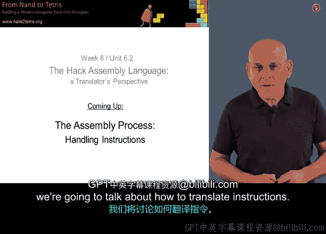

# 耶路撒冷希伯来大学《从零开始构建现代计算机｜Build a Modern Computer from First Principles》中英 - P43：43_08_03_单元-6-2-Hack汇编语言.zh_en - GPT中英字幕课程资源 - BV1Zp421y7Ex

In the previous unit， we talked about the assembly process and logic in general and about writing assembers in general。

And in this unit， we will start the journey of actually building an assemb。

 an assembler that works and that can translate programs from symbolic he code into binary he code。

So here is the overall picture in a nutshell， we are given a source program written in symbolic Hac language and we have to translate it into an equivalent program written in binary code。

 So if you were the person who is supposed to write to develop such an assembler how would you go about it and what is the knowledge that you have to know in order to develop such a general purpose translator because bear in mind we have to be able to translate any program written in hec symbolic code。

 not just the subset of programs but any given program。Well， this is。In general。

 it's a translation challenge， right， You have to translate from one language。

 from the source language to the target language。 And in order to do this。

 you have to know the grammar of both languages。 you have to know the syntax rules。 For example。

 if you want to translate from French to Spanish， you have to know the grammatical rules of French。

 in order to take the source sentence and decompose it or pass it into its lingual elements。

 and you observe or you inspect these elements。 you figure out what is the semantics of this sentence。

 and then you reexpress this semantics in Spanish。 and in order to do this。

 you have to know the rules of the game in Spanish。

 you have to be able to synthesize a target sentence written in the target language。

And that's exactly what we do here， however， when we write translators for programming languages。

 the task is supremely easier because programming languages are supremely simpler than human spoken languages or natural languages and in particular machine languages are very simple and therefore the translation task is going to be less formidable as it may seem at the outset。

Alright， so what do we have to know about the he language？ Well。

 the hec language consists of a instructions， same instructions and symbols。

 So let us explore every one of these categories very briefly。

The A instruction comes up in its symbolic syntax and here is the equivalent binary syntax and if you want to translate one to the other。

 I think it doesn't take too much imagination to figure out how to do it and in any rate we are going to say it explicitly down the road the C instructions in a very similar fashion has a symbolic syntax and a binary syntax and there's a set of tables that describe the mapping between the former and the letter and finally the heCC language features symbols。

 the programmer is invited to use some predefined symbols and also the programmer is invited to invent symbols of his or her own using the label declaration statement and E statement or a instructions that are designed to declare and use variables。

Baically， this is a complete description of the hec machine language and given this description you should be able to develop the desired asmbler。

So given that we have a program in which all these things that I mentioned before come to play in a vivid example。

 what exactly do we have here you know in terms of general constructs well first of all we have white space。

 we haven't mentioned white space in the language specification we should have but the white space is almost the same in every language that you can think about you are welcome to introduce empty lines and comments and in the hec language a comment is anything that begins with two slashes so we have to know how to deal with white space。

And then we have a sequence of a instructions and C instructions that we have to translate。

 and finally we have to deal with the symbols， symbols come to play either in label declaration commands or in references in the context of a instructions。

 so to make a long story short， if you want to write an assembbller。

 you have to know how to deal with white space with the instructions and with symbols。

Let me say a few words about symbols before we go along。

 I've used red ink in what you see here in order to highlight all the symbols that appear in this program and as you can see there are quite a few of them and that's quite characteristic to symbolic machine language programs。

 they have numerous symbols in them， so the question is how do we deal with these symbols。Well。

 you know， the answer is that。In many cases in life， when you face。

A big mountain in front of your track。 Well， in some cases， you know。

 the best way to deal with this mountain is simply to bypass it。

 And that's exactly what I'm going to do with the symbols， I'm going to deal with them later。

 And by the way， if we are lucky as we bypass this mountain。

 we may gain some ground and then sumting the mountain may be easier from the other side than from the original side。

 And indeed you will see that when we'll introduce symbols later on in the process。

 it will be much easier to morph them。 So to speak into our asmbble solution。 Allright。

 so symbols later。 And with that in mind， I now have to deal only with programs that have no symbols。

 And the assemmbler that I have to write is much simpler。 It's an assmbble that deals with a symbol。

 less symbolic heck programs。 So the challenge that remain is to deal with white space and instructions。

Only。And let us begin with white space， you know what should we do with white space once again。

 I've used the red ink to highlight all the white space in the program。

And the easiest way to deal with white space。 and obviously。

 the most sensible way is to simply ignore it。So as you process the source code。

 whenever you see a comment or an empty line， you simply toss away all this all the contents that follow that follow in this specific line and you go on to translate the remaining code。

 So whitespace is simply ignored。So what remains after we eliminate eliminated the white space is only instructions。

 so the challenge is reduced to translating programs that have pure instructions， so to speak。

 and these are this is a sequence or a stream of a instructions and see instructions and in order to translate them。

 we have to know how to translate these instructions into binary code。

And that's exactly what we are going to do in the next unit。But before we introduce the next unit。

 I'd like to give you。An overall picture of where we are heading from here onward。 Well， here's the。

 here's the plan。Since we decided to defer the treatment of symbols to a later stage。

 we'll begin by writing a basic assembler that can deal with programs that contain no symbols。

This will be done in the next unit In the subsequent unit。

 we are going to develop the ability to represent。Handle and use symbols。 And finally。

 using this ability， we are going to return to the basic as that we wrote before and morph it or extend it into a general purpose assembly that can translate any given program。

 Any given program written in hec assembly code into binary code。 This is the plan。😊。

So beginning with the next unit， we are going to talk about how to translate instructions。

