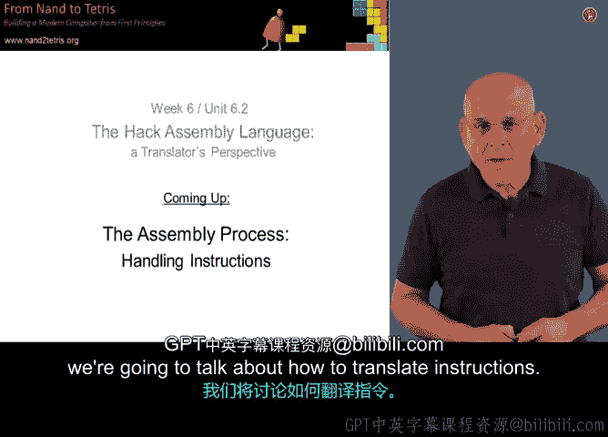

# 从零开始构建现代计算机：6-2：Hack汇编语言

在本节课中，我们将学习如何构建一个Hack汇编语言的汇编器。我们将从理解汇编过程的基本逻辑开始，并探讨如何将符号化的汇编代码翻译成二进制机器码。

## 概述

上一节我们介绍了汇编过程及其通用逻辑。本节中，我们来看看如何实际构建一个能工作的汇编器，一个能将符号化的Hack汇编程序翻译成二进制代码的程序。

## 汇编器的任务

我们面临的核心任务是将用符号化Hack语言编写的源程序，翻译成等价的二进制代码程序。要开发这样一个通用的翻译器，我们需要掌握源语言和目标语言的语法规则。

翻译编程语言比翻译人类自然语言要简单得多，因为机器语言的结构非常简洁明了。

## Hack语言构成

要翻译Hack语言，我们必须了解它的三个组成部分：A指令、C指令和符号。

**A指令**有其符号语法和对应的二进制语法。两者之间的转换规则相对直接。

**C指令**同样有符号语法和二进制语法，并且有一组表格描述了它们之间的映射关系。

**符号**是Hack语言的一个特性。程序员可以使用一些预定义的符号，也可以通过标签声明语句或A指令来声明和使用自定义的变量。

以上是对Hack机器语言的完整描述。基于此，我们应该能够开发出所需的汇编器。

## 处理程序中的不同元素

在一个实际的程序中，我们会遇到多种结构。以下是需要处理的主要部分：

*   **空白**：包括空行和注释。在Hack语言中，注释以双斜杠 `//` 开始。
*   **指令序列**：一系列需要翻译的A指令和C指令。
*   **符号**：出现在标签声明命令或A指令引用中的符号。

因此，编写汇编器需要知道如何处理空白、指令和符号。

## 关于符号的处理策略

在典型的符号化机器语言程序中，符号的数量可能很多。处理它们是一个挑战。

一个有效的策略是暂时绕过这个“大山”，先处理其他部分。有时，从另一个角度（即在处理了其他部分之后）再来解决符号问题会更容易。我们将在后续阶段引入符号处理。

基于这个策略，我们目前只需要处理**不包含任何符号**的程序。这使得我们要编写的汇编器变得简单得多，成为一个“无符号汇编器”。剩下的挑战就是处理空白和指令。

## 处理空白

处理空白最简单、最合理的方式就是忽略它。

在源代码处理过程中，每当遇到注释或空行，我们只需丢弃该行中后续的所有内容，然后继续翻译剩余的代码。因此，空白被简单地忽略。

## 后续计划

在消除了空白之后，剩下的就是纯粹的指令流。接下来的挑战就是将这些A指令和C指令翻译成二进制代码。这将是下一节的重点。

以下是我们的整体计划：

1.  首先，编写一个能处理无符号程序的基本汇编器（下一节内容）。
2.  接着，开发处理符号的能力。
3.  最后，利用这种能力，扩展我们之前编写的基本汇编器，使其成为一个能翻译任何给定Hack汇编程序的通用汇编器。

## 总结

本节课中，我们一起学习了构建Hack汇编器的整体思路。我们分析了Hack语言的构成，并制定了先处理无符号程序、再引入符号处理的分步策略。下一节，我们将开始探讨如何具体翻译指令。