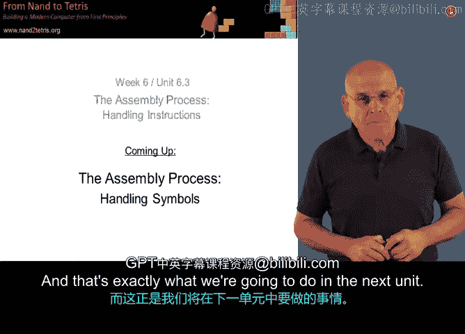

# 耶路撒冷希伯来大学《从零开始构建现代计算机｜Build a Modern Computer from First Principles》中英 - P44：44_08_04_单元-6-3-汇编过程：指令处理.zh_en - GPT中英字幕课程资源 - BV1Zp421y7Ex

In this unit， we're going to talk about the challenge of translating individual statements or individual instructions from symbolic to binary code。

Now， the general problem that we are facing is developing an assembler that translates program from symbolic heCC language into binary he code。

 and in order to write such an asssembler， we have to know how to deal with white space。

 instructions and symbols。Now， in order to make our life easier。

 we decided to defer the treatment of symbols to a later stage。

 and we also described previously how to handle white space。

 Basically we're going to ignore white space。 So what remains is a program that contains instructions only A instructions and C instructions without symbols。

So in order to write an assembler that can translate such a program into binary code。

 we have to know how to translate a instructions and see instructions。

 And that's exactly what we' are going to discuss next。So let us begin with a instructions。

 Here's the general rule and the syntax rule of how to put together an a instruction and an example。

 And here's the same instruction expressed in binary code notice that the up code of an a instruction is0。

 This is the first red zero bit that you' seeing in the example at the bottom right。 By the way。

 the colors are completely meaningless and I use them only to improve our communications you know once it gets into actual implementation the colors once again。

 play neural role whatsoever。 So how to translate from symbolic to binary when it comes to an a instruction。

 Well， if you think about it， the only challenge is to do something with this value。

 So basically if the value is a decimal constant。All we have to do is compute the binary representation of。

 of this value， Add as many zeros as we need in order to turn it into a 15 B constant。

Addd or append the zero op code and。That's what we and that's what is needed。

 A 16 B representation of this of this instruction。 So it's not a big deal， but obviously。

 we have to do it。What if value is a symbol。 Well， I just want to remind you what what we said earlier。

 we're going to deal with symbols later on。 So translating instructions is is something which is not terribly complicated。

 but once again it takes some programming。 All right， what about see instructions。 Well。

 see instructions also have a symbolic manifestation and and a binary manifestation。

 and there's a set of tables so to speak that describe the mapping from symbolic mneonics into their binary representations。

 So these are the rules of the game when it comes to translating see instructions。

 So how do you actually do it， I think the easier way to describe the translation process is to do it using an example。

 So suppose we are giving this。Single say instruction。 And we have to translate it into binary code。

 Well， before we go on， I want to remind you that every say instruction consists of three fields。

 So in the example that we have here， the M D p mneummonic is。

The destination field or the value of the destination field in this particular instruction then comes D plus one。

 which is the value of the comp or computational computation field。And we also have a jump field。

 which happens to be null。 You know， we don't have a jump instruction here。 So the jump is null。

So implicit in what I' am saying is the assumption that we can somehow take this source instruction and decompose it into these three fields。

And indeed， this is something that is going to be done by an element of our asmbler called parer。

 The parer is going to take a source statement or instruction written in a symbolic code and chop it into three individual individual fields。

 And then we can inspect every one of these fields in isolation and act on it。

 And that's exactly what I'm going to do next。 So let us begin to put together the string of characters that will end up representing the binary code of M equals D plus one。

 We can do it in many different ways。 And here is one of them。 focusing on the target expression。

 We see that every scene instruction begins with three ones。

 when it comes to to the binary flavor of scene instructions。

 So we initialize the string that we are building with。😊，3 one。 That's。

 that's what we do when we get started。 Next， we focus， if we want。

 we focus on the next 7 bits that we have to create。 And these 7 bits correspond to the comp field。

Now， the comp field happens to be D plus one。 Once again， I assume that I have access to this field。

 I can easily retrieve it。 I see that it's D plus one。And if it's d plus one。

 I can look it up in the relevant table， I look up this mnemonic and I see that it corresponds to an a bit which is0 and6 conl bits which are0 and51s so putting these bits together。

 I generate the  seven bit value 00，11，111， and I append it to the string that I gradually build here。

Alright， the next thing to do is focus on the next part of the instruction。

 which corresponds to the destination。So I look up the value of my destination field。

 it happens to be MD。I consult the relevant table， and I see that the M D mnemonic corresponds to 0。

1，1。 I take this 0，1，1 value。 I append it to the string that I gradually build。

 and I have completed the the。The synthesis of these two fields together moving along the remaining three bits correspond to the jump directive I look up the value of the jump directive in my source instruction。

 I see that it's null。 I look up null in the relevant table and I see that it corresponds to the three bits 0。

0，0。 I take these bits append them to the end of the string andvoa。

 we have managed to translate the symbolic instruction into its binary equivalent。

As you see everything that I do here is text processing and in some languages。

 it is called string processing。 I have a source string which I analyze in some way。

 and I have a target string which I build you know in some gradual process。

 and every highleve language has the capability to do such a string processing and that's exactly what youll do when you actually write the asler。

Now， when we say that we generate binary code， there may be some misunderstanding here。

 So let me clarify it。 We basically generate a text file that contains of which is which consists of two characters only0 and one。

 but they are treated as characters as askI or unode characters。

 So we have this text file that we write， which consists of zeros and ones only。 and later on。

 we are going to load this text file into the computer。 And once we load it into the computer。

 it becomes real zeros and ones so to speak。 Alright。

 so this basically concludes the translation of C instructions。

 So with that in mind here is the overall assembly logic。

 we are given a text file and this text file contains all sorts of characters that hopefully represents a hec program written in symbolic he。

Cold。So how do we translate it into binary Well， we process this file and we begin marching through it and for each instruction or for each line in this file。

 we first of all， pass the instruction， we break it into its underlying fields。

 So if we have an a instruction， we have the E sign and a value。

 we take this value and we reexpress it in binary code。

 If it's a C instruction we split the instruction into its three field， comp desk and and jump。

And also for every one of these fields， we generate the corresponding binary binary bits。

 and then we assemble all these codes that we created into a single 16 bit instruction and we write this instruction to an output file which is not seen here in the picture。

 but the assembler creates this empty file at the beginning and begins to populate it with lines each line being a sequence of or a string of 16 zeros and ones。

 So this is the overall process of translating a hack program a program that consists of only a and C instructions without symbols。

If you do all this。Then you will manage to create an assembler that can translate programs into binary code and everything looks very nice indeed。

And I'd hate to be a party spoiler， but there's a big gap that we haven'tcloed yet。

 And this is the fact that the source code contains no symbols。

 We have managed to to design an assemler that translates symbol less programs。

 but we still have to close this gap of dealing with symbols。

 And that's exactly what we're going to do in the next unit。

