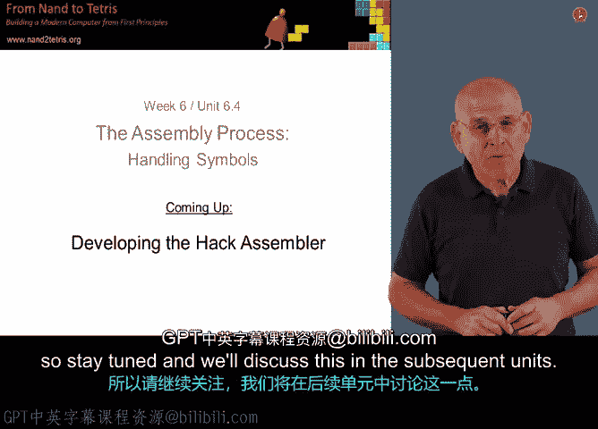

# 耶路撒冷希伯来大学《从零开始构建现代计算机｜Build a Modern Computer from First Principles》中英 - P45：45_08_05_单元-6-4-汇编过程：符号处理.zh_en - GPT中英字幕课程资源 - BV1Zp421y7Ex

In this unit， we will talk about how the assembler represents and handles symbols using binary code。

So the general problem that we are facing is writing an as for the hec machine language and the development strategy that we adopted was one of delaying the treatment of symbols to a later stage。

 Well， this later stages is has come up and we now have to deal with symbols explicitly。

 I want to remind you that we already know how to handle white space and instructions and therefore we now want to focus on symbols。

And as usual， I use red ink to highlight all the symbols in this particular example。

 And as you can see， there are quite。A few of them。 and I think I mentioned it before。

 this is very typical in programming in general and machine language programming in particular。

 the more symbols you have， the more expressive and easy to read is the program and therefore we encourage programmers to use symbols。

 which means that the asmbler has to work hard to resolve these symbols into into binary code。

But once we do it， we achieve something very remarkable because symbolic programming is a very nice obstruction that improves the quality of your program and the quality of life of the programmer significantly。

 Okay， so what kind of symbols do we have in hec programme。 As it turns out。

 they fall into three distinct categories。 First of all， we have variable symbols。😊。

Variable symbols represent memory locations where the programmer wants to maintain some values that typically change in the course of executing the program。

 Now， this sentence is a little bit misleading because the programmer doesn't care at all。

 where these variables are actually located in memory。

 You know as far as the programmer is concerned he or she is going to say something like at sum or at X or at Y。

 and let the asmbler worry about where to store these or represent these variables in memory。

 Once again， this is a very nice abstraction that the assembler delivers to the practicing programmer。

 So this is one kind of symbols we have to worry about。

Another kind of symbols is label symbols that represent destinations of go to command。

Commands in plural。 And in this example that we are facing here， we have three such symbols， loop。

 stop and end。And finally， we may have all sorts of predefined symbols like virtual registers。

 screen， keyboard and so on and so forth。 And in the example that we have here， I think we have two。

 We happen to have two predefined symbols， which are our0 and R1。😊。

So if you want to deal with symbols， these are the three kinds of symbols that you have to handle。

So let me begin to describe what to do with every one of these symbols and we'll start from the end。

 we'll start with predefined symbols。So according to the heCC language specification。

 the language features 23 predefined symbols and here you see all of them。

And how do you translate such a symbol into binary code？ Well， first of all。

 we have to realize that these symbols come to play only in the context of a instructions。

 So the only play place where you can see such a symbol popping up in a program is an instruction like at predefined symbol。

 How do you translate this instruction into binary。 Well。

 you simply replace the predefined symbols with its corresponding value， which is a decimal number。

 And now the only thing that remains is to translate the at decimal number into binary。

 And this is something that we discussed in the previous unit。 So case closed。

 We know how to handle predefined values。 The next category of symbols that we have to deal with are symbols that denote labels。

Now， label symbols are used to denote destinations in the program that I may want to jump to using go to commands。

 and they are declared very specifically using the Cdo command。

Round parentheses and the name of the label in the middle， I've used X Xx to stand for this label。

 which can be any sequence of characters。And these things are calledcedo commands because they don't generate any code when we translate the program into binary。

 we don't translate the label declaration instructions and that's why theyre calledsedo commands and we'll talk about this further later on。

 So we declare label symbols using the agreed upon parentheses。

 and you might ask yourself why parentheses， why not label colon or something like this。 Well。

 when Noam and I designed this language， we decided to use this syntax once again for reasons that will become clear later on Now。

 once we declare a symbol using round parentheses。The meaning of this declaration is that from now on。

 whenever we see X， X X in the program， we mean。To replace it with the address of the memory location that contains the next instruction in the program。

Now in order to make sense of what I just said， I have to keep track of instruction numbers and that's what I do next。

 if you look at the left hand side of the slide， you will see that I've marked or labeled every instruction in the program with a running number that starts with zero。

And notice that I'm skipping empty lines。 empty lines are white space， which is tossed away。

 And also， I'm skipping theseo instructions。 So label declaration instructions like loop。

 stop and end are not counted， so to speak。Now， once I have these line numbers in front of me or once I remember it somewhere in my memory。

 now I see that I can relate loop to the number four stop to the number 8 team and end to the number 22 so I can basically generate this association and keep it in the back of my mind。

 So from now on whenever I see an instruction like at loop we actually mean at4。

 you know we want to go to instruction number four and so on and so forth for for all the other label symbols in your program。

 So how do you deal with an at labeled symbol instruction Well all you have to do is look up the value of this instruction which you figured out before as I just explained and replace it with the the symbol what remains is an at value instruction where value is a decimal number。

And we know how to deal with this because we discussed it in the previous unit。

So that's how you deal with symbols that represent labels。

The last category of symbols that we have to deal with are symbols that represent variables。 Now。

 as you recall， when you wrote programs in the hex symbolic language。

 we have this fantastic ability to create and use as many symbolic variables as we want。

 This is one of the most important obstructions in programming。😊，And someone has to pay the price。

 So to speak， someone has to implement this obstruction。And as， as you can imagine。

 the agent that implements this obstruction is the asler。 How do we do it？ Well。

 according to the hackck language specification， any symbol that appears in a program。

Which is not predefined and is not accompanied by another label declaration。

 statement is considered a variable。We have two such variables in the example in front of us。

 and they are called I and sum。 And the program， as you can see。

 begins with four lines of code that basically declare and initialize these two these two variables to  one and 0。

 respectively。 It's not terribly interesting， but I'm just trying to add some color to this discussion。

 Allright， so we know how the programmer expresses variables in the way that I just described。

 how do we handle these variables if we are the assseler。 Well。

 each such variable is assigned a unique memory address starting with 16。You may ask yourself why 16。

 Well， this is a decision that Nor and I made when we developed this language and this assembler。

 and it's not exactly an arbitrary decision， as you will see later on， but for now。

 you can treat it as an arbitrary decision。 So variables are assigned to memory from address 16 onward。

Allright， so with that in mind， we have only two variables in this program， I and sum。

 and the values of these variables are going to be 16 and 17。Now。

 like any other symbol in a hec program， the only context in which such symbol can come to play is in the context of an a instruction。

 So we we may。 we may see instructions like。At variable name。We definitely we see them。

 We'll see them， because otherwise， why did we declare these variables to begin with。

 We want to act on these variables， and we do it using A instructions， followed by C instructions。

So whenever we see such an instruction， how do we translate it， Well。

 all you have to do is the following。 If you see this instruction for the first time in the program。

 if this variable appears in the program for the first time。

 then you allocate it to a memory address starting from address 16 onward。

If you see this value popping up later in the program。

 you simply look up the value that you assign to it before。

And then what remains is an at decimal value instruction， which we already know how to handle。

So this is how you handle symbols that represent variables。那。

I think that you will agree with me that handling all these different kinds of symbols is a major headache。

And。What can we possibly do to make this task simpler。Well， exactly for this reason。

 computer scientists have invented an artifact called symbol table。

 The symbol table is a very simple and powerful data structure that enables you to store and use symbol value pairs。

 and I can populate the table with as many symbol value pairs as I please。

So when I write an assembler。I construct such an empty symbol table。

 and then I begin to populate it with all the symbols that I encounter in the program that I'm supposed to translate。

And that's also how I'm going to explain to you the structure and the use of a symbol table I'm going to do it constructively。

 I'm going to describe how we actually build a symbol table in order to deal with the example that we see here。

 and by the way， the same will hold for any other heCC program that you will see in the future。

So how do you create this symbol table？ Well， the first thing that you do is you。

 you construct an empty symbol table and then you populate it with all the predefined symbols。

 which are specified in the language。 So in the case of the heck assembly language。

 we have 23 such pairs， you simply add them up to the table one by one。And you do this， by the way。

 before you even touch the source program and before you start any translation。

 that's how you initialize the symbol table。Now， what do you do next， The next thing that you do。

Is you march through the entire text file that constitutes your source assembly program。

 and the only thing that you do is you look for label declarations。

 you look for lines of code that begins with left。Pentheses， once you have such line of code。

 you know that if the code was well written， if it contains no error。

 it must be the beginning of a label declaration。Now， as you do this。

 you also keep track of how many lines you read so far。 And as I explained previously。

 you count only real instructions， skipping label declarations in white space。So once you do this。

 if you have this count in mind， when you encounter loop， for example。

 you should know that loop corresponds to4。And then you go on。

 you ignore everything else until you hit the next label declaration， which is stop。

 and then you consult your counter， you see that stop corresponds to 18 and so on and so forth。

Based on this scanning， you can continue to build the symbol table and at the end of this process。

 you have added to the symbol table all the symbols that represent go to destinations in your program。

 label symbols。Now we call this process first pass so the asmbler that we are going to develop is going to be a two pass assembly process in the first pass we extract from the program all the label symbols and in the second pass。

 which I'm going to discuss next， we are going to extract all the variable symbols。

 So here's what we do in the next pass。Once we finish the first pass。

 we start once again to scan the entire program from beginning to end。

 and whenever we see a label or I'm sorry， whenever we see a symbol which does not appear in the symbol table we know that it's a variable。

 So we add to the table， and we assign to a the values，16，17，18。

19 and so on for as many variables as you have in the program。

And when we encounter these variables later on in the program。

 we always look them up in the symbol table。 If we find them in the symbol table， well。

 they are declared already and we can use them。 if we don't find them。

 we can conclude that it's a new variable and we simply add to the symbol table。

That's the the basic logic of constructing and utilizing a symbol table。

 So how do you actually use it Well， to resolve to resolve a symbol， you look it up。

 you look it up in the table， you extract or retrieve its value， put it into the instruction。

 and what you get is the meaning of this symbol， according to the symbol table。Now before we go on。

 I'd like to emphasize that the symbol table is some sort of an auxiliary data structure that the assembler needs in order to carry out the translation process once we finish the translation process。

 we can throw away this symbol table， we don't need it anymore。

 so we maintain it as long as the assembler is processing the program and then we can toss it away。

Alright， so with that in mind。We can now describe the overall assembly process。

 We have reached to a point where we can actually lay out the algorithm for according to which the assembler can be developed。

So here we go。 First of all， we do some initialization。

 We construct an empty symbol table and we get ready to process the input file。

 We add the predefined symbols to the symbol table， and then we go to work。We do a first pass。

 we go through the entire input file and we look up or we search for instructions that begin with the left parentheses and we add the PERS X XX address to the symbol table as we go along。

Then we do a second pass in the second pass we take care of the variable declarations as I explained earlier。

 and at the same time if we have an instruction which is a C instruction。

 we simply translate it into binary code and if we have another et instruction which deals with the variable that has been used declared previously。

 we look up the table， we replace the values and so on。We take the binary code that we generated。

 We write it into the output file， and that's it。 we have completed translating the program from symbolic to binary。

Now， I have intentionally， I didn't read all the details of this algorithm because I discussed them in various different ways in the previous units and in this unit。

 So you're welcome to stop the video， consult this algorithm and and。

Convince yourself that it actually delivers the required translation task。

 So if you do all this and if you actually implement it in some programming language or on a piece of paper if you want。

 or you know you can teach a human being to be it an asmb if you want， if you do all of the above。

 you have accomplished the the task of actually translating。Heck symbolic code into heck binary code。

 And that's the end of developing our asemler。In the next units。

 we are going to talk about actually building such an assembler using a programming language like Java or Python。

 or if you're not a programmer or if you don't have a previous knowledge of programming。

 we will also give you an option to develop an assembler without using a programming language。

 so stay tuned and we'll discuss this in the subsequent units。

