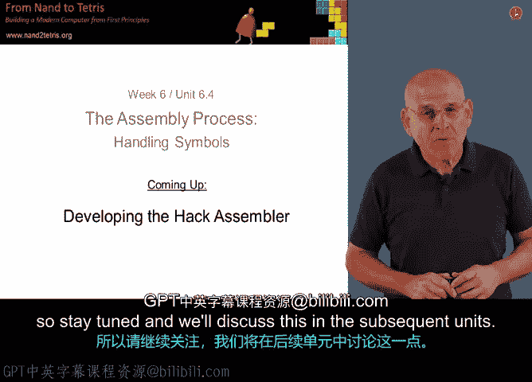

# 从零开始构建现代计算机：6-4：汇编过程：符号处理 🧩

在本节课中，我们将学习汇编器如何表示和处理符号。符号是汇编语言中用于指代内存地址或值的名称，它们使程序更易于编写和理解。我们将探讨符号的类型以及汇编器如何将它们转换为二进制代码。

## 概述

汇编器的主要任务之一是将符号化的汇编代码转换为纯二进制机器码。为了实现这一点，它必须识别和处理程序中出现的各种符号。上一节我们介绍了如何处理空白和指令，本节中我们来看看如何处理符号。

## 符号的类型

在Hack汇编程序中，符号主要分为三类。

以下是三类符号的详细说明：

1.  **变量符号**：代表程序员希望存储某些值的内存位置，这些值通常在程序执行过程中会改变。程序员不关心这些变量的具体内存地址，只需使用如 `@sum`、`@x` 这样的符号，由汇编器负责分配地址。
2.  **标签符号**：代表 `goto` 命令跳转的目标地址。它们通过 `(LOOP)` 这样的伪指令声明，本身不生成任何代码。
3.  **预定义符号**：语言规范中预先定义好的符号，如虚拟寄存器 `R0`、`R1`，以及 `SCREEN`、`KEYBOARD` 等。总共有23个预定义符号。

## 符号的处理方法

接下来，我们将分别介绍如何处理这三类符号。

### 处理预定义符号

预定义符号的处理最为直接。根据Hack语言规范，每个预定义符号都对应一个固定的十进制数值。

当汇编器遇到形如 `@R0` 的A指令时，只需将符号 `R0` 替换为其对应的数值（例如0），然后将 `@0` 转换为二进制即可。这个过程我们在上一单元已经掌握。

### 处理标签符号

标签符号用于标记程序中的跳转目的地。它们通过 `(LABEL_NAME)` 的格式声明。

汇编器在第一次扫描（第一遍扫描）程序时，会忽略空白行和伪指令，只对实际会生成机器码的指令进行计数。当遇到 `(LOOP)` 这样的标签声明时，汇编器会将标签名 `LOOP` 与**下一条指令**的地址（行号）关联起来，并记录在符号表中。

例如，如果 `(LOOP)` 声明后的下一条指令是程序中的第4行，那么 `LOOP` 的值就是4。之后，当汇编器在第二遍扫描中遇到 `@LOOP` 指令时，它会从符号表中查找 `LOOP` 的值（4），将其替换为 `@4`，然后再将 `@4` 转换为二进制。

### 处理变量符号

变量符号为程序员提供了强大的抽象能力，允许他们按需创建和使用任意数量的变量。

根据Hack语言规范，任何在程序中出现的、既非预定义也未被标签声明语句声明的符号，都被视为变量。

汇编器在第二遍扫描中处理变量。当首次遇到一个变量符号（如 `@sum`）时，汇编器会从内存地址 **16** 开始，为其分配一个尚未使用的新地址，并将这个 `符号-地址` 对添加到符号表中。之后在程序中再次遇到同一个变量时，汇编器只需从符号表中查找其地址并替换即可。

变量地址从16开始分配是一个设计决策，并非完全随意，其缘由我们将在后续课程中探讨。

## 符号表：汇编器的核心工具

处理多种不同类型的符号是一项复杂的任务。为了简化这一过程，计算机科学家引入了**符号表**这一数据结构。

符号表是一个用于存储和查询 `符号-值` 对的简单而强大的工具。汇编器在开始翻译程序前，会先初始化一个空的符号表。

以下是构建和使用符号表的两遍扫描算法：

1.  **初始化与第一遍扫描**：
    *   首先，创建一个空符号表，并将所有23个预定义符号及其对应值填入表中。
    *   接着，进行第一遍扫描。从头到尾读取源程序，忽略空白行，并对实际指令（非标签声明）进行计数。
    *   当遇到标签声明（如 `(LOOP)`）时，将当前指令计数器的值作为该标签的值，并将 `(LOOP, 地址)` 对添加到符号表中。此遍扫描完成后，符号表中包含了所有预定义符号和标签符号。

2.  **第二遍扫描与代码生成**：
    *   再次从头扫描源程序。
    *   对于A指令：
        *   如果 `@` 后是数字，直接将其转换为二进制。
        *   如果 `@` 后是符号，则在符号表中查找。如果找到，用其值替换符号；如果未找到（说明是一个新变量），则从地址16开始为其分配一个新地址，添加到符号表，再用该地址替换符号。
    *   对于C指令，直接根据规则翻译为二进制。
    *   将生成的每一条二进制指令写入输出文件。

符号表是汇编器在翻译过程中使用的辅助数据结构。一旦翻译完成，符号表就可以被丢弃。

## 总结

本节课中我们一起学习了汇编器处理符号的完整过程。我们了解了变量、标签和预定义符号这三种符号类型，并掌握了汇编器如何通过构建和使用符号表，在两次扫描程序的过程中，将所有符号解析为具体的二进制地址或数值。这套两遍扫描的算法是汇编器工作的核心逻辑。在接下来的单元中，我们将探讨如何使用Java或Python等编程语言，或者通过其他方式，实际构建这样一个汇编器。