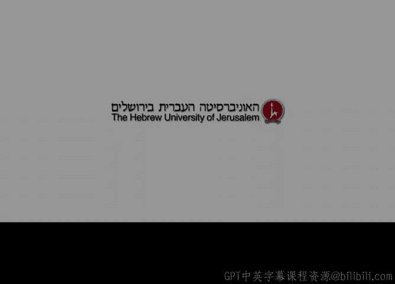

# 耶路撒冷希伯来大学《从零开始构建现代计算机｜Build a Modern Computer from First Principles》中英 - P48：48_08_08_单元-6-6b-项目6概述（非编程选项）.zh_en - GPT中英字幕课程资源 - BV1Zp421y7Ex

For this old week， we explained how to write an asmb program。

 a program that takes assembly language code and translate it to machine language code。Now。

 when we advertise this course， we said it was also appropriate for people without any programming experience。

I suppose that is you， the person who is now watching this unit。

 So how are you supposed to write any program not to mention an assembler。Well。

 the answer is very simple， you can also do by hand what the program should do。

 and then you just need to understand what it does rather than know how to do any programming。

 and this is the second option for doing the last exercise that we're giving you an option to just translate by hand from assemblymbler to machine language。

 from assembly language to machine language。So basically your goal in this exercise is exactly the same as the goal of the people who write a program。

 take as input， a file in assembly language， and produce as output another file in machine language which is the exact translation of the assembly language the only difference is that programmers would write a programs that does this translation while in your case you're going to do it yourself。

You're going to take get a file in the left hand format and produce the file in the right hand format that is supposed to be equivalent。

So let's see what exactly this means for you。We will give you on the Coursera website a few short programs in written in assembly language。

Each program， if that form will be in a file called something dot AM。

 which denote it an assembly language program for each of these files。

 let's say called the X X X dot AM。 you're supposed to write your own file。

 X X X dot hack that contains a binary machine code equivalent of the original file。 Now。

 how are you going to write that file， you need some kind of text editor， for example。

 Wordpad or something like that It just allows you to enter characters and keep it in a file。

So how are you supposed to do this translation？ Well。

 we've explained for this whole week exactly what the program is supposed to do。

 you can do the same thing that the program is supposed to do and basically produce the output that the program would have produced without actually needing to know how to program it。

😊，So again， to make things a bit simpler， it's probably worthwhile to break this endeavor into two stages。

 The first case is the easy case where there are no symbols。Okay。

 so assembly language programs may have symbols， but also they may happen not to have symbols in them。

 In fact， one of the programs that we give you in as an exercise does not have any symbols。

 Start with seeing how you can translate that a program without， without any， any symbols in it。

Once you have that under your belt， then you start thinking about the next stage。

 how to deal with symbols。And then you figure out how to eliminate the symbols。

 translate the program that has symbols in it to another assembly language program without symbols。

 And once you figured out how how to do that， now you can just。

 you know already how to solve how to translate an assembly language program without symbols into machine language。

 So let's talk just very shortly about these two stages and see that you already know how to do that。

Okay，So in the easy case， you get an assembly language program without symbols like we see here on the left hand side。

 and you're supposed to translate it to the right。 How is this translation done， Well， line by line。

 How is the translation of each line done。 Well， you break it into part， You translate to each part。

 exactly what was explained in unit 6。3，3， And this you basically have to look up at the same tables that the program would have looked at and do the translation hand by hand。

 So that's the easy part。😊，The more general， but the more difficult part。

Is what happens with when you do have symbols in your program。 Then as we said。

 the first stage is to eliminate the symbols。 And once you've eliminated the symbols。

 then you'd already know how to proceed。 So how do you eliminate the symbols。 Well。

 that we devoted all of units 6。4 to explain the exact conventions in the hack assembly language of what symbols mean and what kind of symbols there are as as you may recall。

 there are basically symbols that are variables， There are symbols that are labels in the program and there are also some predefined symbols and there were exact rules where each one was allocated and how you specify them。

So this kind of translation， basically， you go again line by line。

 but now you have to figure out the various kind of symbols that you need to handle。

 So in some cases of commands， for example， the command M equals one that you see here。

 no translation is necessary because no symbols are involved。 You just copy it。Of course。

 there are comments on the left hand side and no comment on the right hand side。 you， as a person。

 it's very easy for you to ignore comments because， you know， these are just comments。

 Programgram would have had to work a little bit to ignore the comments。In other cases。

 there are variables。 and again， you need to go back to unit 6。

4 and see exactly how we allocated places for variables。 For example。

 the first variable is always allocated at location 16。

 And then each time you see the same variable name you have to translate it to the same location。 So。

 for example， I is the first variable that we see in this program。

 So whenever and it's always allocated at play 16。 So whenever we see another another instance of using the I variable you need to translate it to the same location。

😊，And the third type of thing is whenever you see a label in a program。

 you have to figure out first what is the address of the label and then any time you see a reference to that label you need to put that address。

 So for example， look at the loop label in this program。

 If you look at it it's just before the command number four in the program just before command at I。

Now notice that weve inserted line numbers and just next to the programs and the line numbers denote where in which memory location。

 each one of these commands will be put when you actually put it into memory the logic of why the logic of how this was done is already explained in 。

6。4 and basically each command takes one position。 Of course。

 declarations of labels like the loop declaration is not really a command is just something in that the asseemblers should take into account and that you now translating it should take into account。

 and of course it is not really a command so we don't allocate any place to it and of course empty lines or comments or nothing So once we have that whenever we see the declaration of the label loop now we know what location it is we need to remember it and every time in the rest of the program that we refer to loop we need to basically replace the symbol loop with the number which indicates the address。

😊，Which is the next program， the next line after it is， in this case， address number 4。

So suppose you've done on this translation。 how do you know that it works。Well。

 the simplest kind of thing that you may think of is that， well， you just take your CPU。

 the CPU you designed last week， you put it into the hardware simulator and then you load the binary version of the program that you just created and sees that it works。

 That is something with a tool that you already know。

 and it should give you great satisfaction to see how the program that you translated actually works in a computer。

😊，We also have another tool that maybe it's not worthwhile to start studying how to use that actually immediately does a simulation emulation as a hack computer in which you don't need to load your design。

 but it just simulates the computer in in our software。

 And then you can just run your program in that that hack machine emulator。

And the third version is we also provide ourselves an assembler tool。

 and our assembler tool not only can translate automatically and correctly， we hope any machine。

 but it can also by when you are doing it， compare the our translation to another translation that you provide。

 And then you can basically test that your translation is equivalent to our translation。

 So heres a screenshot of of the assemblymbler that we provide running when you can actually compare it to a presupplied program。

 So basically， you see on the left hand side the assembly language program。😊。

You see on the right hand side the compare file， a file。

 which you are supposed to provide your translation， which we check is correct。

 And in the middle is automatic translation from the assembly language into machine language that our assembr does。

 And if our output is equivalent to your output， then you know you did it correctly。 Otherwise。

 you did a mistake somewhere or you've discovered a bug in our software。

 but hopefully there is no such bug。 So that basically finishes a description of the last exercise of this course for nonprogrammerrs。

 And the next thing we will just talk we will wrap up the course with a usual perspectives unit。😊。

